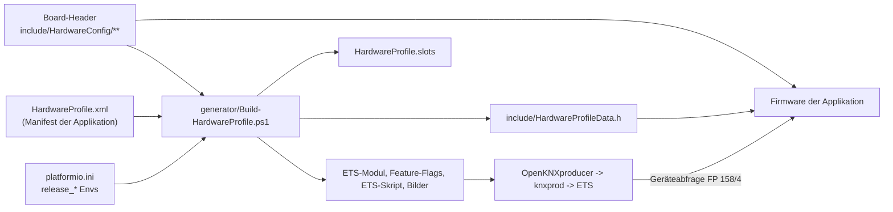

# OGM-HardwareConfig

OpenKNX Hardware Definition Headers

## Architecture

### High-Level Overview

Das Repo hat zwei Teile, die dieselben Makros lesen:

1. **Board-Header** (`include/`): je Gerät ein Block `#ifdef DEVICE_<...>` mit Pins und Eigenschaften. Die Firmware
   einer Applikation (OAM) bindet `HardwareConfig.h` ein; die Bibliothek stellt `include/` als Quell- und
   Include-Pfad bereit (`library.json`).
2. **Hardware-Profil-Generator** (`generator/`): liest die Board-Header mit den Build-Flags jedes PlatformIO-Envs der
   Applikation und das Manifest `HardwareProfile.xml` der Applikation. Daraus erzeugt er das ETS-Modul der
   Hardware-Auswahl und einen Firmware-Header mit dem eigenen Board.



| Pfad | Inhalt |
|---|---|
| `include/HardwareConfig.h` | bindet alle Hersteller-Header ein (nur `#include`-Zeilen) |
| `include/HardwareConfig/OpenKNX/` | OpenKNX-Geräte (REG1, REG2, UP1, OpenKNXiao; PiPico/PiPico2 BCU Connector in `misc.h`) |
| `include/HardwareConfig/Others/` | Drittanbieter und Partner (Gledopto, QuinLED, Adafruit, Smart-MF, AB-SmartHouse, Shelly) |
| `include/HardwareConfig/Helpers/HardwarePorts.h` | `hwPortGpio()`, `hwRelayGpio()`: Ports und fest verdrahtete Relais des eigenen Boards für die Firmware |
| `generator/` | Generator, Vorlagen, Fähigkeiten-Paket, Bilder; Einstieg [README](generator/README.md), Kurzweg [QUICKSTART](generator/QUICKSTART.md) |
| `examples/HardwareProfileDemo/` | Demo-Applikation mit allen Funktionen des Generators |
| `doc/` | Datenblätter von Bauteilen (`doc/datasheets`); `doc/OpenKNX` und `doc/OpenKNX-Ready` (Partner) sind Platzhalter (nur `.keep`), die Geräteunterlagen folgen |
| `.github/workflows/hardware-profile.yml` | CI: `-ListIds` (doppelte IDs) und `-Check` der Demo (erzeugte Dateien aktuell) |

Grundregeln, auf denen alles aufbaut:

- **`DEVICE_HW_ID`** ist die Identität eines Geräts in ETS und Firmware und wird nie neu vergeben (siehe unten).
- **Ein Makro, zwei Verbraucher:** Fähigkeiten, Ports, Relais und Pins stehen nur im Board-Header; ETS (über den
  Generator) und Firmware lesen dieselben Defines.
- **Was eine Applikation nicht nutzt, ändert ihre Ausgaben nicht:** jede Funktion des Generators ist über das Manifest
  eingeschaltet; ohne den Eintrag bleiben die erzeugten Dateien byte-gleich.
- **Stabile ETS-IDs:** Parameter je Board hängen an einem Slot je HW-ID (`HardwareProfile.slots`), nicht am Listenplatz;
  ein App-Update behält die Werte.

## Regeln

Jede Geräte-Definition erfolgt als ein Block, abhängig von `DEVICE_<DeviceID-Macro>`:
```
#ifdef DEVICE_<DeviceID-Macro>
    #define DEVICE_ID "<DeviceID>"
    #define DEVICE_NAME "<DeviceName>"
    
    // Pindefinitionen
    // #define PROG_LED_PIN 7
    // etc. ...
#endif
```


`<DeviceID>` darf aus a-z, A-Z, 0-9, _ und - bestehen. Hardware von Drittanbietern muss ein jeweilig einheitliches Präfix vorangestellt werden.  
Maximallänge: am besten nicht länger als 16 Zeichen
Beispiel: `PiPico-BCU-Connector` (OpenKNX) oder `SMARTMF-Modbus-RTU-3BE` (OpenKNX-Ready, Präfix SMARTMF)


`<DeviceID-Macro>` wird aus der `<DeviceID>` gebildet, wobei alle Kleinbuchstaben durch Großbuchstaben und - durch _ ersetzt werden.  
Beispiel: `SMARTMF-Modbus-RTU-3BE` wird zu `SMARTMF_MODBUS_RTU_3BE` und somit zu `DEVICE_SMARTMF_MODBUS_RTU_3BE`


`<DeviceName>` darf aus allen ASCII-Zeichen bestehen. Möglichst keine Klammern verwenden.
Maximallänge: am besten nicht länger als 32 Zeichen

## Wichtig:
`<DeviceID>` und `<DeviceName>` müssen exakt so lauten, wie auch in der Geräteliste im Wiki definiert.  
https://openknx.atlassian.net/wiki/spaces/OPENKNXDEV/database/131098?atl_f=PAGETREE


## Ports (`HW_PORT_*`)

Ausgänge, die eine Applikation als Port anbietet (z. B. LED-Ausgänge), stehen im Board-Block oder einem gemeinsamen
Block in dieser Reihenfolge: `HW_PORT_COUNT`, `HW_PORT_<n>_GPIO`, `HW_PORT_<n>_LABEL`. Firmware und
[Generator](generator/README.md) lesen dieselben Makros. Bis zu 64 Ports je Board (`HW_PORTS_MAX` in
`include/HardwareConfig/Helpers/HardwarePorts.h`), jeder GPIO 0..254; mehr ist ein Compilerfehler und im Generator ein Abbruch.

Fest verdrahtete Relais (Ausgang mit Relais auf der Platine, kein freier Port): `HW_RELAY_COUNT`, `HW_RELAY_<n>_GPIO`,
`HW_RELAY_<n>_LABEL` (n = 1..`HW_RELAY_COUNT`), z. B. QuinLED und Gledopto. Die Firmware nimmt den Relais-GPIO aus dem
Header (`hwRelayGpio()` in `include/HardwareConfig/Helpers/HardwarePorts.h`), eine Applikation kann ihn per `<Ports excludeRelayPins="true">`
aus den LED-Ports nehmen.

`HW_LEVELSHIFTER` im Board-Block: Pegelwandler der LED-Datenleitungen, Namen in `HardwareConfig/OpenKNX/Xiao.h`
(`HW_LEVELSHIFTER_TXS0108E` 1, `_SN74HCT125` 2, `_SN74AHCT125` 3, `_SN74LV8T245` 4; ohne Define: keiner). Die Zahlen
entsprechen `LevelShifterType` von OFM-NeoPixel; ein Build-Flag `-DNEOPIXEL_HW_LEVELSHIFTER=<n>` geht dort vor.

`HW_INFO_URL` im Board-Block: Info-Seite des Geräts, z. B.
`#define HW_INFO_URL "https://go.openknx.de/kneopix"` (Kurzlink: kürzere URL, kleinerer QR-Code; der Link muss in
eine Zeile von 150 px passen). Der [Generator](generator/README.md) zeigt sie in ETS als QR-Code mit dem Link ohne Schema
darunter (ETS zeigt keine Links); ohne Define kein QR-Code. Die Firmware liest das Makro nicht. Welche Boards es setzen:
`grep -rn HW_INFO_URL include/HardwareConfig` (PowerShell:
`Get-ChildItem include/HardwareConfig -Recurse -Filter *.h | Select-String HW_INFO_URL`).

`HW_INFO_TEXT` im Board-Block: kurze Beschreibung des Geräts, höchstens 255 Zeichen (ETS-Grenze, der Generator bricht
sonst ab). Der Generator zeigt sie auf der Hardware-Seite unter dem Gerätenamen (mit Info-URL links neben dem QR-Code); ohne Define
gilt der Standardtext der Applikation. Welche Boards es setzen: `grep -rn HW_INFO_TEXT include/HardwareConfig` (PowerShell: `Select-String` wie oben).

Bild über dem Gerätenamen: OpenKNX-Logo, bei `#define DEVICE_THIRD_PARTY` im Board-Block das Badge „Drittanbieter“ mit
Hinweis. Ein eigenes Bild oder keines je Board legt das Manifest der Applikation fest (`<InfoImage><Logo board file>`, siehe
[Generator](generator/README.md#hardware-seite-gerätekarte)).

## Hardware-ID (`DEVICE_HW_ID`)

Jedes Gerät bekommt zusätzlich eine eindeutige 16-Bit-Hardware-ID:

```
#ifdef DEVICE_<DeviceID-Macro>
    #define DEVICE_HW_ID 0x1203
    #define DEVICE_ID "<DeviceID>"
    #define DEVICE_NAME "<DeviceName>"
    ...
#endif
```

**Warum eine Zahl, wenn es `DEVICE_ID` schon gibt?**
`DEVICE_ID` ist ein Text. ETS kann einen Text weder in einem Auswahlfeld speichern noch in einem
`<when test="...">` vergleichen; das geht nur mit Zahlen. Die Hardware-ID ist die Zahl, unter der ein
Gerät überall gleich heißt:

- **ETS:** Das Auswahlfeld „Gerätetyp“ speichert die Hardware-ID, nicht einen Listenplatz. Kommen Geräte
  hinzu oder ändert sich die Reihenfolge, bleibt die Auswahl im Projekt gültig.
- **ETS-Sichtbarkeit:** `<when test="4129 4130 8481">` blendet Einstellungen genau für diese Geräte ein.
- **Firmware:** Sie kennt ihre eigene ID zur Compile-Zeit und kann sie mit der ETS-Auswahl vergleichen.
- **Geräteabfrage:** In Applikationen mit dem Hardware-Profil liest ETS die ID per Function Property vom Gerät
  und setzt die Auswahl selbst.
- **Konsole:** Die Startmeldung zeigt `DEVICE_ID (HW ID: 0x....)`.

**Schema `0xHUVV`** (H = Hauptgruppe, U = Untergruppe, VV = Variante):

| Hauptgruppe | Untergruppen |
|---|---|
| 0x1 OpenKNX | 0x10xx REG1, 0x11xx REG2 (0x110x–0x113x PiPico, 0x114x ESP-S3-Pico), 0x12xx UP1, 0x13xx OpenKNXiao, 0x1Fxx Sonstige |
| 0x2 OpenKNX-Ready / Partner | 0x20xx Gledopto, 0x21xx QuinLED, 0x22xx Adafruit, 0x23xx Smart-MF, 0x24xx AB-SmartHouse, 0x25xx Shelly |
| 0x3 Community | frei |

Regeln:

- Eine ID wird nie neu vergeben, auch nicht nach dem Entfernen eines Geräts.
- Unterscheiden sich Varianten derselben Platine in der Bestückung (z. B. WLAN- statt LAN-Modul), bekommen
  sie eigene IDs (Beispiel QuinLED Dig-Quad: 0x2120 WLAN, 0x2121 Ethernet).
- Ob eine vorhandene Bestückung genutzt wird (WLAN auf dem Pico W), entscheidet der Build. Dafür gibt es
  keine eigene ID; das Manifest gibt den Build-Flag mit (`<Board ... flags="-DKNX_IP_WIFI"/>`).
- Eine Fähigkeit gehört als Define in den Header des Geräts, nicht nur in das Build-Env, sonst sieht
  der Generator sie nicht.
- Bausteine ohne eigenes Gerät (`OKNXHW_*_CONTROLLER*`, `*_APP_*`) bekommen keine ID.
- Hardware eines Drittanbieters ohne OpenKNX-Support trägt im Board-Block zusätzlich
  `#define DEVICE_THIRD_PARTY`. Das ist eine Angabe des Headers, keine Folge der ID: Hauptgruppe 0x2 enthält auch
  OpenKNX-Ready-Partner. Der Generator kennt sie fest als Fähigkeit `ThirdParty` (Bit 0 der Geräteabfrage).
  Gesetzt bei Gledopto (0x2000–0x2002), QuinLED (0x2100–0x2140) und Shelly (0x2500–0x2511).

Alle IDs auflisten und auf Doppelte prüfen:

```
pwsh generator/Build-HardwareProfile.ps1 -ListIds            # Tabelle
pwsh generator/Build-HardwareProfile.ps1 -ListIds -Markdown  # als Markdown
pwsh generator/Build-HardwareProfile.ps1 -NextId 0x25        # nächste freie ID einer Gruppe + Board-Block
```

Wofür die ID gebraucht wird, zeigt [generator/README.md](generator/README.md).

## Work-in-progress !
Regeln hinterfragen, ggf. abgestimmte Änderungen hier einpflegen.

