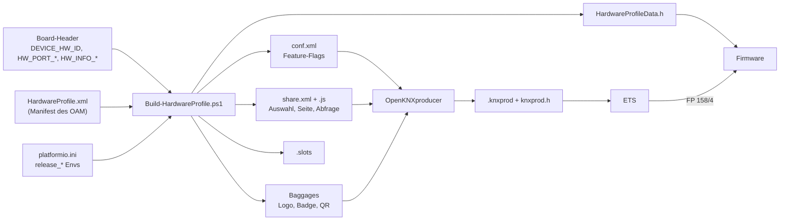

# Hardware-Profil-Generator

**Eine knxprod, viele Hardware-Varianten – und die ETS zeigt nur, was das Gerät kann.**

Der Generator liest die Board-Header dieses Repos und erzeugt daraus für eine Applikation:

- das Auswahlfeld „Hardware“ (gespeichert wird die `DEVICE_HW_ID`),
- einen Button „Hardware vom Gerät abfragen“ (ETS liest ID, Fähigkeiten und Werte vom Gerät),
- eine Übersicht „Fähigkeiten dieser Hardware“ (mit `<Page>`: eine Hardware-Seite mit Gerätekarte aus Logo, Name, Board-Text
  und QR-Code, Hinweisen und Entwickleransicht),
- GPIO-Auswahlfelder mit den Pins der gewählten Hardware, ohne die Pins aus den `<ReservedPins>` des Manifests (z. B.
  KNX-UART, Prog, Ethernet, SD, I2C; die Liste führt jede Applikation selbst),
- **Feature-Flags** (`op:config`-Platzhalter wie `%HWP_CAP_Wifi%`), mit denen jedes Modul der Applikation Einstellungen ein- und ausblendet,
- einen Firmware-Header mit dem eigenen Profil (gleiche Ausdrücke wie für ETS).

Beispiel-Applikation: [examples/HardwareProfileDemo](../examples/HardwareProfileDemo).

## Ordner

| Pfad | Inhalt |
|---|---|
| `Build-HardwareProfile.ps1` | der Aufrufer (einziges Skript, das man startet) |
| `QUICKSTART.md` | Schnellstart: das Hardware-Profil in fünf Schritten in ein bestehendes OAM einbinden |
| `Anwendungsfaelle.md` | Rezepte mit Beispielen: Module, Feature-Flags, Kanalzahl, Auswahllisten, Sensoren, Netzwerk, Firmware |
| `helpers/` | vom Aufrufer per Dot-Source geladen: `TemplateEngine.ps1` (Vorlagen), `QrCode.ps1` (QR-Kodierer), `PngImage.ps1` (PNG lesen/schreiben, QR-Code + Link) |
| `capabilities/` | `Common.caps.xml`: Fähigkeiten-Paket zum Einbinden per `<Import href>` (LAN, WLAN, Display, … aus den Board-Headern, dazu die gesperrten Plattform-Pins); optional, aber empfohlen, `-Init` bindet es ein. Eigene Fähigkeiten definiert jedes OAM in seinem Manifest; `ThirdParty` ist fest eingebaut |
| `templates/` | Standard-Vorlagen für `<Generate template="@hw/…">` |
| `assets/` | Logo, Badge, Schriftatlas, Seiten-Icon (siehe `assets/README.md`) |
| `../examples/HardwareProfileDemo` | Demo- und Test-Applikation: alle Anwendungsfälle in einer knxprod, mit Kontexthilfe |
| `../.github/workflows/hardware-profile.yml` | CI: `-ListIds` und `-Check` bei jedem Commit (Windows PowerShell 5.1) |

Alle Skripte: Windows PowerShell 5.1 kompatibel (`#Requires -Version 5.1`), kein System.Drawing, keine externen Werkzeuge.

## Was ein Entwickler tun muss

Kurzfassung mit allen Zeilen zum Kopieren: [QUICKSTART.md](QUICKSTART.md).

1. **Board-Header:** Das Gerät hat eine `DEVICE_HW_ID` (siehe [README](../README.md#hardware-id-device_hw_id)).
2. **Manifest** `HardwareProfile.xml` im Repo der Applikation anlegen (Beispiel unten).
3. **Generator laufen lassen** – vor dem OpenKNXproducer, im selben Schritt, in dem `knxprod.h` entsteht:
   ```
   pwsh lib/OGM-HardwareConfig/generator/Build-HardwareProfile.ps1
   ```
4. **In der Applikations-XML** die erzeugten Dateien einbinden und nur noch Feature-Flags benutzen:
   ```xml
   <op:config href="HardwareProfile.conf.xml" />
   <op:define prefix="HWP" ModuleType="45" configTransferName="Hardware" share="HardwareProfile.share.xml" />
   ...
   <choose ParamRefId="%HWP_SelectRef%">
     <when test="%HWP_CAP_Wifi%"> ... nur auf Geräten mit WLAN ... </when>
   </choose>
   ```
   Das `prefix` von `op:define` muss dem `prefix` des Manifests entsprechen, `ModuleType` dem `moduleType`.
   Hat das OAM ein Hauptmodul, wird das Hardware-Modul mit `isSubmoduleOf="<Präfix des Hauptmoduls>"` definiert
   (z. B. `isSubmoduleOf="NEO"`): dann legt der OpenKNXproducer kein eigenes Kontrollkästchen unter „Module“ an. Allein
   bekommt es dieses Kästchen; „aus“ blendet die Auswahl aus. Was ETS dann für die Auswahl lädt, ist nicht gemessen
   (die Auswahl ist ein Union-Parameter); gedacht ist „aus“ als „nicht gewählt“, also alle GPIO-Rollen aus.
   Wie jede knxprod mit Modulliste braucht die Applikation ConfigTransfer (UCT).
5. **Firmware** (für die Geräteabfrage): `include/HardwareProfileData.h` einbinden und im Modul eine Zeile:
   `if (HardwareProfile::answerQuery(objectIndex, propertyId, resultData, resultLength)) return true;`
   in `processFunctionProperty` (Beispiel: `HardwareProfileModule` der Demo).

## Ablauf



1. **Build:** Der Generator liest je `release_*`-Env die Board-Header (C-Präprozessor mit den Flags des Envs) und das
   Manifest. Er schreibt die Feature-Flags, das ETS-Modul (Auswahl, Hardware-Seite, Port-Parameter, Abfrage-Skript), die Bilder,
   den Firmware-Header und die Slot-Datei. Danach baut der OpenKNXproducer daraus die knxprod.
2. **ETS:** Der Anwender wählt die Hardware in der Liste oder fragt sie vom programmierten Gerät ab. ETS speichert die
   `DEVICE_HW_ID` in einem 16-Bit-Parameter; die Feature-Flags blenden alles aus, was die Hardware nicht hat.
3. **Download:** ETS schreibt die Auswahl und nur die sichtbaren Port-Parameter.
4. **Firmware:** Sie vergleicht die Auswahl mit der eigenen `DEVICE_HW_ID` und nutzt die Port-Parameter nur bei
   Gleichheit. Auf Function Property 158/4 antwortet sie mit HW-ID, Fähigkeiten und Werten (siehe „Geräteabfrage“).

## Regeln

**So ist es gedacht**

- Der Generator läuft vor dem OpenKNXproducer (im OAM-Build, z. B. `Build-Release.ps1`).
- Module blenden nur über Feature-Flags ein und aus: `%<p>_SelectRef%`, `%<p>_CAP_<Name>%`, `%<p>_VAL_<Name>_GE_<n>%`.
- Neue Hardware = neuer Board-Block mit eigener `DEVICE_HW_ID`; Drittanbieter-Hardware zusätzlich mit
  `DEVICE_THIRD_PARTY` (Badge und Hinweis kommen dann von selbst).
- Board-Texte stehen im Board-Header (`HW_INFO_TEXT`, `HW_INFO_URL`), Seitentexte im Manifest, nie in der Applikations-XML.
- `HardwareProfile.slots` wird mit committet.
- Jede inhaltliche Änderung an der knxprod bekommt eine neue Applikationsversion (`ReplacesVersionsDownTo`).
- Nach jeder Änderung prüfen: Generator zweimal (zweiter Lauf „unverändert“), dann die Seite in ETS5.

**Erlaubt**

- Seitentexte überschreiben oder leer lassen (`<Page>`), eigenes Logo oder Badge (`<InfoImage logo badge>`), eine
  Standard-URL für Boards ohne eigene (`<InfoImage default>`), eigene Fähigkeiten und Werte (`<Capability>`, `<Value>`).

**Nicht erlaubt**

- Generierte Dateien von Hand ändern (`<Output>`-Dateien, `Baggages/<prefix>Info/`): der nächste Lauf überschreibt sie.
- Slot-Nummern ändern oder neu vergeben, die `DEVICE_HW_ID` eines ausgelieferten Boards ändern: ETS verliert beim
  Update die Werte.
- OAM-Spezifisches im Generator oder in OGM-HardwareConfig hart codieren: alles geht über das Manifest.
- Text in Bilder legen, Bilder breiter als ~520 px, mehr als ein Element oder einen eingebetteten Block in einer
  Rasterzelle (siehe „Regeln aus der ETS5-Messung“).
- In der Firmware Port-Parameter lesen, solange die Auswahl nicht die eigene `DEVICE_HW_ID` ist.

## Ausgabe

`--help` (auch `-h`, `-Help`) zeigt Aufruf, Optionen und Beispiele im Layout der OpenKNX-Build-Skripte; `Get-Help
Build-HardwareProfile.ps1 -Detailed` die volle Beschreibung.

Während des Laufs zeigt eine Fortschrittszeile, was gerade passiert (`Env 12/44`, `Board 12/44`, `QR-Bild 1/2`, `erzeugen <Datei>`, `vergleichen <Datei>`); mit `-Detailed` und bei umgeleiteter Ausgabe (CI, Log-Datei) entfällt sie.

Danach: je Board eine Zeile `OK 0x<HW-ID>  <Name>` (nach HW-ID sortiert), dann eine Zusammenfassung, z. B.
`Hardware: 44 Envs, 40 Boards, 9 Dateien geschrieben` oder `Hardware: 44 Envs, 40 Boards, unverändert`. Warnungen (`!`) und Fehler (`x`, mit
dem letzten Schritt davor) erscheinen immer. `-Detailed` zeigt das volle Protokoll (Manifest, Boards mit Fähigkeiten und
Werten, jede Ausgabe); `-ListIds`, `-Init` und `-DryRun` geben immer alles aus.

## Manifest anlegen (`-Init`)

Für ein OAM ohne Manifest einmalig:

```
pwsh lib/OGM-HardwareConfig/generator/Build-HardwareProfile.ps1 -Init
```

Schreibt `HardwareProfile.xml` neben die `platformio.ini` (Ziel: `-Manifest`) und bricht ab, wenn es die Datei schon
gibt (kein Überschreiben). Inhalt: `<Boards platformio="release_*" />` mit den gefundenen Boards als Kommentar (HW-ID,
Define, Name); `release_*`-Envs ohne Board kommen nach `exclude`. Kein oder nur ein Board: Abbruch ohne Datei (eine Auswahl braucht mindestens zwei Boards).
`moduleType` = 45, sonst der nächste freie Wert aufwärts bis 99, dann abwärts ab 44 (alle `op:define ModuleType` der
Applikations-XMLs `src/*.xml` mit `<op:ETS`, Dev und Release zusammen; Werte in `"` oder `'`, `op:define` in Kommentaren zählt nicht); `prefix` = `HWP`, sonst `HWP2`, `HWP3` …
`ids="slot"`, `unselected="showAll"` (eine bestehende knxprod bekommt eine Auswahl: ETS schreibt beim Download den
Standardwert jedes unsichtbaren Parameters), Standard-Ausgaben `src/HardwareProfile.*` und
`include/HardwareProfileData.h` (Abbruch, wenn eine davon existiert und keine Generator-Ausgabe ist),
`Import` von `capabilities/Common.caps.xml`. Danach zeigt das Skript die Zeilen für die Applikations-XML (`op:config`,
`op:define`, `op:include` in `<generate><Dynamic>`) und erinnert an die neue Applikationsversion
(`ReplacesVersionsDownTo`). Beim Build wird nie ein Manifest angelegt: ohne Manifest bleibt die knxprod, wie sie ist.
Eigene Fähigkeiten der Applikation (`<Capability>`) trägt der Entwickler danach ein.

## Manifest

```xml
<HardwareProfile prefix="HWP" moduleType="45" text="Hardware">
  <Output conf="src/HardwareProfile.conf.xml" share="src/HardwareProfile.share.xml"
          script="src/HardwareProfile.script.js" header="include/HardwareProfileData.h" />

  <!-- Standard-Fähigkeiten: TP, LAN, WLAN, Display, RTC, SD, Summer, Binäreingänge, Status-LEDs, Flash -->
  <Import href="lib/OGM-HardwareConfig/generator/capabilities/Common.caps.xml" />

  <!-- eigene Fähigkeit der Applikation: ein Präprozessor-Ausdruck -->
  <Capability name="LargeFlash" text="Großer Datenspeicher" expr="defined(DEVICE_FLASH_SIZE_MB) &amp;&amp; DEVICE_FLASH_SIZE_MB >= 8" />

  <!-- Geräte: Standard = die Envs, die das OAM ohnehin baut (Board-Define + Build-Flags je Env) -->
  <Boards platformio="release_*" />
  <!-- zusätzlich möglich: einzeln oder per Muster (jedes Board mit DEVICE_HW_ID, dessen Define passt) -->
  <Board define="DEVICE_REG2_PIPICO2_W_V1_DD_RTC" flags="-DKNX_IP_WIFI" />

  <!-- GPIO-Rolle: Pins aus den Makronamen des Headers (scan = regulärer Ausdruck, $1 = Gruppe 1) -->
  <GpioRole name="Pin" number="1" text="Freier Anschluss" count="2">
    <Pins board="OKNXHW_OPENKNXIAO_*" scan="^OKNXHW_OPENKNXIAO_D(\d+)$" label="D$1" />
    <Pins board="DEVICE_X"><Pin gpio="X_PIN_A" label="Klemme A" /></Pins>
  </GpioRole>
</HardwareProfile>
```

| Element | Bedeutung |
|---|---|
| `prefix`, `moduleType` | Modulpräfix und ModuleType (`%TT%`) des erzeugten ETS-Moduls |
| `unselected` | `showAll` (Standard): „Nicht gewählt“ zählt als jede Fähigkeit, alles bleibt sichtbar · `hide`: ohne Auswahl ist alles Hardwareabhängige ausgeblendet |
| `<Capability name text expr>` | Ja/Nein-Fähigkeit, `expr` ist ein `#if`-Ausdruck |
| `<Value name text expr ifdef default max unit>` | Zahl (1 Byte); ist `expr` kein Makroname, muss `ifdef` das Makro nennen, das existieren muss |
| `<Value …><Set board value/></Value>` | Wert je Board-Muster, nur für ETS (ohne `expr` gilt sonst `default`); ein Define ohne `*`/`?` geht vor einem Muster, zwei passende Einträge derselben Art brechen ab; mit `<Output header>` nur zusammen mit `query="false"` (die Firmware sähe den Wert nicht) |
| `<Value … query="false">` | Wert nur für ETS (Feature-Flags, Fähigkeiten-Seite): nicht Teil der Geräteabfrage und nicht im Firmware-Header; die Grenze von 4 Werten gilt nur für abgefragte Werte |
| `<ReservedPins macros>` | Pins der Applikation (Makronamen, Werte aus den Board-Headern), die nie in einer GPIO-Rolle erscheinen und mit `<Conflicts reserved="true">` als reserviert gelten. Das Capability-Pack enthält keine: jeder Pin ist erlaubt, bis die Applikation ihn hier nennt |
| `<Boards platformio project exclude>` | Boards aus den PlatformIO-Envs, deren Name auf `platformio` passt (z. B. `release_*`). Je Env zählt das erste `-D DEVICE_…`/`OKNXHW_…`/`BOARD_…`; alle anderen `-D` des Envs gelten als Flags. Mehrere Envs mit demselben Board (TP, TP+WLAN) ergeben einen Eintrag mit der Vereinigung ihrer Fähigkeiten. Das Board eines Envs ist das Define eines Header-Blocks mit `DEVICE_HW_ID` (Build-Flags wie `DEVICE_DISPLAY_MODULE` zählen nicht); ein Env ohne solches Board oder mit zwei Boards bricht den Lauf ab (ein übergangenes Board fiele aus ETS und der Firmware-Tabelle und stünde in der Slot-Datei als `removed`); ein Board nimmt man heraus, indem man sein Env löscht. Envs, die kein Board bauen (Test-, Tool-Envs), nennt `exclude` (Muster, durch Leerzeichen getrennt), z. B. `<Boards platformio="release_*" exclude="release_native_*" />`; ein ausgeschlossenes Env, das ein Board baut, bricht den Lauf ab, `exclude` darf also kein Board-Env nennen. Die Build-Flags eines ausgeschlossenen Envs werden nur auf ein Board hin geprüft (ein Flag, das auf `\` endet, wird dabei übergangen); eine Zeile, die sich nicht auswerten lässt, wird übergangen, außer sie nennt ein Board (Header-Define oder Alias, der eine `DEVICE_HW_ID` ergibt): dann bricht sie den Lauf ab. Ein Build-Flag, das sich nicht auswerten lässt (endet auf `\`, ungültige Quotes), bricht immer ab: ein weggelassenes Define könnte eine Fähigkeit ändern. Vorrang bei gleicher HW-ID: `<Board>`-Zeile vor Env vor Muster. `project` = Ordner der platformio.ini (Standard: der des Manifests). Braucht `pio` im PATH oder in `<PLATFORMIO_CORE_DIR oder ~/.platformio>/penv`. |
| `<Board define flags>` | Gerät oder Muster (`*`, `?`); `flags` = Build-Flags des Envs, die eine Fähigkeit oder Variante ändern. `flags` an einem Muster gelten für **jedes** passende Board. Ein einzeln genanntes Board hat Vorrang vor einem Muster (auch wenn es über Alias + Flags dieselbe HW-ID ergibt); dasselbe Board zweimal mit verschiedenen Flags bricht ab |
| `<GpioRole name number text count>` | `count` Auswahlfelder; `number` (1–9) ist Teil der Parameter-ID und wird nie geändert |
| `order` (Wurzel) | `manifest` (Standard): Reihenfolge der Einträge · `hwid`: aufsteigend nach `DEVICE_HW_ID` |
| `ids` (Wurzel) | Board-Nummer `$b.Slot` in IDs: `slot` (Standard, Slot-Datei) · `index`: Position in der Liste (nur für Bestands-OAMs, deren IDs schon am Listenplatz hängen) |
| `<Output>` | jedes Attribut optional; `share` (das ETS-Modul) braucht `script` und `moduleType` |
| `unselectedValue` (Wurzel) | Wert von „nicht gewählt“ in der Hardware-Auswahl (Standard 0); geht mit `unselected="showAll"` in die Feature-Flags |
| `<Capability merge>` | wie mehrere Envs eines Boards zusammengehen: `any` (Standard, Vereinigung) · `all` (jedes Env muss die Fähigkeit haben) |
| `<Capability switch fixedBy reportedBy>` | `switch="true"`: Schalter `<Prefix>_<Name>On` auf der Hardware-Seite (1 Bit im Gerätespeicher, Byte nach den GPIO-Rollen am Ende des Moduls, Standard „ein“; höchstens 8) und Firmware-Stand `<Prefix>_<Name>Fw` (ohne Speicher: nicht abgefragt / vorhanden / nicht vorhanden). Boards, die auch die Fähigkeit `fixedBy` haben, zeigen „immer ein“ statt des Schalters; ein ausgeblendeter Schalter lädt seinen Standard (ein). Die Geräteabfrage trägt das Bit `reportedBy` (Standard: das eigene) als Firmware-Stand ein und schaltet aus, was die Firmware nicht hat (nicht bei `fixedBy`). Was der Schalter in der Firmware bewirkt, entscheidet die Applikation (`Param<Prefix>_<Name>On`). Mit `<Page>` steht der Schalter links unter dem Board-Text; `fixedBy`-Boards zeigen dort nichts. Ohne `switch` bleiben alle Ausgaben wie bisher |
| `<Capability runtime>` | `runtime="true"`: `expr` sagt, dass das Board den Platz dafür hat (Steckplatz); ob das Teil da ist, erkennt die Firmware zur Laufzeit und meldet es über `answerQuery(…, runtimeCaps)`. Das Bit fehlt in `OWN_CAPS`, die Geräteabfrage zählt es nicht als Abweichung (siehe „Geräteabfrage“) |
| `<Capability feature featureOn featureOff featureInvert featureNote featureNoteWhen>` | Zeile der Entwickleransicht (`<Page features>`): `feature` = Bezeichnung (Standard `text`), `featureOn`/`featureOff` = Wert, wenn das Board die Fähigkeit hat / nicht hat (Standard „ja“/„nein“); unterscheiden sich die Envs des Boards: „je nach Firmware-Variante“, mit `featureOn`/`featureOff` „<off> oder <on> (je nach Firmware-Variante)“. `featureInvert="true"`: das Board hat das Merkmal, wenn die Fähigkeit fehlt. `featureNote` wird an den Wert für „hat“ angehängt (`featureOn`, Standard „ja“: „ja (<Note>)“), wenn das Board auch die Fähigkeit `featureNoteWhen` hat (beide zusammen) |
| `<Value relays names>` | `relays="true"`: der Wert zählt Relais; die ersten `HW_RELAY_COUNT` sind die fest verdrahteten des Boards, jedes weitere belegt einen Port (Entwickleransicht: „1, fest verdrahtet“, „bis 4, Port wählbar“, „bis 2, 1 fest verdrahtet, 1 Port wählbar“, 0 = „nein“); `names="a b c"`: Anzeigename je Wert 0, 1, 2, … in der Entwickleransicht |
| `<Ports board use excludeRelayPins max>` | angebotene Hardware-Ports der passenden Boards (siehe „Ports“) |
| `<Generate template output [finalNewline]>` | ganze Datei aus einer Vorlage (siehe „Vorlagen“); `<Param name value>` → `$P.<name>`; `@hw/` = Ordner `templates` |
| `<InfoImage style define default module version width urlFont supersample urlColor logo badge thirdPartyWhen>` | Gerätekarte der Hardware-Seite, siehe [Hardware-Seite](#hardware-seite-gerätekarte) |
| `<Page text icon help intro queryTitle query infoDefault unselectedInfo unselectedText updateInfo firmware changeInfo features dev>` | Hardware-Seite als OpenKNX-Seite, siehe [Hardware-Seite](#hardware-seite-gerätekarte) |
| `<Notice when title><Text>…</Text>…</Notice>` | Hinweis-Kasten für Boards mit der Fähigkeit `when`, siehe [Hardware-Seite](#hardware-seite-gerätekarte) |
| `portManualValue`, `portNoneValue` (Wurzel) | Werte der Port-Auswahlen der Applikation: 0..n-1 = Port n des Boards, `portManualValue` (0..254) = manueller GPIO, `portNoneValue` (0..255) = kein Port, jeder andere Wert (z. B. nie geschrieben 255) = kein GPIO. Nur zusammen, verschieden. Einmal angegeben, gilt es für die Konfliktprüfung (`<Conflicts>`) und den Firmware-Header (`signalGpio`, siehe [Port-Auswahl in der Firmware](#port-auswahl-in-der-firmware)). Ein angebotener Port auf einem der beiden Werte bricht den Lauf ab |
| `<Conflicts output number value error reserved reservedError tpError>` | GPIO-Konfliktprüfung in ETS, siehe [GPIO-Konflikte](#gpio-konflikte-conflicts) und [Reservierte GPIOs](#reservierte-gpios-conflicts-reservedtrue) |
| `<BoardTable name header scan>` | Zahlen-Tabelle je Board im ETS-Skript aus einem Header der OAM, siehe [Board-Tabellen](#board-tabellen-boardtable) |

### Board-Tabellen (`<BoardTable>`)

Werte, die die Firmware eines Envs aus seinen Build-Flags über einen Header der OAM ableitet (z. B. welche Effekte ein
Target abschaltet), stehen damit auch im ETS-Skript.

```xml
<BoardTable name="EffectsOff" header="src/NeoPixelEffectGroups.h" scan="^NEO_FXOFF_(\d+)$" />
```

- Je Env (bzw. je `<Board>`-Zeile ohne Env) läuft der Präprozessor wie für die Fähigkeiten, mit demselben Compiler. Er
  sieht genau: die `-D`-Flags des Envs (bzw. `flags` der `<Board>`-Zeile), die `ARDUINO_ARCH_*`-Defines der MCU,
  `HardwareConfig.h`, danach `header` (Pfad relativ zum Manifest). Nicht dabei: `build_unflags`, `-include`, Header des
  Frameworks oder der sdkconfig und `knxprod.h` (beim Lauf in Build-Release gibt es sie noch nicht). Der Header muss also
  allein übersetzbar sein; scheitert der Präprozessor, nennt der Abbruch Board, `name`, `header` und den ersten
  Compiler-Fehler.
- Jedes Makro, dessen Name auf `scan` passt (regulärer Ausdruck, Groß-/Kleinschreibung zählt), ist ein Eintrag: die eine
  unbenannte Gruppe = Index (0..1023; eine benannte Gruppe wie `(?<i>\d+)` bricht ab).
- Wert: das expandierte Makro muss eine Zahl 0..2147483647 sein: dezimal, hex (`0x1F`) oder C-oktal (`017`), mit
  `u`/`l`-Suffix, in Klammern und mit Casts wie `(uint8_t)` in beliebiger Reihenfolge (`((uint8_t)3u)`, `(uint8_t)(3)`);
  ein Makro, das darauf expandiert, geht auch. Ein Wert außerhalb des Cast-Typs (`(uint8_t)300`, `(int8_t)200`) bricht ab,
  statt wie C abzuschneiden. Ausdrücke wie `(1 << 3)` oder `(A | B)` rechnet der Generator nicht aus: Abbruch mit Board,
  Datei und Makro.
- Mehrere Envs eines Boards: `any` = bitweises ODER, `all` = bitweises UND je Index; ein fehlender Index zählt 0. Gewinnt
  eine `<Board>`-Zeile mit derselben HW-ID gegen die Envs (siehe `<Boards>`), kommt die Tabelle des Boards nur aus den
  `flags` dieser Zeile.
- Ausgabe im ETS-Skript (`<Output script>`, Pflicht), Index = Position, fehlender Index = 0:
  ```js
  // <BoardTable name="EffectsOff">: DEVICE_HW_ID -> src/NeoPixelEffectGroups.h per index ...
  var HWP_table_EffectsOff = {
      4880: { any: [1, 1, 1, 0, 4], all: [0, 1, 0, 0, 0] },
      4896: { any: [0, 1, 1, 0, 0], all: [0, 1, 1, 0, 0] }
  };
  ```
- Abbruch: `name` nicht nur Buchstaben und Ziffern oder doppelt, `header` fehlt, `scan` ohne genau eine unbenannte
  Gruppe, zwei Makros für einen Index. Warnung: kein Makro auf irgendeinem Board. Ohne `<BoardTable>` bleiben alle Ausgaben gleich.

## Hardware-Seite (Gerätekarte)

Eine OpenKNX-Seite „Hardware“ mit Auswahl, Geräteabfrage und Gerätekarte. Alles ist ETS-Text, nur Logo, Badge und
QR-Code sind Bilder (ETS skaliert Bilder mit der Windows-Skalierung, Bildtext wird dabei weich).

```
Nicht gewählt                                   Hardware gewählt
-------------------------------------------     -------------------------------------------
Hardware                                        Hardware
<intro>                                         <intro>
Hardware   [Nicht gewählt          v]           Hardware   [OpenKNXiao V1 KNeoPix   v]
─────────────────────────────────────           [OpenKNX-Logo] bzw. [Drittanbieter-Badge]
Abgleich mit dem Gerät                          OpenKNXiao V1 KNeoPix RP2350   (Überschrift)
<query>                                         <HW_INFO_TEXT>                 [QR-Code]
           [Hardware vom Gerät abfragen]                                       go.openknx.de/kneopix
(Leerzeile)                                     (i) <Notice>   nur Drittanbieter
(i) <unselectedInfo>
```

Der Abfrage-Knopf steht nur bei „Nicht gewählt“. Ohne Info-URL entfällt der QR-Code, der Text nutzt die volle Breite.

### 1. Board-Header

```c
#ifdef DEVICE_MY_BOARD
    #define DEVICE_HW_ID 0x1310
    #define DEVICE_NAME "OpenKNX Mein Board"
    #define HW_INFO_TEXT "OpenKNX-Controller für ... (höchstens 255 Zeichen)"   // optional, sonst <Page infoDefault>
    #define HW_INFO_URL "https://go.openknx.de/meinboard"                     // optional, sonst kein QR-Code
    // #define DEVICE_THIRD_PARTY                                             // Drittanbieter: Badge statt Logo + <Notice>
#endif
```

### 2. Manifest (`HardwareProfile.xml`)

```xml
<HardwareProfile prefix="XYZHW" moduleType="45" text="Hardware" order="hwid" ids="slot">
  <Output conf="src/MyApp.hw.conf.xml" share="src/MyApp.hw.module.gen.xml" script="src/MyApp.hw.module.gen.js" />

  <Page text="Hardware" icon="memory" help="XYZ-Hardware" /> <!-- alle Texte mit Standard, siehe Tabelle unten; help = Help_de/XYZ-Hardware.md -->
  <Notice when="ThirdParty" title="Produkt eines Drittanbieters: ... (höchstens 255 Zeichen)" />
  <InfoImage style="card" />

  <Boards platformio="release_*" />
</HardwareProfile>
```

### 3. Applikations-XML

```xml
<op:config href="MyApp.hw.conf.xml" />
<op:define prefix="XYZHW" ModuleType="45" isSubmoduleOf="XYZ" configTransferName="Hardware" share="MyApp.hw.module.gen.xml" />
...
<!-- im OpenKNX-Kanal, nach "Allgemein"; %XYZHW_PageHelp% gibt es nur mit <Page help> -->
<ParameterBlock Id="%AID%_PB-nnn" Name="Hardware" Text="%XYZHW_PageText%" Icon="%XYZHW_PageIcon%" HelpContext="%XYZHW_PageHelp%">
  <op:include href="MyApp.hw.module.gen.xml" xpath="//ApplicationProgram/Dynamic/Channel/ParameterBlock[@Name='Profile']/*" IsInner="true" prefix="XYZHW" />
</ParameterBlock>
```

`src/Baggages/<prefix>Info/` und `src/Baggages/Icons/<icon>.png` sind Generator-Ausgabe: ein OAM kann sie per `.gitignore`
ausnehmen (der Build erzeugt sie); wer `-Check` in der CI laufen lässt (wie die Demo), committet sie.

### Texte (`<Page>`)

Fehlt ein Attribut, gilt der Standard; ein leeres Attribut lässt den Text weg. Jeder Text höchstens 255 Zeichen.

| Attribut | Wo | Standard |
|---|---|---|
| `intro` | unter der Überschrift | „Wählen Sie die Hardware, auf der diese Applikation läuft. Danach zeigt die ETS nur die Einstellungen, die diese Hardware unterstützt.“ |
| `queryTitle` | nicht gewählt | „Abgleich mit dem Gerät“ |
| `query` | nicht gewählt, über dem Knopf | „Nachdem das Gerät programmiert wurde (PA + Applikation) ist ein Abgleich mit den Fähigkeiten der Hardware möglich:“ |
| `unselectedInfo` | nicht gewählt, Info-Kasten | „Hardwareabhängige Einstellungen sind ausgeblendet, bis eine Hardware gewählt ist.“ (`unselected="showAll"`: „… zeigt die Applikation alle Einstellungen …“) |
| `unselectedText`, `updateInfo` | nicht gewählt, Text / Info-Kasten | keiner |
| `firmware` | gewählt, unter der Karte: z. B. `"Firmware: {env}"` (`{env}` = `release_*`-Env(s) des Boards; Boards ohne Env ohne Zeile) | aus |
| `changeInfo` | gewählt, Info-Kasten, z. B. „Nach einem Wechsel der Hardware … prüfen“ | aus |
| `infoDefault` | Board ohne `HW_INFO_TEXT` | „Die Einstellungen dieser Applikation sind auf diese Hardware abgestimmt.“ |
| `features`, `dev` | Entwickleransicht (nur Dev-knxprod) | – |
| `help` | Kontexthilfe der Seite (`HelpContext`, als `%<prefix>_PageHelp%` auch für einen eigenen Seitenblock der OAM); die OAM liefert `Help_de/<help>.md` wie für ihre anderen Seiten | keine |

### Gerätekarte (`<InfoImage>`)

| Attribut | Standard | Bedeutung |
|---|---|---|
| `define` | `HW_INFO_URL` | Makro der Info-URL im Board-Header |
| `default` | leer | URL für Boards ohne Makro; leer = kein QR-Code |
| `width` | 150 | Breite des Bilds „QR-Code + Link“ in px (40..400); der Link muss hineinpassen, sonst Abbruch |
| `module`, `version` | 2, 3 | px je QR-Modul, QR-Version (größer nur, wenn die URL nicht passt: Warnung) |
| `urlColor` | `#0067C0` | Farbe des Links |
| `urlFont`, `supersample` | `NotoSans-Regular-44`, 4 | Glyphenatlas in `assets/fonts` und Faktor (11 px Schrift, auf 1/4 px gesetzt) |
| `logo`, `badge` | `assets/card-badge.png`, `assets/third-party-badge.png` | eigene PNGs, Pfad relativ zum Manifest |
| `thirdPartyWhen` | `ThirdParty` | Fähigkeit, die Badge und `<Notice>` auslöst |

Bilder: `Baggages/<prefix>Info/Logo.png`, `Badge.png`, je URL `Info<n>.png` (n = kleinste Board-Nummer der Gruppe;
Parameter ohne Speicher: Logo 900, Badge 901, QR 1000 + n). Ungenutzte Bilder löscht der Generator.

### Regeln aus der ETS5-Messung

- Nutzbare Seitenbreite etwa 525 px: breitere Bilder schneidet ETS5 rechts ab (nicht skaliert).
- Raster: je Zelle genau ein Element. Ein eingebetteter Block in einer Zelle bekommt eine Scrollleiste.
- Text in einer Rasterzelle steht mittig zum QR: kurzer Text neben dem QR lässt oben eine Lücke.
- Ein Bild ohne Raster steht in der Wertespalte; Logo und Badge stehen deshalb in einem Raster mit einer Spalte 100 %.

### Prüfen

1. Generator zweimal: der zweite Lauf meldet „unverändert“. `-Check` prüft das ohne zu schreiben (Exit-Code 1 = veraltet).
2. knxprod bauen und die Seite in ETS5 je Zustand ansehen: nicht gewählt, OpenKNX-Board mit und ohne URL, Drittanbieter.
3. QR-Code mit dem Handy vom Bildschirm lesen.

Alle Fälle auf einmal: [Demo](../examples/HardwareProfileDemo/README.md). Bei jedem Commit prüft die GitHub Action
`.github/workflows/hardware-profile.yml` (Windows PowerShell 5.1) die Board-Header (`-ListIds`) und ob die erzeugten Dateien
der Demo aktuell sind (`-Check`); die Job-Zusammenfassung zeigt die Board-Liste und welche Dateien eine Änderung betrifft.

## Ports (`HW_PORT_*` im Board-Header)

Ein Board beschreibt die Ausgänge, die eine Applikation als Port anbieten kann, im Header:

```
#define HW_PORT_COUNT 3
#define HW_PORT_1_GPIO QUINLED_LED_DATA1_GPIO
#define HW_PORT_1_LABEL "IO16 (LED 1)"
...
```

Der Generator liest je Board `n = 1..HW_PORT_COUNT` (höchstens `HW_PORTS_MAX` = 64 aus `include/HardwareConfig/Helpers/HardwarePorts.h`; ein Board mit mehr Ports bricht den Lauf ab) in dieser Reihenfolge (`$b.Ports`: `N`, `Gpio`,
`Label`; ohne `LABEL` heißt der Port „Port n“). `$b.PortCount` ist der Wert von `HW_PORT_COUNT`. Die Firmware nutzt
dieselben Makros. Die Ports sind im Header lückenlos ab 1 nummeriert; eine Lücke (z. B. 1 und 3 ohne 2) bricht den Lauf
ab. Ein `HW_PORT_<n>_GPIO` über `HW_PORT_COUNT` wird nicht angeboten, ein `HW_PORT_COUNT` über dem höchsten beschriebenen
Port gibt eine Warnung.

**ETS-Wert eines Ports = Hardware-Portnummer − 1** (`N - 1`), nie die Position in der angebotenen Liste. Die Firmware
bildet Wert k auf `HW_PORT_<k+1>` ab; so bleibt ein gespeicherter Wert gültig, auch wenn eine knxprod nur einen Teil der
Ports anbietet.
Firmware: `#include "HardwareConfig/Helpers/HardwarePorts.h"` (Ordner `include` dieses Repos) liefert `constexpr uint8_t hwPortGpio(uint8_t value)`
= `HW_PORT_<value+1>_GPIO` des eigenen Board-Headers, 255 für einen nicht beschriebenen Port (C++11). Ein GPIO muss 0..254
sein (255 = keiner); ein `HW_PORT_COUNT` über `HW_PORTS_MAX` oder ein GPIO außerhalb 0..254 ist ein Compilerfehler, im Generator
ein Abbruch.

Teilmenge je knxprod (im Manifest, der Header bleibt vollständig):

```xml
<Ports board="OKNXHW_OPENKNXIAO_*_MINI_V1" use="1 2 3" />   <!-- Nummern oder Bereiche, z. B. "1 3 5-8" -->
```

`board` ist ein Define-Muster (`*`, `?`). Ein Board, auf das kein `<Ports>` passt, bietet alle beschriebenen Ports an.
Passen zwei `<Ports>` auf ein Board, nennt `use` einen Port, den der Header nicht beschreibt, oder steht eine Nummer
doppelt, bricht der Lauf ab; ein `<Ports>` ohne passendes Board gibt eine Warnung. `$b.Ports` enthält dann nur die
angebotenen Ports (jeder mit seiner Nummer `N`). Die Firmware ist davon nicht betroffen.

`excludeRelayPins="true"` nimmt einen Port heraus, dessen GPIO ein fest verdrahtetes Relais des Boards ist
(`HW_RELAY_<n>_GPIO`); der Port bleibt eine Lücke, die übrigen behalten ihre Nummer. Ohne `use` gilt es für alle
beschriebenen Ports, z. B. `<Ports board="*" excludeRelayPins="true" />`.

`max="n"`: höchste Portnummer, die die knxprod speichern kann (z. B. weil Wert n eine andere Bedeutung hat). Beschreibt ein
passendes Board mehr Ports, bricht der Lauf ab, statt einen Port auf einen belegten Wert zu legen.

## Port-Auswahl in der Firmware

Mit `portManualValue` / `portNoneValue` an der Wurzel schreibt der Generator in den Firmware-Header (`<Output header>`,
Namensraum `HardwareProfile`, nach `#include "HardwareConfig/Helpers/HardwarePorts.h"`):

| Name | Inhalt |
|---|---|
| `PORT_MANUAL`, `PORT_NONE` | die Werte aus dem Manifest |
| `GPIO_NONE` | 255 (kein GPIO) |
| `selectionIsOwn(selected)` | `selected` ist dieses Board (nie bei „nicht gewählt“) |
| `signalGpio(selected, portValue, manualGpio)` | `PORT_MANUAL` → `manualGpio`, ein Port des Boards → `hwPortGpio()`, sonst `GPIO_NONE` |
| `relaySignalGpio(selected, relayIndex, portValue, manualGpio)` | `relayIndex` < `hwRelayCount()` (fest verdrahtet) → `hwRelayGpio()`, das Port-Byte zählt nicht; sonst `signalGpio()` |

`selected` ist die Hardware-Auswahl (`Param<Präfix>_HardwareSelect`). Ist sie nicht dieses Board, liefern beide Funktionen
`GPIO_NONE`, auch für ein fest verdrahtetes Relais: ETS schreibt die Port-Bytes nur für die gewählte Hardware, ein nie
geschriebenes Byte liest 0 = Port 1. Die Prüfung steckt deshalb in der Funktion und kann beim Aufruf nicht fehlen.
`PORT_MANUAL` und `PORT_NONE` werden vor dem Port geprüft: Beschreibt ein Board einen Port auf einem der beiden Werte, nutzt
die Firmware ihn nie. Bietet ETS einen solchen Port an (`<Ports>`), bricht der Generator ab.
Alle Funktionen sind `constexpr` (C++11). Ohne die beiden Attribute bleibt der Header, wie er ist.

## GPIO-Konflikte (`<Conflicts>`)

Optional: Belegen zwei Einstellungen der Applikation denselben GPIO der gewählten Hardware, zeigt ETS unter jeder eine
Fehlermeldung. Eine ParameterCalculation (JavaScript, ES3) läuft über eine erzeugte Tabelle: jede aktive Nutzung ergibt
einen GPIO (Port-Wert über die Port-Tabelle des gewählten Boards, „manuell“ über den GPIO-Parameter, fest verdrahtetes
Relais über `HW_RELAY_<n>_GPIO`); zwei Nutzungen mit demselben GPIO bekommen beide ihr Flag. Ohne gewählte (oder bei
unbekannter) Hardware sind alle Flags 0. Die Flags sind Parameter ohne Gerätespeicher. Die Prüfung liest nur vorhandene
Parameter, deren IDs bleiben. Ohne `<Conflicts>` ändert sich keine Ausgabe.

```xml
<HardwareProfile ... portManualValue="10" portNoneValue="15">
  <Conflicts output="src/MyApp.conflicts.gen.xml" number="900">
    <Param name="Strips" ref="%AID%_UP-%TT%00020_R-%TT%0002001" />
    <Param name="Type1" ref="%AID%_UP-%TT%91030_R-%TT%9103001" />
    <Use name="Strip1Data" text="Streifen 1 Daten" when="Strips >= 1"
         port="%AID%_UP-%TT%01{{D3 (900 + $b.Slot)}}_R-%TT%01{{D3 (900 + $b.Slot)}}01">
      <Manual when="Type1 in 5 6 21 22 25" ref="%AID%_UP-%TT%91035_R-%TT%9103501" />
      <Manual ref="%AID%_UP-%TT%91033_R-%TT%9103301" />
    </Use>
    <Use name="Relay1" text="Relais 1" wiredRelay="1" when="Relays >= 1" port="..." />
  </Conflicts>
</HardwareProfile>
```

| Element / Attribut | Bedeutung |
|---|---|
| `<Conflicts output>` | Datei mit den Teilen, die die Applikation in **ein** eigenes Modul einbindet (`%TT%` dieses Moduls) |
| `number` | erste Parameter-Nummer der Flags (`%AID%_P-%TT%<number + i>`, i = Position der `<Use>`; mit `<ChannelBlock>` siehe dort) und Nummer der Berechnung (`%AID%_PC-%TT%<number>`). **Die Applikation hält `number` bis `number` + Anzahl der Flags (mit `<ChannelBlock>`: bis `number` + 10 × Blöcke + 9) und `PC-%TT%<number>` im einbindenden Modul frei.** Als Hinweis sucht der Generator die Nummern in den XML-Dateien neben `output` (ohne seine eigenen Ausgaben, frühere Teile-Dateien und `*.debug.xml`) und warnt mit dem Dateinamen; er vergleicht `%TT%` nicht (eine Datei eines anderen Moduls kann warnen) und sieht keine IDs mit `%C%` oder `{{ }}` und keine Dateien in anderen Ordnern |
| `value` | Standard der `<Use value>`: `port` (Standard) oder `gpio` |
| `error` | Fehlertext, `{text}` = Text der Nutzung (höchstens 255 Zeichen); Standard „GPIO-Konflikt: {text} nutzt denselben GPIO wie …“ |
| `reserved` | `true`: eine Nutzung auf einem GPIO, den das gewählte Board selbst belegt, bekommt Flag 2 bzw. 3, siehe [Reservierte GPIOs](#reservierte-gpios-conflicts-reservedtrue); Standard `false` (Ausgabe wie ohne das Attribut) |
| `reservedError`, `tpError` | Texte zu Flag 2 (Fehler) und 3 (Information), `{text}` wie bei `error`, höchstens 255 Zeichen; nur mit `reserved="true"` |
| `<Param name ref>` | Eingang für Bedingungen: ParamRefId (ohne `{{ }}`) und ein Name |
| `<Use name text>` | eine Nutzung eines GPIO, `name` alphanumerisch und eindeutig (Flag `Conflict<name>`, Block `Conflict_<name>`) |
| `<Use when>` | Bedingung, unter der die Nutzung aktiv ist: `<Param> <op> <Zahl>` mit `==` `!=` `<` `<=` `>` `>=` (in XML `&lt;`) oder `<Param> in <Zahl> <Zahl> …`, verbunden mit `and` / `or` (`and` bindet stärker, keine Klammern; `and`, `or`, `in` klein geschrieben; Zahlen 32 Bit); ohne `when` immer aktiv |
| `<Use port>` | ParamRefId der Auswahl je Board; `{{ }}` sind Ausdrücke wie in Vorlagen mit `$b` (Board), `$tt` (ModuleType des Hardware-Moduls, zweistellig, für die GPIO-Rollen), `$Boards`, `$M`. Ergibt der Ausdruck für alle Boards dieselbe ID (z. B. ohne `{{ }}`), ist es ein Parameter für alle Boards |
| `<Use value>` | `port`: Port-Wert (0..n-1 = Port n des Boards aus seinen angebotenen Ports, `portManualValue`, `portNoneValue`, jeder andere Wert = kein GPIO); `gpio`: der Wert ist der GPIO (0..254, 255 = keiner), z. B. eine GPIO-Rolle |
| `<Use wiredRelay="n">` | auf Boards mit mindestens n fest verdrahteten Relais (`HW_RELAY_<n>_GPIO`) ist die Nutzung dieses Relais: GPIO fest, **immer** belegt (auch ohne `when`), kein Port-Parameter; auf den übrigen Boards gilt `port` (fehlt `port`, ist sie dort nicht belegt). Hat ein Board mehr feste Relais, als `wiredRelay` nennt, gibt es eine Warnung |
| `<Manual ref when>` | manueller GPIO bei `portManualValue`: der erste `<Manual>`, dessen `when` gilt; ein `<Manual>` ohne `when` ist der letzte. Wert 255 = kein GPIO. Braucht `value="port"` und `portManualValue` |
| `<ChannelBlock name text uses>` | ein UI-Block `ConflictChannel_<name>` für eine Kanalvorlage des OpenKNXproducers (`%C%` = Kanal 1..9): die n-te Nutzung in `uses` ist Kanal n; `text` (mit `%C%`) ersetzt `{text}` im Fehlertext der Nutzungen; die Nutzungen eines Blocks brauchen denselben `error` (sonst Abbruch). Der OpenKNXproducer ersetzt `%C%` im eingebundenen Inhalt, nicht im `xpath` eines `op:include` (`Conflict_Strip%C%Data` fände nichts, ohne Meldung). Nummern dann: `number` ein Vielfaches von 10, Nutzungen außerhalb eines Kanalblocks `number` + 0..9 (höchstens 10), Kanalblock k Nutzung n `number` + 10 k + n (höchstens 9 Blöcke); der Block nennt das Flag `%AID%_P-%TT%<(number + 10 k) / 10>%C%_R-…` |

Erzeugte Teile (`output`): ParameterType (`//ApplicationProgram/Static/ParameterTypes/ParameterType`), Blöcke `Parameters`,
`ParameterRefs`, `Calculation` (in `<ParameterCalculations>`) und je Nutzung `Conflict_<name>` (unter der Auswahl, auf
jeder Seite): der Flag-Parameter (`Access="None"`, damit das `choose` aktiv ist) und ein Fehler-Separator bei Flag 1.
Die Funktion `<Präfix>_conflictCheck` und die Tabellen stehen im erzeugten Script (`<Output script>`, nötig wie `share`).
Eingänge liest das Script über ihren Alias (`Sel`, `P_<Param>`, `M<i>_<k>`, `U<i>B<Board-Nummer>` bzw. `U<i>` für einen Parameter
aller Boards), die Flags schreibt es
mit Punkt-Namen (`output.F_<name>`).

`name` von `<Param>` und `<Use>` höchstens 48 Zeichen (Alias `P_`/`F_` + Name, ETS: 50). Eine Teile-Datei eines früheren Laufs
(Markierungszeile) in einem Ordner der Ausgaben, die nicht mehr `output` ist, meldet der Generator als Warnung („delete it“);
er löscht sie nicht, `-Check` zählt sie als nicht aktuell.

### Reservierte GPIOs (`<Conflicts reserved="true">`)

Mit `reserved="true"` meldet ETS auch eine Nutzung auf einem GPIO, den das gewählte Board selbst belegt, und der
Firmware-Header bekommt `HardwareProfile::isReservedGpio(gpio)` mit denselben Pins; die Firmware lehnt damit z. B. einen
Streifen auf dem KNX-TX-Pin ab. Reserviert sind:

| Pins | Quelle | Bedingung |
|---|---|---|
| `PROG_BUTTON_PIN`, `FUNC1_BUTTON_PIN` .. `FUNC3_BUTTON_PIN` | OGM-Common `Hardware.cpp` (Interrupt), `Common.cpp`, `TimerInterrupt.cpp` | automatisch, wenn das Makro im Board-Header steht |
| `PROG_LED_PIN`, `INFO_LED_PIN`, `INFO1_LED_PIN` .. `INFO3_LED_PIN`, `OPENKNX_SERIALLED_PIN` | OGM-Common `Led/Manager.cpp` | automatisch |
| `SAVE_INTERRUPT_PIN` | OGM-Common `Common.cpp` | automatisch |
| `KNX_UART_RX_PIN`, `KNX_UART_TX_PIN` | OGM-Common `Hardware.cpp` unter `KNX_HAS_TP` | automatisch, nur in einem TP-Build: `MASK_VERSION` 0x07B0, 0x091A oder 0x2920 (knx `config.h` setzt dort `USE_TP`) |
| Flash-/PSRAM-Bus des ESP32 | ESP-IDF `soc/spi_pins.h` (`MSPI_IOMUX_PIN_NUM_*`), `sdkconfig.h` | automatisch, siehe unten |
| `<ReservedPins macros>` des Manifests | Board-Header | was die Applikation darüber hinaus nicht ansteuert (z. B. Ethernet-PHY, Status-LED) |

Die automatischen Pins lassen sich nicht abwählen. Ein Pin-Makro mit einem Wert außerhalb 0..254 (z. B. `-1` = nicht
vorhanden, 255 = kein GPIO, > 255 = IO-Expander) ist kein GPIO. Eine Pin-Konstante des Arduino-Variants
(`pins_arduino.h`: `static const uint8_t D8 = 7;`, z. B. `PROG_LED_PIN (D8)` oder `LED_BUILTIN` beim UP1 WLAN) setzt der
Generator ein; den Variant nimmt er aus `board_build.variant`, sonst `build.variant` des Board-Manifests. Ein Makro, das
danach kein Zahlenwert ist (z. B. ein Enum-Name), bricht den Lauf ab: ETS und Firmware würden sonst verschiedene Pins prüfen.

Flash-/PSRAM-Bus (Tabelle im Generator, gleiche Werte wie die ESP-IDF-Header von framework-arduinoespressif32-libs 5.5.5):

| MCU | immer (CLK MISO MOSI HD WP CS0) | PSRAM-CS1 | Oktal D4..D7, DQS |
|---|---|---|---|
| ESP32 | 6–11 | – | – |
| ESP32-S3 | 27–32 | 26 | 33–37 |
| ESP32-C3 | 12–17 | – | – |
| ESP32-C5 | 16 17 18 20 21 22 | 15 | – |
| ESP32-C6 | 24 25 26 28 29 30 | – | – |

CS1 zählt mit `CONFIG_SPIRAM` und `BOARD_HAS_PSRAM` (ohne das Flag löscht `esp32-hal-psram.h` `CONFIG_SPIRAM`); der
Generator liest `BOARD_HAS_PSRAM` aus den Build-Flags, `board_build.extra_flags` oder dem Board-Manifest. Die Oktal-Pins
zählen bei einem Speichertyp `*_opi` (wie die Plattform: `board_build.memory_type`, sonst
`board_build.arduino.memory_type`, sonst `build.arduino.memory_type` bzw. `build.memory_type` des Board-Manifests; das
Manifest wird auch gelesen, wenn das Env `board_build.mcu` setzt). RP2040/RP2350 haben einen eigenen QSPI-Bus, keinen GPIO. Ein ESP32-Typ ohne Tabelle gibt eine Warnung.
Ohne Board-Manifest (Plattform nicht installiert) fehlen MCU, Speichertyp und `BOARD_HAS_PSRAM` des Manifests: ohne MCU
keine Flash-/PSRAM-Pins (mit Warnung); mit `board_build.mcu` im Env die Pins der Spalte „immer“, CS1 und Oktal-Pins aber
nur, wenn das Env `BOARD_HAS_PSRAM` bzw. den Speichertyp selbst setzt (ohne Warnung). Die CI installiert deshalb die
Plattformen der Demo-Envs, ohne Toolchains und Frameworks: Variant-Konstanten aus `pins_arduino.h` (z. B. `D8`) löst sie
nicht auf; ein reservierter Pin mit einer solchen Konstante bricht dort mit `<Conflicts reserved="true">` den Lauf ab.

ETS wertet je Env aus (MCU, Speichertyp, `MASK_VERSION` des Envs); mehrere Envs eines Boards ergeben die Vereinigung. Die
KNX-UART-Pins eines Boards, dessen Envs TP und IP mischen (z. B. KNeoPix ESP32-S3: TP, IP, TP+WLAN unter einer HW-ID),
bekommen Flag 3 mit `tpError` (Information: „eine TP-Firmware lehnt ihn ab, mit einer IP-Firmware ist er frei“); ETS kennt
die geladene Firmware nicht. Ein Board nur mit IP-Envs hat die UART-Pins frei. Flag 2 (Fehler, `reservedError`) geht vor
Flag 1 (gleicher GPIO), Flag 1 vor Flag 3.

```cpp
// Firmware: der erzeugte Header prüft das eigene Board zur Compile-Zeit
if (HardwareProfile::isReservedGpio(gpio)) { /* Kanal nicht starten */ }
```

Grenzen: Ein Board aus einer `<Board>`-Zeile (ohne Env) hat keine MCU, keinen Variant und kein `MASK_VERSION`: ETS kennt
dort keine Flash-/PSRAM-Pins und meldet die UART-Pins mit Flag 3, eine Variant-Konstante (`D8`) bricht den Lauf ab; die
Firmware prüft trotzdem vollständig. GPIO-Rollen lassen nur die
`<ReservedPins>` des Manifests weg, nicht die automatischen Pins (deren Auswahl meldet die Prüfung). Ein Text kann den GPIO
nicht nennen (ETS-Texte sind fest). Die Tabelle des Flash-/PSRAM-Bus muss mit einem neuen ESP-IDF geprüft werden.

Grenzen: Nutzungen eines Boards ohne den Port-Parameter (Board nicht in der Union) brechen beim OpenKNXproducer ab, nicht
im Generator. Die Port-Tabelle enthält die angebotenen Ports (`<Ports use>`, `excludeRelayPins`); die Firmware
(`hwPortGpio`) kennt alle beschriebenen, ETS speichert aber nur angebotene. Feste Relais ohne `<Use wiredRelay>` zählen
nicht als belegt. Jede Nutzung zählt für sich: sie belegt ihren GPIO, auch wenn die Firmware den Kanal wegen einer anderen
Einstellung nicht startet (z. B. ein Takt ohne Daten-Port). Die ETS selbst (Windows-JScript) ist nicht getestet, nur der OpenKNX-Viewer und Node.js.

## Relais (`HW_RELAY_*` im Board-Header)

`HW_RELAY_COUNT`, `HW_RELAY_<n>_GPIO`, `HW_RELAY_<n>_LABEL` (n = 1..`HW_RELAY_COUNT`, höchstens 8) beschreiben fest
verdrahtete Relais. Der Generator liest sie je Board als `$b.Relays` (`N`, `Gpio`, `Label`, ohne `LABEL` „Relais n“);
ein fehlendes `HW_RELAY_<n>_GPIO` unter `HW_RELAY_COUNT` oder eines darüber bricht den Lauf ab, ebenso zwei Envs eines
Boards mit verschiedenen Relais. Für ETS taugt `<Value expr="HW_RELAY_COUNT">` als Relais-Anzahl. Firmware:
`hwRelayCount()`, `hwRelayGpio(index)`, `isHwRelayGpio(gpio)` aus `include/HardwareConfig/Helpers/HardwarePorts.h` (C++11).

## Vorlagen („Bausteine“)

`<Generate>` erzeugt eine ganze Datei (XML, JavaScript, C, Text) aus einer Vorlage; in eine handgeschriebene Datei
wird nie etwas eingefügt. Eine Ausgabe (auch die Slot-Datei) wird nur geschrieben, wenn sich ihr Inhalt (LF, ohne
BOM) von der Datei auf der Platte unterscheidet („unchanged <Datei>“ sonst); so bleibt ihr Zeitstempel und nichts
wird unnötig neu gebaut. XML-Teile bindet die Applikation mit `op:include` ein, z. B.
`<op:include href="X.gen.xml" xpath="//Block[@name='Name']/*" />`; ParameterTypes stehen in der erzeugten Datei unter
`ApplicationProgram/Static/ParameterTypes` und werden mit `xpath="//ApplicationProgram/Static/ParameterTypes/ParameterType"`
eingebunden (der OpenKNXproducer liest Typen eines Includes nur dort).

Ausdrücke sind PowerShell-Ausdrücke. Sichtbar sind `$Boards` (Liste der Boards), `$M` (Manifest), `$P` (Parameter)
und die Schleifenvariablen. Ein Board hat `HwId`, `Name`, `Define`, `Index`, `Slot`, `Ports`, `PortCount`, `Relays`,
`Cap.<Name>` (bool), `Val.<Name>` (Zahl), `Envs`. PowerShell unterscheidet bei Variablen keine Groß-/Kleinschreibung:
eine Schleifenvariable `$p` überdeckt `$P`. Eine Variable, die nicht im Kontext steht, ist ein Fehler (kein stiller Rückgriff auf
Variablen des Generators). Ein Ausdruck behält seine Form: eine leere oder einelementige Liste bleibt eine Liste,
`@@for` über `$null` läuft nicht. Ein Filter (`Where`, `Select-TBoards`, `MaxOf`) bekommt das Board als `$_`.

| Zeile | Wirkung |
|---|---|
| `{{ <Ausdruck> }}` | Wert im Text; ein wörtliches `{{` schreibt man `{{ '{{' }}` |
| `@@for $v in <Ausdruck>` … `@@end` | Schleife; setzt `$index`, `$first`, `$last` |
| `@@if` / `@@elseif` / `@@else` / `@@end` | Bedingung |
| `@@set $name = <Ausdruck>` | Variable |
| `@@params A! B C` | Parameter eines Bausteins (`!` = Pflicht, `$null` gilt als fehlend, `""` nicht); ein anderer übergebener oder gelesener Parameter (`$P.X`, `$P['X']`) ist ein Fehler. `@@default`-Namen zählen als deklariert. Fehler in einem Text-Parameter nennen Datei und Zeile des Aufrufers; ein relatives `@@use` in einem Text-Parameter gilt relativ zum Ordner des Aufrufers |
| `@@default Name = <Ausdruck>` | Parameter-Standardwert eines Bausteins |
| `@@use <Datei> [<Hashtable>]` | Baustein einsetzen; `@hw/<Datei>` = `generator/templates` |
| `@@param Name` … `@@endparam` … `@@enduse` | mehrzeiliger Text-Parameter direkt nach `@@use` |
| `@@expand <Ausdruck>` | Vorlagentext (z. B. ein Text-Parameter) hier auswerten |
| `@@# …` | Kommentar |

Hilfsfunktionen: `D3`, `D5`, `X4` (Format), `Xml`, `JsSq`, `CStr` (Maskierung), `Expand <Text> [<Hashtable>]`,
`IdList <Boards> [Trenner] [leer]`, `Range a b` (leer bei b < a), `MaxOf`, `Select-TBoards <Boards> <Filter>`.

Bausteine in `templates/`:

| Baustein | erzeugt | Parameter |
|---|---|---|
| `HardwareSelectType.xml` | ParameterType der Hardware-Auswahl (Wert = HW-ID) | `Name`, `UnselectedText`, `UnselectedValue`, `SizeInBit` |
| `PortListTypes.xml` | je Board ein ParameterType mit seinen Ports (Wert = Portnummer − 1) | `Name`, `PlaceholderText/Value`, `ExtraText/Value`, `EmptyText`, `EmptyFillerText/Value`, `SizeInBit` |
| `ValueRangeType.xml` | ParameterType 0..Maximum eines `<Value>` (eine Liste für alle Boards) | `Name`, `Value`, `ZeroText`, `SizeInBit`, `UIHint` |
| `ValueRangeParameter.xml` | Auswahl 0..n mit n = Wert der **gewählten** Hardware: je vorkommendem n ein Typ und ein Parameter, alle in einer Union auf einem Byte; n = 0 versteckt (`Assign` 0), `Fixed` n schreibgeschützt (`Assign` n), sonst Liste `ZeroText`, 1..n; nicht gewählt: bei `showAll` die längste Liste. Teile `Type`, `Parameter` (der Aufrufer setzt `<Union><Memory/>` darum), `ParameterRef`, `Choose`. Beispiel: Demo `src/hw/Ranges.xml` | `Part`, `Value`, `Name`, `Number` (mit `$n`), `Text`, `ZeroText`, `Default` (Zahl oder `max`), `Fixed` (Skriptblock, `$_` = n), `SelectRef`, `IndentLevel`, `UIHint`, `SizeInBit` |
| `BoardParameter.xml` | je Board Parameter / ParameterRef / ParameterRefRef / `<when>` / Kopier-Berechnung | `Part`, `Number` und je Teil `Name`, `Type`, `Text`, `Value`, `Offset`, `Alias`, `IndentLevel`, `HelpContext`, `Body`, `CalcId`, `CalcName`, `Function`, `RLFunction`, `InAlias`, `Target`, `OutAlias`, `Where` |
| `BoardWhens.xml` | je Board `<when test>` mit Inhalt | `Body`, `Test`, `Where` |
| `JsBoardEntries.js` | JavaScript-Objekteinträge `key: value,  // Kommentar` | `Key`, `Value`, `Comment`, `Indent`, `Where` |
| `JsBoardInline.js` | eine Zeile `Prefix item, item Suffix` | `Item`, `Prefix`, `Suffix`, `Sep`, `Where` |
| `JsBoardPorts.js` | Portnamen je Board als JavaScript-Array, Index = Portwert (Portnummer − 1), nicht angebotener Port = `null` | `Indent`, `Key` |
| `JsBoardPortGpios.js` | GPIO-Nummern der Ports je Board als JavaScript-Array (Index wie `JsBoardPorts.js`), z. B. für eine Konfliktprüfung „manueller GPIO = GPIO eines gewählten Ports“ | `Indent`, `Key` |

Fest eingebaut: `ThirdParty` = `defined(DEVICE_THIRD_PARTY)` im Board-Header, immer Bit 0 der Geräteabfrage (Gerätekarte und `<Notice when="ThirdParty">` brauchen sie); ein Manifest oder Paket darf sie nicht neu definieren.

## Feature-Flags (`HardwareProfile.conf.xml`)

| Feature-Flag | Inhalt |
|---|---|
| `%HWP_SelectRef%` | ParamRefId des Hardware-Auswahlfelds – für `<choose ParamRefId=...>` |
| `%HWP_ALL%` | alle Hardware-IDs der knxprod |
| `%HWP_CAP_<Name>%` | Hardware-IDs **mit** der Fähigkeit |
| `%HWP_NOCAP_<Name>%` | Hardware-IDs **ohne** die Fähigkeit |
| `%HWP_CAP_<Name>_OR_NONE%` | Hardware-IDs mit der Fähigkeit **und** „nicht gewählt“ (auch bei `unselected="hide"`): für Einstellungen, die bis zur Hardware-Auswahl sichtbar bleiben müssen, damit ein Download sie nicht zurücksetzt (z. B. WLAN-Zugang eines IP-Geräts nach dem App-Update) |
| `%HWP_VAL_<Name>_GE_<n>%` | Hardware-IDs, deren Wert mindestens n ist (z. B. Kanal n anzeigen) |
| `%HWP_VAL_<Name>_EQ_<n>%` | Hardware-IDs, deren Wert genau n ist (n = 0..`max`); bei `unselected="showAll"` steht „nicht gewählt“ beim größten vorkommenden n |

Die IDs stehen dezimal, wie ETS sie vergleicht (4611 = 0x1203). „Nicht gewählt“ ist der Wert `0`.

- `unselected="showAll"` (Standard): `CAP_…` und `VAL_…_GE_n` enthalten zusätzlich die `0`, `NOCAP_…` nicht.
  Ohne Hardware-Auswahl ist also alles sichtbar, auch Kanal n, den kein Board hat.
- `unselected="hide"`: die `0` steht in keinem Feature-Flag. Hat keine Hardware eine Fähigkeit, steht im Feature-Flag
  `65535` (keine Hardware hat diese ID), weil ETS ein leeres `test=""` nicht zulässt.

## Ein Ausdruck, zwei Verbraucher

Eine Fähigkeit ist ein Präprozessor-Ausdruck über die Defines des Board-Headers, z. B.
`defined(KNX_IP_LAN) || defined(ETH_SPI_INTERFACE)`. Der Generator wertet ihn pro Board mit dem
C-Präprozessor aus (für ETS), der erzeugte Firmware-Header wertet denselben Ausdruck beim Kompilieren
aus (für die Geräteabfrage). Beide sehen den Header und die `flags` aus dem Manifest. Build-Flags eines
Envs, die nicht im Manifest stehen, sieht nur die Firmware; eine solche Abweichung meldet die Geräteabfrage.

Präprozessor (Mac, Linux und Windows gleich): je Env die PlatformIO-Toolchain seiner MCU aus
`<PlatformIO>/packages/toolchain-*/bin` (RP2040/RP2350 `arm-none-eabi-g++`, ESP32/-S2/-S3 `xtensa-esp32…-elf-g++` bzw.
`xtensa-esp-elf-g++`, ESP32-C/H/P `riscv32-esp-elf-g++`), dazu die Defines des Arduino-Frameworks (`ARDUINO_ARCH_RP2040`
bzw. `ARDUINO_ARCH_ESP32`), so sieht der Board-Header dieselben Zweige wie die Firmware. Ohne Env (Boards aus `<Board>`,
`-ListIds`, `-Init`) und ohne passende Toolchain: die erste PlatformIO-Toolchain, erst danach `clang++`/`g++`/`cpp` im PATH
(mit Warnung); `-Compiler` geht allem vor. Jeder Kandidat muss eine C++-Probe vorverarbeiten (ein Makro wird ersetzt). Eine kaputte Installation (z. B.
fehlendes Compiler-Frontend) wird gemeldet und übersprungen; scheitert danach ein Board, bricht der Lauf mit dem
Board und der Meldung des Compilers ab.
Boards ohne Env und Envs, deren MCU PlatformIO nicht kennt (z. B. ohne installierte Plattform), sehen kein
`ARDUINO_ARCH_*`: Eine Fähigkeit darf deshalb nicht von `ARDUINO_ARCH_*` abhängen.

Die Header benennen gleiche Dinge verschieden (LAN: `ETH_SPI_INTERFACE`, `ETH_CLK_MODE`,
`ETH_PHY_SPI_HOST`, `ETH_PHY_RST`, `KNX_IP_LAN`). Das Paket
[capabilities/Common.caps.xml](capabilities/Common.caps.xml) bildet das einmal zentral ab.

## Geräteabfrage

Button → Function Property **158 / 4** → Antwort (7 Byte + 1 Byte je abgefragtem Wert, höchstens 11, passt in einen TP-Standardrahmen):

| Byte | Inhalt |
|---|---|
| 0 | Status (0 = ok) |
| 1–2 | `DEVICE_HW_ID` (big endian) |
| 3–6 | Fähigkeiten-Bits (little endian; Bit 0 `ThirdParty`, dann Pakete und Manifest in ihrer Reihenfolge) |
| 7–10 | Werte (max. 4, ohne `query="false"`, Reihenfolge wie im Manifest) |

ETS setzt damit das Auswahlfeld und meldet Abweichungen zwischen dem erwarteten und dem tatsächlichen
Profil (z. B. ein Pico W, der ohne WLAN gebaut wurde). Antwortet die Firmware nicht auf 158/4, meldet
ETS einen Zeitüberlauf. Die Antwort steht fertig im erzeugten Header: `HardwareProfile::answerQuery(objectIndex,
propertyId, resultData, resultLength)` schreibt sie und gibt `true` zurück, wenn es die Abfrage war; die Applikation ruft
sie in `processFunctionProperty` auf. OGM-Common beantwortet 158/2 (nicht unterstützte Module), 158/4 nicht.

- **Zur Laufzeit erkannte Teile** (Steckmodul, Sensor am I2C): im Manifest eine Fähigkeit mit `runtime="true"` (meist mit
  `switch="true"`). Ihr Bit steht nicht in `OWN_CAPS`; `answerQuery(…, runtimeCaps)` setzt es, wenn die Firmware das Teil
  findet (nur Bits aus `RUNTIME_CAPS` zählen: die Laufzeit-Fähigkeiten, für die das Board den Platz hat). Die Abfrage stellt
  damit den Schalter (aus, wenn das Teil fehlt; ein, wenn es gefunden wird) und meldet dafür keine Abweichung.
- **Firmware-Varianten:** Bits, in denen sich die Envs eines Boards unterscheiden (z. B. TP / IP / TP+WLAN), meldet die
  Abfrage nicht als Abweichung; jede Variante gilt als passend.
- **Auswahl prüfen:** `HardwareProfile::checkSelection(Param<p>_HardwareSelect)` liefert `NotSelected`, `Match` oder
  `Other`. Nur bei `Match` hardwareabhängige Parameter lesen; `Other` (falsche Firmware oder falsche Auswahl) kann die
  Applikation melden (Log, KO, Info-LED) – optional.

## GPIO-Rollen in der Firmware

Die Pin-Parameter aller Boards einer Rolle liegen in einer ETS-Union auf **einem** Byte
(`HWP_ROLE_<Name>_<n>`). ETS schreibt dieses Byte nur, solange ein Parameter der Union sichtbar ist.
Die Firmware liest es deshalb nur, wenn `ParamHWP_HardwareSelect == OWN_HW_ID` und
`ROLE_<Name>_ON_OWN_BOARD` gilt; sonst steht dort kein gültiger Wert.

## Bestehendes OAM migrieren

1. Manifest mit den Boards, für die es heute Envs gibt; `unselected` auf `showAll` lassen.
2. Generator in den knxprod-Bau einhängen, Dateien einbinden (wie oben).
3. Vorhandene Seiten in `<choose ParamRefId="%HWP_SelectRef%">` mit Feature-Flags einpacken. Die Parameter selbst
   bleiben unverändert und behalten ihre IDs.
4. Neue Applikationsversion mit `ReplacesVersionsDownTo`.

Warum `showAll`: Beim Download schreibt ETS für jeden **unsichtbaren** Parameter dessen Standardwert
(ETS 6.4, aus den ETS-DLLs gelesen). Nach dem App-Update steht die Hardware-Auswahl auf „Nicht gewählt“.
Mit `hide` wären die eingepackten Seiten dann unsichtbar, und ein Download vor der Hardware-Wahl würde
die Einstellungen des Anwenders zurücksetzen. Mit `showAll` bleibt bis zur Auswahl alles sichtbar.
Das App-Update selbst übernimmt die Werte über die ParameterRef-Nummer; eingepackte Parameter behalten sie.

## Slot-Datei (`HardwareProfile.slots`)

Die GPIO-Parameter haben pro Board eine eigene ETS-ID. Damit ein App-Update die Pinauswahl nicht
verliert, hängt diese ID nicht am Listenplatz, sondern an einem Slot pro `DEVICE_HW_ID`. Der Generator
legt neue Slots selbst an und vergibt nie eine Nummer neu. **Die Datei gehört ins Repo.** Erlaubt sind Zeilen
`0x<HW-ID> = <Slot>` (optional `removed`), Kommentare (`#`) und Leerzeilen; jede andere Zeile bricht den Lauf mit
Datei, Zeilennummer und Zeile ab (sonst bekäme ihr Board einen neuen Slot und alle seine IDs).

Die Datei hält auch die **Bit-Reihenfolge der Geräteabfrage** fest (`cap <n> = <Name>`, `val <n> = <Name>`): Eine Firmware im
Feld liest die Antwort nach Position. Neue Fähigkeiten und Werte werden angehängt (Warnung, neue Applikationsversion);
ein eingefügter oder entfernter Eintrag bricht den Lauf ab, eine reine Umbenennung ändert man in dieser Zeile.
Ein neuer Eintrag im Paket (`Common.caps.xml`) steht vor den eigenen Einträgen eines Manifests und verschiebt deren Bits: Bei
einem OAM mit eigenen Fähigkeiten oder Werten bricht der Lauf dann ab. Mit `ids="index"` gibt es keine Slot-Datei und damit
keinen Schutz der Bit-Reihenfolge.

## Lebenszyklus (gemessen an der Demo)

| Fall | Was der Entwickler tut | Was sich ändert | Was gleich bleibt |
|---|---|---|---|
| Neues Gerät | Header-Block mit `DEVICE_HW_ID` und das Build-Env; im Manifest nichts (`<Boards platformio>` oder Muster) | Auswahlliste, Feature-Flags, 2 neue Pin-Parameter, neuer Slot am Ende | alle bisherigen Parameter-IDs, Speichergröße |
| Gerät entfernt | Env (bzw. `<Board>`-Zeile) entfernen | Gerät fehlt in Liste und Feature-Flags | Slot bleibt reserviert, übrige IDs, Speichergröße |
| Fähigkeit nachgetragen | Define in den Header | Feature-Flags (z. B. `%HWP_CAP_Wifi%`) | Parameter-IDs |
| Pins geändert | Header ändern | Einträge der Pin-Auswahlliste | Parameter-IDs |

Jede Änderung am erzeugten ETS-Inhalt braucht wie jede ETS-Änderung eine neue Applikationsversion
(`ReplacesVersionsDownTo`). Firmware-seitig wird nur das betroffene Board neu gebaut.

## ID-Liste

```
pwsh Build-HardwareProfile.ps1 -ListIds [-Markdown]
```

Listet alle Geräte mit `DEVICE_HW_ID` und bricht ab bei einer doppelten ID, fehlendem `DEVICE_ID` oder `DEVICE_NAME`,
einem `DEVICE_ID` mit anderen Zeichen als a-z A-Z 0-9 _ - und einem `HW_INFO_TEXT` über 255 Zeichen.

```
pwsh Build-HardwareProfile.ps1 -NextId 0x21     # nächste freie ID in 0x2100..0x21FF
pwsh Build-HardwareProfile.ps1 -NextId 0x213    # nächste freie ID in 0x2130..0x213F
```

Nennt die ID nach der höchsten belegten der Gruppe (eine ID wird nie neu vergeben, Lücken bleiben frei), listet die
Geräte der Gruppe und gibt einen Board-Block zum Ausfüllen aus (in 0x2xxx mit `DEVICE_THIRD_PARTY` als Hinweis).
Gruppen mit Unterbereichen (z. B. 0x135x = OpenKNXiao ESP32-C3) mit drei Ziffern abfragen.

## Grenzen (Stand Demo)

- Max. 32 Fähigkeiten, 4 Werte, 9 GPIO-Rollen × 9 Slots, 64 Ports je Board (`HW_PORTS_MAX`, GPIO 0..254),
  1000 Board-Slots über die Lebensdauer einer knxprod (entfernte Boards behalten ihren Slot).
- Wechselt der Anwender die Hardware, gilt für die neue Hardware deren eigener Pin-Parameter (Standard
  „nicht verwendet“); ein Rücksetzen per ParameterCalculation ist nicht nötig.
- Gleichnamige Boards bekommen in der Auswahlliste die HW-ID angehängt, z. B. „… Ethernet (0x1105)“.
- Ändert sich die Board-Liste (auch über ein Muster), meldet der Generator das und erinnert an die neue
  Applikationsversion; entfernte Boards bleiben in der Slot-Datei als `removed` stehen.
- Später könnte der OpenKNXproducer das Manifest direkt lesen; Format und Feature-Flags blieben gleich.
