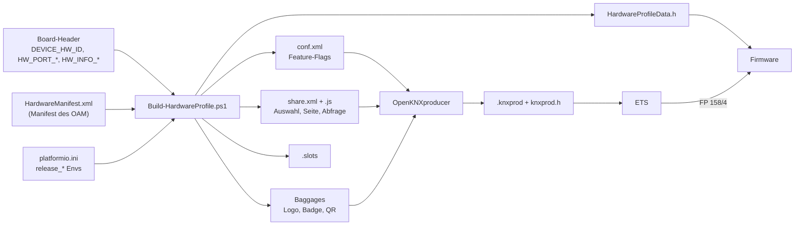

# Hardware-Profil-Generator

**Eine knxprod, viele Hardware-Varianten – und die ETS zeigt nur, was das Gerät kann.**

Der Generator liest die Board-Header dieses Repos und erzeugt daraus für eine Applikation:

- das Auswahlfeld „Gerätetyp“ (gespeichert wird die `DEVICE_HW_ID`),
- einen Button „Vom Gerät lesen“ (ETS liest ID, Fähigkeiten und Werte vom Gerät),
- eine Übersicht „Fähigkeiten dieses Geräts“ (mit `<Page>`: eine Geräteseite mit Gerätekarte aus Logo, Name, Board-Text
  und QR-Code, Hinweisen und Entwickleransicht),
- GPIO-Auswahlfelder mit den Pins der gewählten Hardware, ohne die Pins aus den `<ReservedPins>` des Manifests (z. B.
  KNX-UART, Prog, Ethernet, SD, I2C; die Liste führt jede Applikation selbst),
- **Feature-Flags** (`op:config`-Platzhalter wie `%HWP_CAP_Wifi%`), mit denen jedes Modul der Applikation Einstellungen ein- und ausblendet,
- einen Firmware-Header mit dem eigenen Profil (gleiche Ausdrücke wie für ETS).

Beispiel-Applikation: [examples/HardwareProfileDemo](../examples/HardwareProfileDemo).

## Begriffe

| Begriff | Dateien | Rolle |
|---|---|---|
| Manifest | `HardwareManifest.xml` (Wurzel `<HardwareManifest>`), `HardwareManifest.slots` | Eingabe, von Hand gepflegt; die Slot-Datei wird mit committet |
| Hardware-Profil | die Ausgaben aus `<Output>` und den `output=`-Attributen (`-Init`: `src/HardwareProfile.share.xml`, `.conf.xml`, `.script.js`, `include/HardwareProfileData.h`; NeoPixel: `src/NeoPixel.hw.*`), in der Firmware der Namensraum `HardwareProfile::` | Ausgabe, erzeugt; nie von Hand ändern |
| HW-Profiler | `Build-HardwareProfile.ps1` | das Werkzeug, das aus Manifest und Board-Headern das Profil baut |

## Ordner

| Pfad | Inhalt |
|---|---|
| `Build-HardwareProfile.ps1` | der Aufrufer (einziges Skript, das man startet): Parameter, Hilfe, Konstanten, Ablauf |
| `core/` | der Generator nach Bereichen, vom Aufrufer per Dot-Source geladen: `Console` (Ausgabe), `Text` (Dateien, Escaping, Sortierung), `Toolchain` (C-Präprozessor), `BoardIds` (Identität, `-ListIds`, `-NextId`), `Manifest`, `Boards` (Envs, Fähigkeiten, Pins, Ports), `Slots` (Slot-Datei, Bit-Reihenfolge, Versionswache), `AppModule` (Teile der Applikation: Feature-Flags, Auswahl, Geräteseite, Entwickleransicht), `AppScript` (Skript der Applikation), `Conflicts`, `Fixes`, `PartRows` (Zeilen eines Bausteins je Gerät), `Filters` (Auswahllisten je Gerät), `Header` (Firmware-Header), `Init`, `Generate` (die Schritte eines Laufs nach dem Manifest: Boards, Slots, Bilder, Ausgaben, Versionswache, Schreiben, Zusammenfassung), `Language` (Sprache der Ausgabe) mit `Messages.de.psd1` (deutsche Texte), siehe [Sprache der Ausgabe](#sprache-der-ausgabe) |
| `QUICKSTART.md` | Schnellstart: das Hardware-Profil in fünf Schritten in ein bestehendes OAM einbinden |
| `Anwendungsfaelle.md` | Rezepte mit Beispielen: Module, Feature-Flags, Kanalzahl, Auswahllisten, Sensoren, Netzwerk, Firmware |
| `tests/` | `Test-HardwareProfile.ps1`: Selbsttest (auch `Build-HardwareProfile.ps1 -SelfTest`), siehe [Selbsttest](#selbsttest) |
| `helpers/` | vom Aufrufer per Dot-Source geladen: `TemplateEngine.ps1` (Vorlagen), `QrCode.ps1` (QR-Kodierer), `PngImage.ps1` (PNG lesen/schreiben, QR-Code + Beschriftung) |
| `capabilities/` | `Common.caps.xml`: Fähigkeiten-Paket zum Einbinden per `<Import href>` (LAN, WLAN, Display, … aus den Board-Headern, dazu die gesperrten Plattform-Pins); optional, aber empfohlen, `-Init` bindet es ein. Eigene Fähigkeiten definiert jedes OAM in seinem Manifest; `ThirdParty` ist fest eingebaut |
| `templates/` | Standard-Vorlagen für `<Generate template="@hw/…">` |
| `assets/` | Logo, Badge, Schriftatlas, Seiten-Icon (siehe `assets/README.md`) |
| `../examples/HardwareProfileDemo` | Demo- und Test-Applikation: alle Anwendungsfälle in einer knxprod, mit Kontexthilfe |
| `../.github/workflows/hardware-profile.yml` | CI: `-ListIds` und `-Check` bei jedem Commit (Windows PowerShell 5.1) |

Alle Skripte: Windows PowerShell 5.1 kompatibel (`#Requires -Version 5.1`), kein System.Drawing, keine externen Werkzeuge.

## Was ein Entwickler tun muss

Kurzfassung mit allen Zeilen zum Kopieren: [QUICKSTART.md](QUICKSTART.md).

1. **Board-Header:** Das Gerät hat eine `DEVICE_HW_ID` (siehe [README](../README.md#hardware-id-device_hw_id)).
2. **Manifest** `HardwareManifest.xml` im Repo der Applikation anlegen (Beispiel unten).
3. **Generator laufen lassen** – vor dem OpenKNXproducer, im selben Schritt, in dem `knxprod.h` entsteht:
   ```
   pwsh lib/OGM-HardwareConfig/generator/Build-HardwareProfile.ps1
   ```
4. **In der Applikations-XML** die erzeugten Dateien einbinden und nur noch Feature-Flags benutzen:
   ```xml
   <op:config href="HardwareProfile.conf.xml" />
   <op:define prefix="HWP" ModuleType="45" configTransferName="Gerät" share="HardwareProfile.share.xml" />
   ...
   <choose ParamRefId="%HWP_SelectRef%">
     <when test="%HWP_CAP_Wifi%"> ... nur auf Geräten mit WLAN ... </when>
   </choose>
   ```
   Das `prefix` von `op:define` muss dem `prefix` des Manifests entsprechen, `ModuleType` dem `moduleType`.
   Hat das OAM ein Hauptmodul, wird das Hardware-Modul mit `isSubmoduleOf="<Präfix des Hauptmoduls>"` definiert
   (z. B. `isSubmoduleOf="NEO"`): dann legt der OpenKNXproducer kein eigenes Kontrollkästchen unter „Module“ an. Allein
   bekommt es dieses Kästchen; „aus“ blendet die Auswahl aus. Was ETS dann für die Auswahl lädt, ist nicht gemessen
   (die Auswahl ist ein Union-Parameter); gedacht ist „aus“ als „nicht gewählt“, also alle GPIO-Rollen aus.
   Wie jede knxprod mit Modulliste braucht die Applikation ConfigTransfer (UCT).
5. **Firmware** (für die Geräteabfrage): `include/HardwareProfileData.h` einbinden und im Modul eine Zeile:
   `if (HardwareProfile::answerQuery(objectIndex, propertyId, resultData, resultLength)) return true;`
   in `processFunctionProperty` (Beispiel: `HardwareProfileModule` der Demo).

## Ablauf



1. **Build:** Der Generator liest je `release_*`-Env die Board-Header (C-Präprozessor mit den Flags des Envs) und das
   Manifest. Er schreibt die Feature-Flags, das ETS-Modul (Auswahl, Hardware-Seite, Port-Parameter, Abfrage-Skript), die Bilder,
   den Firmware-Header und die Slot-Datei. Danach baut der OpenKNXproducer daraus die knxprod.
2. **ETS:** Der Anwender wählt die Hardware in der Liste oder fragt sie vom programmierten Gerät ab. ETS speichert die
   `DEVICE_HW_ID` in einem 16-Bit-Parameter; die Feature-Flags blenden alles aus, was die Hardware nicht hat.
3. **Download:** ETS schreibt die Auswahl und nur die sichtbaren Port-Parameter.
4. **Firmware:** Sie vergleicht die Auswahl mit der eigenen `DEVICE_HW_ID` und nutzt die Port-Parameter nur bei
   Gleichheit. Auf Function Property 158/4 antwortet sie mit HW-ID, Fähigkeiten und Werten (siehe „Geräteabfrage“).

## Regeln

**So ist es gedacht**

- Der Generator läuft vor dem OpenKNXproducer: im Release-Build ruft ihn `Build-Release-Preprocess.ps1` von OGM-Common auf,
  sobald das OAM ein Manifest hat (OGM-Common README „Hardware Profile“).
- Manifest: `HardwareManifest.xml` im Projektordner, sonst `src/HardwareManifest.xml` (ohne `-Manifest`; beide zugleich: Abbruch).
  Bis 19.11.2026 hieß es `HardwareProfile.xml` mit dem Wurzelelement `<HardwareProfile>`: beides bricht mit dem neuen Namen ab
  (Manifest und Slot-Datei mit `git mv` umbenennen, das Wurzelelement im Manifest umbenennen).
  Die Slot-Datei `HardwareManifest.slots` liegt immer daneben; bei einem Umzug mit `git mv` mitnehmen, nie neu erzeugen lassen
  (sie hält die Board-Nummern der Port-IDs). Pfade im Manifest gelten relativ zu seinem Ordner, in `src/` also `../include/…`
  und `<Boards project="..">`. Ein Umzug ändert die Pfade, über die die Versionswache ihren Fingerabdruck bildet: danach warnt
  sie, bis die ApplicationVersion steigt; bei einer nie ausgelieferten Version stattdessen die `ets`-Zeile der Slot-Datei löschen.
- Module blenden nur über Feature-Flags ein und aus: `%<p>_SelectRef%`, `%<p>_CAP_<Name>%`, `%<p>_VAL_<Name>_GE_<n>%`.
- Neue Hardware = neuer Board-Block mit eigener `DEVICE_HW_ID`; Drittanbieter-Hardware zusätzlich mit
  `DEVICE_THIRD_PARTY` (Badge und Hinweis kommen dann von selbst).
- Board-Texte stehen im Board-Header (`HW_INFO_TEXT`, `HW_INFO_URL`), Seitentexte im Manifest, nie in der Applikations-XML.
- `HardwareManifest.slots` wird mit committet.
- Jede inhaltliche Änderung an der knxprod bekommt eine neue Applikationsversion (`ReplacesVersionsDownTo`).
- Nach jeder Änderung prüfen: Generator zweimal (zweiter Lauf „unverändert“), dann die Seite in ETS5.

**Erlaubt**

- Seitentexte überschreiben oder leer lassen (`<Page>`), eigenes Logo oder Badge (`<InfoImage logo badge>`), eine
  Standard-URL für Boards ohne eigene (`<InfoImage default>`), eigene Fähigkeiten und Werte (`<Capability>`, `<Value>`).

**Nicht erlaubt**

- Generierte Dateien von Hand ändern (`<Output>`-Dateien, `Baggages/<prefix>Info/`): der nächste Lauf überschreibt sie.
- Slot-Nummern ändern oder neu vergeben, die `DEVICE_HW_ID` eines ausgelieferten Boards ändern: ETS verliert beim
  Update die Werte.
- OAM-Spezifisches im Generator oder in OGM-HardwareConfig hart codieren: alles geht über das Manifest.
- Erklärenden Text in Bilder legen (er gehört in einen Text; Kennzeichen wie das Badge oder Schrittnummern sind erlaubt),
  Bilder breiter als 532 px (geprüft nur für `queryImage`), mehr als ein Element oder einen eingebetteten Block in einer Rasterzelle (siehe „Regeln aus der
  ETS5-Messung“).
- In der Firmware Port-Parameter lesen, solange die Auswahl nicht die eigene `DEVICE_HW_ID` ist.

## Selbsttest

`Build-HardwareProfile.ps1 -SelfTest` (oder `tests/Test-HardwareProfile.ps1`, dort mit `-Only <Muster>`, `-Full`,
`-KeepWork`) lässt den Generator auf kleinen Test-Manifesten laufen, jedes in einem eigenen Wegwerf-Ordner (das Repo bleibt
unberührt), und prüft, was er tun und was er ablehnen muss: stabile Ausgaben, Bit-Reihenfolge, Versionswache,
Manifest-Prüfung, `<Fixes>` (auch Wert aus einem Board-Makro), `<PartRows>` (Zeilen je Board, Label-Gruppen, Abbruch bei keiner Zeile, zwei Zeilen oder ohne Inline-Block), `<Filters>` (Menge je Board aus Define, Muster, Fähigkeit; Texte, Träger, feste Slots; Kanal-Vorlage und Baustein mit Tokens, gespiegelte Refs, Zeilen, `except` aus einer Datei; Abbruch bei Wert außerhalb der Liste, fehlendem Parameter, gleichem Typ, überlappenden Nummern, fremder Zeile), `-Init`, Sprache (deutsche Tabelle vollständig, Standard Deutsch), ordinale Sortierung, PNG, `HardwarePorts.h` (mit g++/clang++, sonst übersprungen),
`-Check` der Demo (mit PlatformIO und den `lib/`-Links der Demo) und mit `-Full` den Update-Test der Demo (mit dem
OpenKNXproducer). Je Test eine Zeile mit ✓/✗/– und Dauer, am Ende eine Zusammenfassung; Exit-Code 1, wenn ein Test
scheitert.

## Ausgabe

`--help` (auch `-h`, `-Help`) zeigt Aufruf, Optionen und Beispiele im Layout der OpenKNX-Build-Skripte; `Get-Help
Build-HardwareProfile.ps1 -Detailed` die volle Beschreibung.

Jeder Kernschritt bekommt eine nummerierte Zeile. Solange er läuft, dreht sich vorne ein Zeichen (`| / - \`) und hinter dem
Text steht, was gerade passiert (`Env 12/44`, `Board 12/44`, `QR-Bild 1/2`, `erzeugen <Datei>`); am Ende ersetzt die Zeile sich
selbst durch das Ergebnis: Häkchen vor dem Text, Dauer und Kurzinfo dahinter (bei einem Abbruch ein Kreuz, darunter der
Grund). Keine aufgefüllte Spalte: eine lange Zeile bricht nicht in die nächste um. Mit `-Detailed` und bei umgeleiteter
Ausgabe (CI, Log-Datei) gibt es kein Drehzeichen, nur die Ergebniszeilen. Der Selbsttest zeigt seine Tests genauso. Beispiel
OAM-NeoPixel (gemessen):

```
  [1/7] ✓ Manifest lesen  1.0 s  5 Fähigkeiten, 2 Werte
  [2/7] ✓ Boards ermitteln (PlatformIO, Board-Header)  18.1 s  44 Envs, 40 Boards
  [3/7] ✓ Slot-Datei, Port-Werte, Konfliktprüfung  0.4 s
  [4/7] ✓ Bilder der Gerätekarte  1.1 s  5 Bild(er)
  [5/7] ✓ Applikation und Firmware-Header erzeugen  5.7 s  13 Datei(en)
  [6/7] ✓ Produkt-XML und Versionswache  0.0 s  2 Produkt-XML(s)
  [7/7] ✓ Dateien prüfen  0.0 s  aktuell
```

Windows PowerShell 5.1 zeigt statt ✓/✗ die Zeichen √/x (Konsolenschrift). Danach: je Board eine Zeile
`OK 0x<HW-ID>  <Name>` (nach HW-ID sortiert), dann eine Zusammenfassung, z. B.
`Hardware: 44 Envs, 40 Boards, 9 Dateien geschrieben` oder `Hardware: 44 Envs, 40 Boards, unverändert`. Warnungen (`!`) und Fehler (`x`, mit
dem letzten Schritt davor) erscheinen immer. `-Detailed` zeigt das volle Protokoll (Manifest, Boards mit Fähigkeiten und
Werten, jede Ausgabe); `-ListIds`, `-Init` und `-DryRun` geben immer alles aus.

### Zwischenspeicher der Boards

Schritt 2 (PlatformIO-Envs und Board-Header, bei NeoPixel 15 s) läuft nur, wenn sich einer seiner Eingänge geändert hat; sonst
nimmt der Generator das Ergebnis des letzten Laufs (gemessen: NeoPixel 0,8 s, Zeile „(Zwischenspeicher, Eingänge unverändert)“,
Ausgaben byteweise gleich). Eingänge: Manifest, Slot-Datei, `<Import>`, Generator, jede Datei der Include-Ordner (ohne die
eigenen Ausgaben), die Header-Ordner der `<BoardTable>`, die Ausgabe von `pio project config`, der `boards`-Ordner des
Projekts, Pakete und Plattformen von PlatformIO, der Präprozessor, Sprache und Schalter; Board-Manifeste und Arduino-Varianten,
die der Schritt unter `~/.platformio` liest, prüft er je Datei nach. Verglichen werden Pfad, Größe und Änderungszeit (keine
Prüfsumme). Ablage: `<Projekt>/.pio/hw-profiler/<Manifest>.boards.xml`, nur wenn das Projekt einen `.pio`-Ordner hat.
`-Check` (CI), `-Detailed` und `-NoCache` werten immer neu aus, `-DryRun` schreibt keinen Zwischenspeicher. Nicht erkannt wird
eine Änderung, die Größe und Änderungszeit einer Datei behält (`cp -p`, Entpacken), und ein Header, den ein `<BoardTable>`-Header
aus einem anderen Ordner einbindet: dann `-NoCache`.

### Sprache der Ausgabe

`-Language de|en` wählt die Sprache der Konsolenausgabe, ohne Angabe Deutsch; die erzeugten Dateien hängen nicht davon ab.
Gleiches gilt für `tests/Test-HardwareProfile.ps1` (er ruft den Generator für seine Textprüfungen auf Englisch auf) und
`examples/HardwareProfileDemo/scripts/Test-DemoUpdate.ps1`. Die Tabellen von `-ListIds` bleiben unübersetzt (Daten für CI
und Doku).

Im Code steht der englische Text, `T` übersetzt ihn und füllt die Platzhalter wie `-f`:

```powershell
Stop-WithError (T "Import not found: {0}" $path)
```

Der deutsche Text steht in `core/Messages.de.psd1` (UTF-8 mit BOM, damit die `.ps1`-Dateien ASCII bleiben), Schlüssel ist
der englische Text, genau wie im Code geschrieben (beim Nachschlagen zählt die Groß-/Kleinschreibung; zwei Texte, die sich nur
darin unterscheiden, lehnt der Parser als doppelten Schlüssel ab):

```powershell
  'Import not found: {0}' = 'Import nicht gefunden: {0}'
```

Die Datei wird mit dem PowerShell-Parser gelesen, nicht ausgeführt; erlaubt sind nur `'Text' = 'Text'`-Einträge. Neue oder
geänderte Meldung: Text im Code ändern, Eintrag in der Tabelle anlegen oder anpassen. Der Selbsttest
(`language-table`) meldet jeden Text ohne Eintrag, jeden Eintrag ohne Text im Code, verschiedene Platzhalter und einen
Aufruf mit zu wenigen oder zu vielen Argumenten. Fehlt ein Eintrag trotzdem, erscheint der englische Text; ist die Tabelle
nicht lesbar, warnt der Lauf und gibt Englisch aus.

## Manifest anlegen (`-Init`)

Für ein OAM ohne Manifest einmalig:

```
pwsh lib/OGM-HardwareConfig/generator/Build-HardwareProfile.ps1 -Init
```

Schreibt `HardwareManifest.xml` neben die `platformio.ini` (Ziel: `-Manifest`) und bricht ab, wenn es die Datei schon
gibt (kein Überschreiben). Inhalt: `<Boards platformio="release_*" />` mit den gefundenen Boards als Kommentar (HW-ID,
Define, Name); `release_*`-Envs ohne Board kommen nach `exclude`. Kein oder nur ein Board: Abbruch ohne Datei (eine Auswahl braucht mindestens zwei Boards).
`moduleType` = 45, sonst der nächste freie Wert aufwärts bis 99, dann abwärts ab 44 (alle `op:define ModuleType` der
Applikations-XMLs `src/*.xml` mit `<op:ETS`, Dev und Release zusammen; Werte in `"` oder `'`, `op:define` in Kommentaren zählt nicht); `prefix` = `HWP`, sonst `HWP2`, `HWP3` …
`unselected="showAll"` (eine bestehende knxprod bekommt eine Auswahl: ETS schreibt beim Download den
Standardwert jedes unsichtbaren Parameters), Standard-Ausgaben `src/HardwareProfile.*` und
`include/HardwareProfileData.h` (Abbruch, wenn eine davon existiert und keine Generator-Ausgabe ist),
`Import` von `capabilities/Common.caps.xml`, `<Page text="Gerät" icon="memory" />`, `<InfoImage style="card" />` und
`<Notice when="ThirdParty">` (Seite „Gerät“ mit Gerätekarte). Danach folgt jede weitere Einstellung als auskommentiertes
Beispiel aus `init/HardwareManifest.examples.xml` (`@PREFIX@` = Präfix, `@DEVTYPE@` = nächster freier ModuleType für die
Entwickleransicht), darunter Info-LEDs (`<PartRows>`) und die Entwickleransicht (`<Page dev features>`, nur Dev-Applikation).
Danach zeigt das Skript die Zeilen für die Applikations-XML (`op:config`,
`op:define`, `op:include` in `<generate><Dynamic>`, wahlweise als Seite im OpenKNX-Kanal) und erinnert an die neue Applikationsversion
(`ReplacesVersionsDownTo`). Beim Build wird nie ein Manifest angelegt: ohne Manifest bleibt die knxprod, wie sie ist.
Eigene Fähigkeiten der Applikation (`<Capability>`) trägt der Entwickler danach ein.

## Manifest

```xml
<HardwareManifest prefix="HWP" moduleType="45" text="Gerät">
  <Output conf="src/HardwareProfile.conf.xml" share="src/HardwareProfile.share.xml"
          script="src/HardwareProfile.script.js" header="include/HardwareProfileData.h" />

  <!-- Standard-Fähigkeiten: TP, LAN, WLAN, Display, RTC, SD, Summer, Binäreingänge, Status-LEDs, Flash -->
  <Import href="lib/OGM-HardwareConfig/generator/capabilities/Common.caps.xml" />

  <!-- eigene Fähigkeit der Applikation: ein Präprozessor-Ausdruck -->
  <Capability name="LargeFlash" text="Großer Datenspeicher" expr="defined(DEVICE_FLASH_SIZE_MB) &amp;&amp; DEVICE_FLASH_SIZE_MB >= 8" />

  <!-- Geräte: Standard = die Envs, die das OAM ohnehin baut (Board-Define + Build-Flags je Env) -->
  <Boards platformio="release_*" />
  <!-- zusätzlich möglich: einzeln oder per Muster (jedes Board mit DEVICE_HW_ID, dessen Define passt) -->
  <Board define="DEVICE_REG2_PIPICO2_W_V1_DD_RTC" flags="-DKNX_IP_WIFI" />

  <!-- GPIO-Rolle: Pins aus den Makronamen des Headers (scan = regulärer Ausdruck, $1 = Gruppe 1) -->
  <GpioRole name="Pin" number="1" text="Freier Anschluss" count="2">
    <Pins board="OKNXHW_OPENKNXIAO_*" scan="^OKNXHW_OPENKNXIAO_D(\d+)$" label="D$1" />
    <Pins board="DEVICE_X"><Pin gpio="X_PIN_A" label="Klemme A" /></Pins>
  </GpioRole>
</HardwareManifest>
```

| Element | Bedeutung |
|---|---|
| `prefix`, `moduleType` | Modulpräfix und ModuleType (`%TT%`) des erzeugten ETS-Moduls |
| `unselected` | `showAll` (Standard): „Nicht gewählt“ zählt als jede Fähigkeit, alles bleibt sichtbar · `hide`: ohne Auswahl ist alles Hardwareabhängige ausgeblendet |
| `<Capability name text expr>` | Ja/Nein-Fähigkeit, `expr` ist ein `#if`-Ausdruck |
| `<Value name text expr ifdef default max unit>` | Zahl (1 Byte); ist `expr` kein Makroname, muss `ifdef` das Makro nennen, das existieren muss |
| `<Value …><Set board value/></Value>` | Wert je Board-Muster, nur für ETS (ohne `expr` gilt sonst `default`); ein Define ohne `*`/`?` geht vor einem Muster, zwei passende Einträge derselben Art brechen ab; mit `<Output header>` nur zusammen mit `query="false"` (die Firmware sähe den Wert nicht) |
| `<Value … query="false">` | Wert nur für ETS (Feature-Flags, Fähigkeiten-Seite): nicht Teil der Geräteabfrage und nicht im Firmware-Header; die Grenze von 4 Werten gilt nur für abgefragte Werte |
| `<ReservedPins macros>` | Pins der Applikation (Makronamen, Werte aus den Board-Headern), die nie in einer GPIO-Rolle erscheinen und mit `<Conflicts reserved="true">` als reserviert gelten. Das Capability-Pack enthält keine: jeder Pin ist erlaubt, bis die Applikation ihn hier nennt |
| `<Boards platformio project exclude>` | Boards aus den PlatformIO-Envs, deren Name auf `platformio` passt (z. B. `release_*`). Alle `-D` eines Envs außer dem Board gelten als Flags. Mehrere Envs mit demselben Board (TP, TP+WLAN) ergeben einen Eintrag mit der Vereinigung ihrer Fähigkeiten; Ports, Relais, Info-URL, `HW_INFO_TEXT` und MCU müssen in allen Envs gleich sein, sonst bricht der Lauf ab. Das Board eines Envs ist das Define eines Header-Blocks mit `DEVICE_HW_ID` (Build-Flags wie `DEVICE_DISPLAY_MODULE` zählen nicht); ein Env ohne solches Board oder mit zwei Boards bricht den Lauf ab (ein übergangenes Board fiele aus ETS und der Firmware-Tabelle und stünde in der Slot-Datei als `removed`); ein Board nimmt man heraus, indem man sein Env löscht. Envs, die kein Board bauen (Test-, Tool-Envs), nennt `exclude` (Muster, durch Leerzeichen getrennt), z. B. `<Boards platformio="release_*" exclude="release_native_*" />`; ein ausgeschlossenes Env, das ein Board baut, bricht den Lauf ab, `exclude` darf also kein Board-Env nennen. Die Build-Flags eines ausgeschlossenen Envs werden nur auf ein Board hin geprüft (ein Flag, das auf `\` endet, wird dabei übergangen); eine Zeile, die sich nicht auswerten lässt, wird übergangen, außer sie nennt ein Board (Header-Define oder Alias, der eine `DEVICE_HW_ID` ergibt): dann bricht sie den Lauf ab. Ein Build-Flag, das sich nicht auswerten lässt (endet auf `\`, ungültige Quotes), bricht immer ab: ein weggelassenes Define könnte eine Fähigkeit ändern. Vorrang bei gleicher HW-ID: `<Board>`-Zeile vor Env vor Muster. `project` = Ordner der platformio.ini (Standard: der des Manifests). Braucht `pio` im PATH oder in `<PLATFORMIO_CORE_DIR oder ~/.platformio>/penv`. |
| `<Board define flags>` | Gerät oder Muster (`*`, `?`); `flags` = Build-Flags des Envs, die eine Fähigkeit oder Variante ändern. `flags` an einem Muster gelten für **jedes** passende Board. Ein einzeln genanntes Board hat Vorrang vor einem Muster (auch wenn es über Alias + Flags dieselbe HW-ID ergibt); dasselbe Board zweimal mit verschiedenen Flags bricht ab |
| `<GpioRole name number text count>` | `count` Auswahlfelder; `number` (1–9) ist Teil der Parameter-ID und wird nie geändert |
| `order` (Wurzel) | `hwid` (Standard): aufsteigend nach `DEVICE_HW_ID` · `manifest`: Reihenfolge der Einträge |
| `<Output>` | jedes Attribut optional; `share` (das ETS-Modul) braucht `script` und `moduleType` |
| `<Capability merge>` | wie mehrere Envs eines Boards zusammengehen: `any` (Standard, Vereinigung) · `all` (jedes Env muss die Fähigkeit haben) |
| `<Capability switch fixedBy reportedBy>` | `switch="true"`: Schalter `<Prefix>_<Name>On` auf der Hardware-Seite (1 Bit im Gerätespeicher, Byte nach den GPIO-Rollen am Ende des Moduls, Standard „ein“; höchstens 8) und Firmware-Stand `<Prefix>_<Name>Fw` (ohne Speicher: nicht abgefragt / vorhanden / nicht vorhanden). Boards, die auch die Fähigkeit `fixedBy` haben, zeigen „immer ein“ statt des Schalters; ein ausgeblendeter Schalter lädt seinen Standard (ein). Die Geräteabfrage trägt das Bit `reportedBy` (Standard: das eigene) als Firmware-Stand ein und schaltet aus, was die Firmware nicht hat (nicht bei `fixedBy`). Was der Schalter in der Firmware bewirkt, entscheidet die Applikation (`Param<Prefix>_<Name>On`). Mit `<Page>` steht der Schalter links unter dem Board-Text; `fixedBy`-Boards zeigen dort nichts. Ohne `switch` bleiben alle Ausgaben wie bisher |
| `<Capability runtime>` | `runtime="true"`: `expr` sagt, dass das Board den Platz dafür hat (Steckplatz); ob das Teil da ist, erkennt die Firmware zur Laufzeit und meldet es über `answerQuery(…, runtimeCaps)`. Das Bit fehlt in `OWN_CAPS`, die Geräteabfrage zählt es nicht als Abweichung (siehe „Geräteabfrage“) |
| `<Capability feature featureOn featureOff featureInvert featureNote featureNoteWhen>` | Zeile der Entwickleransicht (`<Page features>`): `feature` = Bezeichnung (Standard `text`), `featureOn`/`featureOff` = Wert, wenn das Board die Fähigkeit hat / nicht hat (Standard „ja“/„nein“); unterscheiden sich die Envs des Boards: „je nach Firmware-Variante“, mit `featureOn`/`featureOff` „<off> oder <on> (je nach Firmware-Variante)“. `featureInvert="true"`: das Board hat das Merkmal, wenn die Fähigkeit fehlt. `featureNote` wird an den Wert für „hat“ angehängt (`featureOn`, Standard „ja“: „ja (<Note>)“), wenn das Board auch die Fähigkeit `featureNoteWhen` hat (beide zusammen) |
| `<Value relays names>` | `relays="true"`: der Wert zählt Relais; die ersten `HW_RELAY_COUNT` sind die fest verdrahteten des Boards, jedes weitere belegt einen Port (Entwickleransicht: „1, fest verdrahtet“, „bis 4, Port wählbar“, „bis 2, 1 fest verdrahtet, 1 Port wählbar“, 0 = „nein“); `names="a b c"`: Anzeigename je Wert 0, 1, 2, … in der Entwickleransicht |
| `<Ports board use excludeRelayPins max>` | angebotene Hardware-Ports der passenden Boards (siehe „Ports“) |
| `<Generate template output [finalNewline]>` | ganze Datei aus einer Vorlage (siehe „Vorlagen“); `<Param name value>` → `$P.<name>`; `@hw/` = Ordner `templates` |
| `<InfoImage style define default module version width urlFont supersample urlColor logo badge thirdPartyWhen>` mit `<Logo board file>` | Gerätekarte der Hardware-Seite; `<Logo>`: eigenes Bild oder keines je Board, siehe [Hardware-Seite](#hardware-seite-gerätekarte) |
| `<Page text icon help title label intro queryTitle query button queryHelp queryImage unselectedTitle infoDefault unselectedInfo unselectedText updateInfo firmware changeInfo features dev>` | Hardware-Seite als OpenKNX-Seite, siehe [Hardware-Seite](#hardware-seite-gerätekarte) |
| `<Notice when title><Text>…</Text>…</Notice>` | Hinweis-Kasten für Boards mit der Fähigkeit `when`, siehe [Hardware-Seite](#hardware-seite-gerätekarte) |
| `portManualValue`, `portNoneValue` (Wurzel) | Werte der Port-Auswahlen der Applikation: 0..n-1 = Port n des Boards, `portManualValue` (0..254) = manueller GPIO, `portNoneValue` (0..255) = kein Port, jeder andere Wert (z. B. nie geschrieben 255) = kein GPIO. Nur zusammen, verschieden. Einmal angegeben, gilt es für die Konfliktprüfung (`<Conflicts>`) und den Firmware-Header (`signalGpio`, siehe [Port-Auswahl in der Firmware](#port-auswahl-in-der-firmware)). Ein angebotener Port auf einem der beiden Werte bricht den Lauf ab |
| `<Conflicts output number value error reserved reservedError tpError>` | GPIO-Konfliktprüfung in ETS, siehe [GPIO-Konflikte](#gpio-konflikte-conflicts) und [Reservierte GPIOs](#reservierte-gpios-conflicts-reservedtrue) |
| `<BoardTable name header scan>` | Zahlen-Tabelle je Board im ETS-Skript aus einem Header der OAM, siehe [Board-Tabellen](#board-tabellen-boardtable) |
| `<ValueNotices output>` mit `<ValueNotice name ref table all any>` | Hinweis unter einer Auswahl, wenn ihr Wert auf dem gewählten Gerät fehlt (aus einer `<BoardTable>`, reines XML), siehe [Hinweise je Wert](#hinweise-je-wert-valuenotices) |
| `<Fixes output>` mit `<Fix name capability ref value valueMacro show indent help>` | Einstellung eines anderen Moduls je Fähigkeit oder mit dem Wert eines Board-Makros festlegen, siehe [Einstellungen festlegen](#einstellungen-festlegen-fixes) |
| `<PartRows source output>` mit `<Row ref expr label>` | Zeilen eines Bausteins (Part) eines anderen Moduls nur auf den Geräten zeigen, die sie haben, mit Label aus dem Board-Header, siehe [Zeilen je Gerät](#zeilen-je-gerät-partrows) |
| `<Filters output>` mit `<Filter name ref source value number slots indent help>`, `<Allow board capability values except>` und `<Row name ref cell indent help>` | eine Auswahlliste je Gerät auf eine beliebige Teilmenge ihrer Einträge beschränken, siehe [Auswahl je Gerät filtern](#auswahl-je-gerät-filtern-filters) |

### Board-Tabellen (`<BoardTable>`)

Werte, die die Firmware eines Envs aus seinen Build-Flags über einen Header der OAM ableitet (z. B. welche Effekte ein
Target abschaltet), stehen damit auch im ETS-Skript.

```xml
<BoardTable name="EffectsOff" header="src/NeoPixelEffectGroups.h" scan="^NEO_FXOFF_(\d+)$" />
```

- Je Env (bzw. je `<Board>`-Zeile ohne Env) läuft der Präprozessor wie für die Fähigkeiten, mit demselben Compiler. Er
  sieht genau: die `-D`-Flags des Envs (bzw. `flags` der `<Board>`-Zeile), die `ARDUINO_ARCH_*`-Defines der MCU,
  `HardwareConfig.h`, danach `header` (Pfad relativ zum Manifest). Nicht dabei: `build_unflags`, `-include`, Header des
  Frameworks oder der sdkconfig und `knxprod.h` (beim Lauf in Build-Release gibt es sie noch nicht). Der Header muss also
  allein übersetzbar sein; scheitert der Präprozessor, nennt der Abbruch Board, `name`, `header` und den ersten
  Compiler-Fehler.
- Jedes Makro, dessen Name auf `scan` passt (regulärer Ausdruck, Groß-/Kleinschreibung zählt), ist ein Eintrag: die eine
  unbenannte Gruppe = Index (0..1023; eine benannte Gruppe wie `(?<i>\d+)` bricht ab).
- Wert: das expandierte Makro muss eine Zahl 0..2147483647 sein: dezimal, hex (`0x1F`) oder C-oktal (`017`), mit
  `u`/`l`-Suffix, in Klammern und mit Casts wie `(uint8_t)` in beliebiger Reihenfolge (`((uint8_t)3u)`, `(uint8_t)(3)`);
  ein Makro, das darauf expandiert, geht auch. Ein Wert außerhalb des Cast-Typs (`(uint8_t)300`, `(int8_t)200`) bricht ab,
  statt wie C abzuschneiden. Ausdrücke wie `(1 << 3)` oder `(A | B)` rechnet der Generator nicht aus: Abbruch mit Board,
  Datei und Makro.
- Mehrere Envs eines Boards: `any` = bitweises ODER, `all` = bitweises UND je Index; ein fehlender Index zählt 0. Gewinnt
  eine `<Board>`-Zeile mit derselben HW-ID gegen die Envs (siehe `<Boards>`), kommt die Tabelle des Boards nur aus den
  `flags` dieser Zeile.
- Ausgabe im ETS-Skript (`<Output script>`, Pflicht), Index = Position, fehlender Index = 0:
  ```js
  // <BoardTable name="EffectsOff">: DEVICE_HW_ID -> src/NeoPixelEffectGroups.h per index ...
  var HWP_table_EffectsOff = {
      4880: { any: [1, 1, 1, 0, 4], all: [0, 1, 0, 0, 0] },
      4896: { any: [0, 1, 1, 0, 0], all: [0, 1, 1, 0, 0] }
  };
  ```
- Abbruch: `name` nicht nur Buchstaben und Ziffern oder doppelt, `header` fehlt, `scan` ohne genau eine unbenannte
  Gruppe, zwei Makros für einen Index. Warnung: kein Makro auf irgendeinem Board. Ohne `<BoardTable>` bleiben alle Ausgaben gleich.

### Hinweise je Wert (`<ValueNotices>`)

Ein Hinweis unter einer Auswahl, solange sie einen Wert hat, den die Firmware des gewählten Geräts nicht kann. Die Werte kommen
aus einer `<BoardTable>` (Index = Wert der Auswahl, Eintrag ungleich 0 = fehlt). Reines XML, kein Skript, keine Merker.

```xml
<ValueNotices output="src/NeoPixel.hw.notices.gen.xml">
  <ValueNotice name="SegmentFx" ref="%AID%_UP-%TT%%CC%057_R-%TT%%CC%05701" table="EffectsOff"
               all="Effekt nicht verfügbar: …" any="Hinweis: Dieser Effekt fehlt in einer Firmware-Variante dieser Hardware." />
</ValueNotices>
```

- Ausgabe: je `<ValueNotice>` ein Block `ValueNotice_<name>`: `choose` auf die Hardware-Auswahl (Ziffern des Moduls, gilt auch in
  einer Vorlage oder einem Baustein), je Gruppe von Boards mit denselben Werten ein `when`, darin `choose` auf `ref` mit dem Text
  `all` (`UIHint="Error"`) für die Werte, die in **jedem** Env des Boards fehlen, und dem Text `any` (`UIHint="Information"`)
  für die Werte, die nur in **manchen** fehlen. „Nicht gewählt“ und Boards ohne fehlenden Wert bekommen kein `when`, ein
  Hinweis ohne solches Board einen leeren Block.
- Einbindung: `<op:include href="….hw.notices.gen.xml" xpath="//Block[@name='ValueNotice_<name>']/*" />` direkt unter der
  Zeile der Auswahl, in derselben Vorlage bzw. demselben Baustein; `ref` behält die Tokens (`%TT%%CC%`, `%PPP+0%`), der Producer
  setzt sie je Kanal bzw. Instanz.
- `all` oder `any` darf fehlen (dann kein Hinweis dieser Art), beide nicht. Texte höchstens 255 Zeichen.
- Abbruch: `name` nicht nur Buchstaben und Ziffern oder doppelt, `ref` keine ParameterRef, `table` keine `<BoardTable>`
  (Groß-/Kleinschreibung zählt), kein Text, Text zu lang, `<ValueNotices>` zweimal oder ohne `<ValueNotice>`.
- Eine Auswahl mit `<Filters>`: die gefilterte Liste bietet einen fehlenden Wert gar nicht an, ein Wechsel auf ein solches Board
  setzt ihn zurück; der Hinweis greift dann nur für Werte, die der Filter durchlässt.

### Einstellungen anderer Module je Gerät: `<Fixes>`, `<PartRows>` oder `<Filters>`

`<Fixes>` bestimmt den **Wert** einer Einstellung, `<PartRows>` bestimmt, ob und mit welchem Text **Zeilen sichtbar** sind,
`<Filters>` bestimmt, **welche Einträge** eine Auswahlliste anbietet.

| | [`<Fixes>`](#einstellungen-festlegen-fixes) | [`<PartRows>`](#zeilen-je-gerät-partrows) | [`<Filters>`](#auswahl-je-gerät-filtern-filters) |
|---|---|---|---|
| Wirkt auf | den Wert genau eines Parameters | Sichtbarkeit und Text ganzer Zeilen | die Einträge einer Auswahlliste (Dropdown) |
| Je Board | Wert fest (nur lesbar), versteckt, vorbelegt (änderbar) oder nur zugewiesen; Wert fest oder aus einem Board-Makro | Zeile zeigen oder weglassen (C-Ausdruck über den Board-Header), Text um ein Board-Makro ergänzen | beliebige Teilmenge der Einträge: erste passende `<Allow>` (Board, Muster, Fähigkeit), sonst 0..Manifest-Wert, sonst alle |
| Ändert Werte | ja | nein | nur über die Wahl des Nutzers (der Träger übernimmt sie) |
| Einbindung | das Produkt nimmt die Originalzeile aus dem Include des Moduls und setzt den Block `Fix_<name>` an ihre Stelle | das Produkt zeigt per Token auf eine erzeugte Kopie des ganzen Bausteins | Typen, Parameter, ParameterRefs und der Block `Filter_<name>` an die Stelle der Zeile des Trägers |
| Passt für | einzelne Einstellungen, die das Produkt selbst einbindet | Zeilen in einem fremden Baustein, die das Produkt nicht einzeln herausnehmen kann | Listen, deren Einträge nicht jede Hardware kann (Anzahl Relais, Betriebsarten, Quellen) |
| Beispiel | „WiFi-Schnittstelle“ = Ja, nur lesbar, auf WLAN-Boards | Zeile „Info 3“ nur auf Boards mit `INFO3_LED_PIN` | NeoPixel „Externe Relais“ 0..n je Board; Demo „Schaltfunktion“, „Zeitquelle“ |

Faustregel: Soll man etwas **nicht sehen**, `<PartRows>`; soll man etwas **nicht ändern** oder einen **passenden Startwert**
bekommen, `<Fixes>`; soll man **nur passende Einträge** wählen können, `<Filters>`. Beide zusammen: Info-LEDs der Demo und von NeoPixel (`<PartRows>` für die Zeilen, `<Fix valueMacro
show="assign">` für die Vorbelegung, ohne eigene Zeile).

### Einstellungen festlegen (`<Fixes>`)

Eine Einstellung eines anderen Moduls (z. B. „WiFi-Schnittstelle“ von OFM-Network) bekommt auf Boards mit einer Fähigkeit
einen festen Wert:

```xml
<Fixes output="src/MyApp.hw.fixes.gen.xml">
  <Fix name="HasWifi" capability="Wifi" ref="%AID%_P-1401001_R-140100100" value="1" show="readonly" indent="1" help="NETW-WiFi" />
</Fixes>
```

- `ref`: ParameterRef der Einstellung, entweder mit den Ziffern des Moduls statt `%TT%` (`%AID%_P-1401001_R-140100100`: die
  schreibgeschützte Zeile steht im gemeinsamen Block `ParameterRefs`, den ein beliebiges Modul einbindet) oder mit den Tokens
  des Producers, auch einer Kanal-Vorlage oder eines Bausteins (`%AID%_UP-%TT%%CC%001_R-%TT%%CC%00101`, `%PPP+3%`): dann steht
  die schreibgeschützte Zeile (Ref-Endung `99`) im eigenen Block `Fix_<name>_ParameterRefs`, den das Produkt in die
  ParameterRefs derselben Vorlage bzw. desselben Bausteins einbindet, und `Fix_<name>` gilt dort für jeden Kanal bzw. jede
  Instanz (Demo: „Betriebsart“ der Kanal-Vorlage). `value`: der Rohwert.
- `capability="!Name"`: der Fix gilt für die Boards **ohne** die Fähigkeit. Damit verschwindet ein ganzes Modul, das ein Gerät
  nicht hat: jedes OpenKNX-Modul hat auf OpenKNX → Module einen Schalter `BASE_ModuleEnabled_<Präfix>` mit der Id
  `%AID%_UP-00998<ModuleType>` (Ref `…_R-00998<ModuleType>01`), auf dem der Producer den Kanal des Moduls ein- und
  ausblendet; `<Fix capability="!Presence" ref="%AID%_UP-0099849_R-009984901" value="0" show="assign" />`, Block `Fix_<name>`
  in der Hardware-Seite. In ETS6 gemessen (Demo 3.0, 1.1.151): Pro (Präsenz) zeigt das Modul, Basic blendet es aus, zurück
  zum Pro ist es wieder da (ein per `<Assign>` gesetzter Wert fällt auf den eigenen Wert zurück, sobald das `<Assign>` nicht
  mehr greift), „nicht gewählt“ zeigt es. Die Fähigkeit am besten aus der Bedingung nehmen, mit der die Firmware das Modul
  hinzufügt (`openknx.addModule` im `main.cpp` der OAM). Ein Board, dessen Envs sich unterscheiden: mit `merge` any (Standard)
  zählt es als „hat“ (nie ausgeblendet); mit `merge="all"` als „hat nicht“, sobald ein Env die Fähigkeit nicht hat.
- `valueMacro` statt `value`: der Wert kommt je Board aus diesem Makro des Board-Headers (Präprozessor wie `<Capability expr>`,
  eine ganze Zahl 0..2147483647; ein Name, den nur die Firmware kennt, z. B. `OPENKNX_LEDFUNC_BASE_KNX` aus OGM-Common, bricht
  ab: im Header die Zahl schreiben). Boards ohne das Makro bekommen keinen Fix, Boards mit demselben Wert ein gemeinsames
  `<when>`. `capability` ist dann optional (mit ihr: nur Boards, die beides haben); ohne ein solches Board steht im Block nur
  die normale Zeile (`show="assign"`: nichts). Die Envs eines Boards müssen denselben Wert ergeben, sonst Abbruch.
- `show`: `readonly` (Standard, Zeile sichtbar, nicht änderbar; in ETS6 gemessen), `hidden` (keine Zeile; nur für
  Einstellungen ohne Speicher: für einen unsichtbaren Parameter mit Speicher schreibt ETS beim Download den Standardwert,
  laut ETS-DLLs, nicht gemessen), `editable` (Zeile änderbar, der Wert wird beim Wählen des Boards gesetzt; in ETS6
  gemessen, siehe unten), `assign` (nur das `<Assign>`, keine Zeile im Block: die Einstellung behält ihre eigene Zeile in ihrem Modul,
  z. B. in einem Baustein, den der Block nicht ersetzen kann; nicht gemessen). Ohne Auswahl und auf Boards ohne die
  Fähigkeit: die normale Zeile. Zwei `<Fix>` auf dieselbe `ref` brechen ab.
- Ein `<Assign>` darf laut ETS-Schema nur in einem `<when>` innerhalb eines `ParameterBlock` stehen (direkt unter `Channel`
  lehnt der OpenKNXproducer es ab): den Block also in eine Seite einbinden, z. B. in die Hardware-Seite.
- `editable` in ETS6 gemessen (IP-Interface, Info-LEDs auf REG1, 2026-11-19): beim Wählen des Boards stehen die Werte
  des `<Fix>`, die Zeile bleibt im Dialog änderbar, ein geänderter Wert bleibt gespeichert (auch nach Seitenwechsel); ein
  anderes Board ohne den Fix zeigt wieder den eigenen Wert, zurück auf das Board setzt den Fix-Wert neu. Nicht gemessen: ob
  der Download den geänderten Wert schreibt, und das Verhalten von `assign` mit eigener Zeile: vor dem Ausliefern in ETS
  prüfen (Board wählen, Wert ändern, andere Seite, zurück, Download).
- Der Generator schreibt eine Bausteindatei: Block `ParameterRefs` (für `readonly` eine zweite ParameterRef derselben
  Einstellung mit `Access="Read"`, Index 99: `…_R-<TT><nnnnn>99`) in die ParameterRefs eines Moduls einbinden, Block
  `Fix_<name>` an der Stelle der Zeile. Die Applikation nimmt die Originalzeile aus dem Include des Moduls heraus, z. B.
  `xpath="…/ParameterBlock[@Name='NetworkInject']/*[not(contains(@RefId, '%TT%01001_R-'))]"`.
- Gemessen in ETS6: ein `<Assign>` allein sperrt die Zeile nicht. ETS hält den Wert je ParameterRef, deshalb bekommt die
  nur lesbare Zeile ein eigenes `<Assign>`; die änderbare Zeile ist auf diesen Boards nicht sichtbar.

Wert aus dem Board-Header, Beispiel der [Demo](../examples/HardwareProfileDemo/HardwareManifest.xml): die Funktion der Info-LEDs
von OGM-Common (`Info1LedFunc`, BASE = ModuleType 10) wird beim Wählen eines Boards mit `OPENKNX_INFOLED1_DEFAULT` auf diesen
Wert gesetzt, die Zeile bleibt auf der Seite „Info LEDs“ änderbar:

```xml
<Fixes output="src/HardwareProfile.fixes.gen.xml">
  <Fix name="InfoLed1" ref="%AID%_UP-1000020_R-100002001" valueMacro="OPENKNX_INFOLED1_DEFAULT" show="assign" />
</Fixes>
```

```xml
<!-- src/HardwareProfileDemo.xml, in der Hardware-Seite (ParameterBlock) -->
<op:include href="HardwareProfile.fixes.gen.xml" xpath="//Block[@name='Fix_InfoLed1' or @name='Fix_InfoLed2']/*" />
```

Ergebnis (`src/HardwareProfile.fixes.gen.xml`): je Wert ein `<when test="<HW-IDs>">` mit
`<Assign TargetParamRefRef="%AID%_UP-1000020_R-100002001" Value="3" />`, die Boards ohne das Makro fehlen.

### Zeilen je Gerät (`<PartRows>`)

Eine Seite eines anderen Moduls, die als Baustein (`op:part`) eingebunden ist, zeigt einzelne Zeilen nur auf den Geräten, die
sie haben, mit einem Label aus dem Board-Header im Zeilentext. Der Generator schreibt eine Kopie des Bausteins; die
Applikation lässt das Modul diese Kopie statt seines eigenen Bausteins laden (bei OGM-Common über `%BASE_InfoLedPart%`).

```xml
<PartRows source="lib/OGM-Common/src/InfoLed.part.xml" output="src/HardwareProfile.infoled.gen.xml">
  <Row ref="%AID%_UP-%TT%00020_R-%TT%0002001" expr="defined(INFO1_LED_PIN) || defined(INFO_LED_PIN) || defined(INFO1_LED_LABEL)" label="INFO1_LED_LABEL" />
  <Row ref="%AID%_UP-%TT%00021_R-%TT%0002101" expr="defined(INFO2_LED_PIN) || defined(INFO2_LED_LABEL)" label="INFO2_LED_LABEL" />
  <Row ref="%AID%_UP-%TT%00022_R-%TT%0002201" expr="defined(INFO3_LED_PIN) || defined(INFO3_LED_LABEL)" label="INFO3_LED_LABEL" />
</PartRows>
```

```xml
<!-- Applikations-XML, vor dem op:define von BASE (href relativ zu lib/OGM-Common/src) -->
<op:config name="%BASE_InfoLedPart%" value="../../../src/HardwareProfile.infoled.gen.xml" />
```

- `source`: der Baustein, relativ zum Manifest; `output`: die Kopie (nicht die Quelle, nicht zweimal; eine Quelle nur in einem
  `<PartRows>`). Mehrere `<PartRows>` sind erlaubt. Auch eine Kanal-Vorlage geht: das Produkt nennt dann die Kopie als
  `template=` des `op:define` und bindet ihre Seiten aus der Kopie ein (Demo: `HardwareProfile.channel.gen.xml`, Zeile
  „Status-LED“ je Kanal).
- Die Quelle darf eine Datei eines fremden Moduls sein (OFM-Vorlage, OFM-Share): keine Änderung an der Bibliothek. Die Kopie
  schreibt relative `href` auf ihren Ordner um; eine `href` auf die Quelle eines anderen `<PartRows>` zeigt auf dessen Kopie
  (eine kopierte Share-Datei bindet die kopierte Vorlage ein). `<PartRows>` ohne Kind = nur die Kopie mit diesen `href`.
  `op:part`, die die Kopie deklariert, heißen dort `<Name>-PR<n>` (mit ihren `op:usePart`): der Producer führt Teile über das
  ganze Produkt nach Namen, eine zweite Deklaration unter demselben Namen verschöbe die Ids. `%N%` / `%N-1%` ersetzt der
  Producer nur in einer Datei, die er als `share=` oder `template=` liest: nutzt das Produkt die Kopie nur als Dynamic-Include,
  schreibt der Generator `NumChannels` des `op:define` der Quelle hinein (keines oder verschiedene: Abbruch).
- Einbinden einer kopierten **Share-Datei**: `share=` bleibt das Original (Static und `Baggages`: der Producer liest Hilfe und
  Icons immer aus dem Ordner der eingebundenen Datei), nur das Include des Dynamic-Teils zeigt auf die Kopie. Was die Blöcke im
  Static des Moduls brauchen, kommt über ein zweites `op:define` mit demselben ModuleType (eigenes Präfix, eigene kleine
  Share-Datei mit den Includes der Blöcke, `noConfigTransfer="true"`; gleicher ModuleType = gleicher Id-Raum, wie NEO und
  NEOSTRIP in OAM-NeoPixel). Eine kopierte **Vorlage** ist `template=` und bekommt das Static der Blöcke selbst.
- `<Fix name>` / `<Filter name [row]>` (Kinder): die Kopie zeigt den Block `Fix_<name>` / `Filter_<name>[_<row>]` an jeder
  Zeile der Einstellung (eine `ParameterRefRef` direkt in einem `ParameterBlock` oder `when`, auch in den Kopien einer
  gewählten Zeile; nie in einer Berechnung); keine solche Zeile: Abbruch. `Cell` und `IndentLevel` kommen von der ersetzten
  Zeile (fehlen sie dort, fallen sie weg), `HelpContext` von dort oder aus dem Manifest. Ins Static der Kopie kommen einmal
  die eigenen Listen und Refs des Filters bzw. die schreibgeschützte Ref eines Fix mit Tokens (nicht, wenn die Quelle den Block
  schon selbst einbindet; ein Fix mit Modulziffern bringt seine Ref über den gemeinsamen Block `ParameterRefs`); die Typen
  bindet das Produkt wie sonst einmal ein. Ein `<Fix show="assign">` hat keine Zeile: Abbruch. Demo: Info 3 fest auf dem
  Raumcontroller Pro in der Kopie des OGM-Common-Bausteins (Ref über das Modul `BASEHW`, ModuleType 10).
- `<Row ref>`: wählt eine Zeile über die RefId einer `ParameterRefRef` des Bausteins, so wie sie dort steht (mit `%TT%`, in
  einer Vorlage oder einem Baustein mit allen Tokens, z. B. `%AID%_UP-%TT%%CC%003_R-%TT%%CC%00301`).
  Die Zeile ist der `ParameterBlock` mit `Inline="true"`, in dem diese `ParameterRefRef` direkt steht. Abbruch, wenn der
  Baustein keine oder mehr als eine solche `ParameterRefRef` hat, wenn sie nicht direkt in einem Inline-Block steht oder
  wenn zwei `<Row>` dieselbe Zeile treffen: ein geänderter Baustein ergibt so nie still eine falsche Seite.
- `expr`: Präprozessor-Bedingung wie `<Capability expr>`; Boards, für die sie nicht gilt, bekommen die Zeile nicht.
- `count="<Value>"` (nur in einer Kanal-Vorlage: ein `op:define` nimmt Quelle oder Kopie als `template=`, sonst Abbruch): die
  Zeile von Kanal n erscheint nur, solange der Wert des gewählten Boards mindestens n ist (`<when test="&gt;=%C%">`). Der
  Generator legt dafür im Hardware-Modul einen Parameter ohne Speicher an (`%AID%_P-%TT%00<300 + Index des Werts>`,
  `Access="None"`, nicht gewählt 255 = jeder Kanal), den die Auswahl je Board per `<Assign>` setzt (Werte 0..254). Ohne `expr`
  und `label` bekommt die Zeile keinen `<choose>` auf die Auswahl. In ETS6 gemessen (Demo 3.0): „Schaltzustand senden“ auf
  Kanal 1 und 2 beim Shelly Plus 2PM, nur Kanal 1 beim 1PM, keiner beim i4, alle ohne Auswahl.
- Info-LEDs: Ein Board, das seine LEDs selbst in `LED_INIT` anlegt (z. B. REG2-ESP-S3-Pico mit Display: INFO1/INFO2 am
  IO-Expander, INFO3 = WS2812), definiert kein `INFO<n>_LED_PIN`, denn diese Werte wären keine GPIOs. Es meldet die LED mit
  `INFO<n>_LED_LABEL`; die Bedingung der Zeile prüft deshalb auch das Label (`defined(INFO<n>_LED_PIN) ||
  defined(INFO<n>_LED_LABEL)`, siehe oben).
- `label` (optional): Makro des Board-Headers mit einem String (höchstens 20 Zeichen, kein `%`, keine Steuerzeichen). Der
  Text des einen `ParameterSeparator` der Zeile bekommt ` (<label>)` vor dem ersten `%TOKEN%`, sonst am Ende:
  `Info 1%BASE_Info1LedLabel%` wird `Info 1 (links)%BASE_Info1LedLabel%`. Ein Label der Applikation in diesem Token
  (z. B. ` (IP)`) folgt dem des Boards: `Info 1 (links) (IP)`. Mit `label` braucht die Zeile genau einen
  `ParameterSeparator` mit `Text`, sonst Abbruch.
- Erzeugt wird je gewählter Zeile ein `<choose>` auf die Hardware-Auswahl (Ziffern des Hardware-Moduls, gilt auch im
  Baustein eines anderen Moduls): `when test="0"` (nicht gewählt) = die Originalzeile, je Gruppe von Boards mit demselben
  Label ein `when` mit der Zeile und dem Label (ohne Label: Originaltext); Boards ohne die Bedingung haben kein `when`, also
  keine Zeile. Alles andere des Bausteins bleibt, wie es ist.
- Die Envs eines Boards müssen dieselbe Bedingung und dasselbe Label ergeben, sonst Abbruch (ETS zeigt eine Seite je Board).
- Die Kopie hängt vom Stand des Bausteins ab: ändert sich die Quelle (anderer Stand von OGM-Common), ändert sich die Ausgabe
  und `-Check` meldet sie.
- Beispiel: die [Demo](../examples/HardwareProfileDemo/HardwareManifest.xml) (Raumcontroller Plus: „Info 1 (links)“,
  „Info 2 (rechts)“; REG1: drei Zeilen ohne Label; Shelly: keine Zeile; Ausgabe `src/HardwareProfile.infoled.gen.xml`).

### Auswahl je Gerät filtern (`<Filters>`)

Eine vorhandene Auswahlliste bietet je Gerät nur die Einträge an, die diese Hardware kann. ETS kann einzelne Einträge einer
Liste nicht ausblenden; der Generator legt darum je verschiedener Teilmenge einen eigenen Typ und einen Parameter **ohne
Speicher** an, der seinen Wert per `<Assign … SourceParamRefRef>` in den vorhandenen Parameter (den **Träger**) kopiert. Nur der
Träger hat Speicher: Firmware, `choose` auf dem Träger und die Konfliktprüfung bleiben, wie sie sind.

```xml
<Filters output="src/HardwareProfile.filters.gen.xml">
  <Filter name="Function" ref="%AID%_P-%TT%00032_R-%TT%0003201" source="src/HardwareProfileDemo.share.xml" number="600">
    <Allow board="DEMO_SHELLY_PLUS_I4" values="0 5" />        <!-- genaues Board -->
    <Allow board="DEMO_SHELLY_*" values="0-2" />              <!-- Muster -->
  </Filter>
  <Filter name="TimeSource" ref="%AID%_P-%TT%00033_R-%TT%0003301" source="src/HardwareProfileDemo.share.xml" number="650">
    <Allow capability="Rtc" values="0-3" />                   <!-- Fähigkeit -->
    <Allow capability="Lan" values="0 1 3" />
    <Allow board="*" values="0 1" />                          <!-- alle übrigen -->
  </Filter>
  <!-- NeoPixel: 0..Relays je Board -->
  <Filter name="RelayCount" ref="%AID%_UP-%TT%00130_R-%TT%0013001" source="src/NeoPixel.share.xml" value="Relays" number="950" />
</Filters>
```

- `ref`: ParameterRef des Trägers; `source`: eine oder mehrere XML-Dateien (mit Leerzeichen getrennt), die den Parameter, seinen
  Typ (`TypeRestriction Base="Value"` mit `<Enumeration>`) und seine ParameterRefs definieren. Einträge und Texte übernimmt der
  Generator vom Typ (Producer-Attribute wie `op:headerName` nicht), jede ParameterRef des Trägers (Endung und Attribute, z. B.
  `R-…02` mit `Access="Read"`) spiegelt er für die gefilterten Parameter.
- Menge je Board: die **erste passende** `<Allow>` in Manifest-Reihenfolge (`board` = Define, `*`/`?` erlaubt, oder `capability`);
  ohne Treffer mit `value="<Value>"` die Einträge bis zum Wert des Boards, sonst alle. Genaues vor allgemeinem eintragen,
  `board="*"` zuletzt. `values`: Zahlen und Bereiche (`"0-2 4"`), nur Werte der Trägerliste; `except`: alle Einträge außer
  diesen. Beide nehmen mit `@datei` die Werte aus einer Datei (relativ zum Manifest, `#` = Kommentar), z. B. eine Liste, die ein
  anderes Skript schreibt.
- Boards mit allen Einträgen und „nicht gewählt“ zeigen den Träger selbst; jede andere Menge ihre Liste (Vorgabe: die des
  Trägers, wenn enthalten, sonst ihr erster Wert); eine Menge mit einem Wert ist schreibgeschützt.
- Parameter-IDs: `%AID%_P-<Präfix><Nummer>`, Präfix wie beim Träger (Modul, auch Producer-Tokens einer Kanal-Vorlage, z. B.
  `%TT%%CC%`); Nummer = `number` + Slot mit der Stellenzahl des Trägers (`058`) oder ein Token, dessen Offset um den Slot steigt
  (`%PPP+19%` für einen Baustein mit `op:param`). Der Slot gehört zur **Regel**, nicht zur Wertemenge: `filter <name> <Regel> =
  <Slot>` in der [Slot-Datei](#slot-datei-hardwareprofileslots), Regel = `board:<Muster>`, `capability:<Name>` oder `value:<n>`;
  bekommt eine Liste einen Eintrag dazu (z. B. ein neuer Effekt), bleibt ihre Id. Ein Slot wird nie neu vergeben. Schlüssel
  vergleicht der Generator ohne Groß-/Kleinschreibung; ein Board-Muster hat keine Leerzeichen. `slots="n"` begrenzt die Zahl der
  Listen, für die die Ids Platz haben (Vorgabe unbegrenzt); eine Token-Nummer hat Vorgabe 1 Slot (`%PPP+19%` + 1 kann
  `%PPP+0%` der nächsten Instanz sein); `slots` > 1 geht dort nur, wenn ein `op:part` neben den Quellen den Baustein mit
  `<op:param name="%PPP%" increment="n">` einbindet und alle Nummern unter der Schrittweite bleiben (`%PPP+18%` mit `slots="2"`
  bei `increment="20"`: 18 und 19; `%PPP+19%`: Abbruch), sonst Abbruch. Eine Regel, die kein Board mehr trifft, meldet eine Warnung
  und behält ihren Slot; wurde sie nur geändert, ihren neuen Schlüssel in ihre Zeile der Slot-Datei schreiben (die Id bleibt) -
  bei einer Token-Nummer ohne Platz der einzige Weg, sonst bricht der Lauf mit „slots lässt Platz für 1 Liste" ab. Abbruch auch, wenn eine
  eigene Id schon in der Quelle steht (auch als `UP-` statt `P-`, `%X+0%` = `%X%`), bei einem anderen Filter oder bei einem
  Konflikt-Flag von `<Conflicts>`, dessen Bausteindatei die Quelle mit dem Block `Parameters` einbindet (bindet eine andere Datei
  des Moduls sie ein, meldet erst der Producer die doppelte Id). Eine Regel, deren Liste wieder voll ist, trifft ihre Boards weiter
  (keine Warnung, der Slot bleibt).
- Einbinden (Ausgabe `output`): `//ApplicationProgram/Static/ParameterTypes/ParameterType` in die ParameterTypes (der Producer
  nimmt Typen nur über diesen Pfad); `//Block[@name='Filter_<name>_Parameters']/*` und `…_ParameterRefs` in die Datei des
  Trägers (Modul, Kanal-Vorlage oder Baustein: die Tokens bleiben stehen); `Filter_<name>` an die Stelle der `ParameterRefRef`
  des Trägers. Ein Baustein, dessen Parameter die Vorlage in eine Union holt (`op:usePart xpath="//Parameters/*"`), legt die
  gefilterten Parameter (ohne Speicher) in einen eigenen Behälter, z. B. `<FilterParameters>`, und die Vorlage holt diesen
  außerhalb der Union (`op:usePart xpath="//FilterParameters/*"`).
- `<Row name ref cell indent help>`: weitere Stellen derselben Auswahl, je ein Block `Filter_<name>_<row>`: eine andere
  ParameterRef des Trägers (andere Endung) und/oder ein fester Kanal statt der Tokens (`%AID%_UP-%TT%01057_R-%TT%0105702` für
  Kanal 1 einer Übersichtstabelle), `cell` (auch mit Tokens, z. B. `%CUE_NR%,3`), `indent`, `help`. Eine Zeile mit einer
  anderen Endung als `ref` hält deren Wert per `<Assign>` gleich (ETS führt einen Wert je ParameterRef).
- Gemessen in ETS6: ein Wert, den `<Assign>` setzt, löst die Berechnungen (`ParameterCalculation`) des Trägers aus; `choose` auf
  dem Träger folgt. Eine Berechnung braucht darum nur den Träger als Eingang.
- Ein ETS-Skript, das den Träger schreibt (Import, Studio), muss auch die gefilterten Listen schreiben (Name des Trägers +
  `F<Slot>`): sonst kopiert die sichtbare Liste ihren alten Wert per `<Assign>` zurück.
- App-Update: der Träger behält seinen Wert (gleiche ParameterRef); ein Board mit eigener Liste steht danach auf deren Vorgabe
  (neue ParameterRef) - bei ausgelieferten Versionen in der CHANGELOG des Produkts nennen.
- Beispiele: [Demo](../examples/HardwareProfileDemo/HardwareManifest.xml) Seite „3 Listen je Hardware“; NeoPixel „Externe Relais“
  (Modul) und die Effektlisten ohne 2D-Effekte (Segment-Vorlage mit Übersichtszeilen, Szenen- und Cue-Baustein,
  `except="@src/NeoPixel.Effects2D.values"`).

## Hardware-Seite (Gerätekarte)

Eine OpenKNX-Seite „Gerät“ mit Auswahl, Geräteabfrage und Gerätekarte. Alles ist ETS-Text, nur Logo, Stempel, QR-Code und
das Schritt-Bild sind Bilder (ETS skaliert Bilder mit der Windows-Skalierung, Bildtext wird dabei weich).

```
Nicht gewählt (Baum: „Gerät (nicht gewählt)“)   Gerät gewählt (Baum: „Gerät“)
-------------------------------------------     -------------------------------------------
Gerät auswählen                                 Gerät auswählen
<intro>                                         <intro>
Gerätetyp  [Nicht gewählt          v]           Gerätetyp  [OpenKNXiao V1 KNeoPix   v]
─────────────────────────────────────           OpenKNXiao V1 KNeoPix RP2350   (Überschrift)
Oder automatisch erkennen                       [Logo]       <HW_INFO_TEXT>        [QR-Code]
           [Vom Gerät lesen]                    [Stempel]    <HW_INFO_TEXT2>       Geräteinfo
(i) <queryHelp>: „Vom Gerät lesen“ ist          (i) <Notice>   nur Drittanbieter
    grau/inaktiv? 1. … 2. … 3. …
[Schritt-Bild <queryImage>]
```

Der Abfrage-Knopf steht nur bei „Nicht gewählt“. Die Karte ist ein Raster mit einem Element je Zelle: links das Logo und
darunter der Stempel „Drittanbieter“ (nur Boards mit `DEVICE_THIRD_PARTY`), in der Mitte `HW_INFO_TEXT` (sonst `<Page
infoDefault>`) und darunter `HW_INFO_TEXT2` (zwei Textelemente, ETS nimmt je Text höchstens 255 Zeichen), rechts neben dem
ersten Text das Bild „QR-Code + `<InfoImage caption>`“ (Standard „Geräteinfo“, die URL steht im QR-Code). Eine Spalte ohne
Inhalt entfällt: ohne Info-URL kein QR-Code, der Text nutzt die Breite. Jedes Logo ist auf die Höhe des Bilds „QR-Code +
Beschriftung“ aufgefüllt und steht mittig zum QR-Code, auch ohne QR-Code: alle Logos stehen auf einer Linie, der Stempel darunter.
Logo: `<InfoImage><Logo>` des Boards, sonst `HW_INFO_LOGO` des Board-Blocks (Pfad relativ zu einem Include-Ordner des
Generators, gesucht erst in `<IncludePath>` des Manifests, dann in OGM-HardwareConfig `include/`; der erste Treffer gilt), sonst auf
Boards ohne `DEVICE_THIRD_PARTY` das OpenKNX-Logo
(`<InfoImage logo>`, Standard `include/HardwareConfig/OpenKNX/logo.png`); ein Drittanbieter-Board ohne Logo zeigt den
Stempel an der Stelle des Logos. Ein Logo ist höchstens 100 px breit (linke Spalte 104 px) und so hoch wie der QR-Code (74 px), ein
Stempel höchstens 100 px breit, sonst Abbruch.
Den Baumtext setzt eine Berechnung (`PC-<TT>00903`) aus der Auswahl in einen Text ohne Gerätespeicher (`P-<TT>00903`); das
Schritt-Bild ist `P-<TT>00902`. Das Schritt-Bild hat einen transparenten Hintergrund und den Inhalt mittig: die Seitenbreite
folgt dem Fenster (ETS5 und ETS6), eine eigene Bildkante wäre nie bündig mit dem Info-Kasten.

### 1. Board-Header

```c
#ifdef DEVICE_MY_BOARD
    #define DEVICE_HW_ID 0x1310
    #define DEVICE_NAME "OpenKNX Mein Board"
    #define HW_INFO_TEXT "OpenKNX-Controller für ... (höchstens 255 Zeichen)"   // optional, sonst <Page infoDefault>
    #define HW_INFO_TEXT2 "Zweiter Teil, direkt darunter (höchstens 255 Zeichen)" // optional
    #define HW_INFO_LOGO "HardwareConfig/Others/MeinHersteller/logo.png"        // optional, Pfad wie bei #include
    #define HW_INFO_URL "https://go.openknx.de/meinboard"                     // optional, sonst kein QR-Code
    // #define DEVICE_THIRD_PARTY                                             // Drittanbieter: Stempel unter dem Logo + <Notice>
#endif
```

### 2. Manifest (`HardwareManifest.xml`)

```xml
<HardwareManifest prefix="XYZHW" moduleType="45" text="Gerät">
  <Output conf="src/MyApp.hw.conf.xml" share="src/MyApp.hw.module.gen.xml" script="src/MyApp.hw.module.gen.js" />

  <Page text="Gerät" icon="memory" help="XYZ-Hardware" /> <!-- alle Texte mit Standard, siehe Tabelle unten; help = Help_de/XYZ-Hardware.md -->
  <Notice when="ThirdParty" title="Hardware eines Drittanbieters. ... (höchstens 255 Zeichen)" />
  <InfoImage style="card" />

  <Boards platformio="release_*" />
</HardwareManifest>
```

### 3. Applikations-XML

```xml
<op:config href="MyApp.hw.conf.xml" />
<op:define prefix="XYZHW" ModuleType="45" isSubmoduleOf="XYZ" configTransferName="Gerät" share="MyApp.hw.module.gen.xml" />
...
<!-- im OpenKNX-Kanal, nach "Allgemein"; %XYZHW_PageHelp% gibt es nur mit <Page help>, %XYZHW_PageTextRef% nur mit
     <Page unselectedTitle> (Standard: an); ohne die beiden Attribute Text und TextParameterRefId steht nur der Seitentext im Baum -->
<ParameterBlock Id="%AID%_PB-nnn" Name="Hardware" Text="{{0:%XYZHW_PageText%}}" TextParameterRefId="%XYZHW_PageTextRef%" Icon="%XYZHW_PageIcon%" HelpContext="%XYZHW_PageHelp%">
  <op:include href="MyApp.hw.module.gen.xml" xpath="//ApplicationProgram/Dynamic/Channel/ParameterBlock[@Name='Profile']/*" IsInner="true" prefix="XYZHW" />
</ParameterBlock>
```

Zwei Arten der Einbindung:

| Einbindung | xpath | Ergebnis im Baum |
|---|---|---|
| ganzer Kanal (QUICKSTART, einfachster Weg) | `//ApplicationProgram/Dynamic/*` | eigener Kanal „Gerät“ (`text`) mit der Seite; Baumtext bereits gesetzt |
| Seite im OpenKNX-Kanal (oben, Demo, NeoPixel) | `…/ParameterBlock[@Name='Profile']/*` mit `IsInner="true"` | die Seite steht im OpenKNX-Kanal; den Block schreibt die Applikation, also auch `Text` und `TextParameterRefId` |

`src/Baggages/<prefix>Info/` und `src/Baggages/Icons/<icon>.png` sind Generator-Ausgabe: ein OAM kann sie per `.gitignore`
ausnehmen (der Build erzeugt sie); wer `-Check` in der CI laufen lässt (wie die Demo), committet sie.

### Texte (`<Page>`)

`cardFeatures="true"` (oder ein Text = Überschrift statt „Funktionen des Geräts“): die Zeilen von `features` (Fähigkeiten und
Werte, wie in der Entwickleransicht: „LAN: ja“, „Relais: 2“, „Binäreingänge: 10“) stehen unter der Gerätekarte des gewählten
Boards; Boards mit gleichen Zeilen teilen sich ein `when`. Braucht `features`.

Fehlt ein Attribut, gilt der Standard; ein leeres Attribut lässt den Text weg. Jeder Text höchstens 255 Zeichen; `&#10;`
ist ein Zeilenumbruch (nicht in `text`, `title`, `label`, `queryTitle`, `button`, `unselectedTitle`: einzeilig, sonst Abbruch), `{page}` der Seitentext, `{button}` der Knopftext. Die Texte nennen die ETS nicht beim Namen und
nutzen ihre Begriffe (Gerät, physikalische Adresse, Programmiertaste).

| Attribut | Wo | Standard |
|---|---|---|
| `text` | Baum (Seitentext) | `text` der Wurzel |
| `unselectedTitle` | Baum, solange nichts gewählt ist | „{page} (nicht gewählt)“; leer = immer der Seitentext |
| `title` | Überschrift der Seite | „Gerät auswählen“ |
| `intro` | unter der Überschrift | „Diese Applikation gilt für mehrere Geräte. Wählen Sie das Gerät aus, das verbaut ist. Erst dann sind seine Anschlüsse und Einstellungen sichtbar.“ (`unselected="showAll"`: „… Danach sind nur seine Anschlüsse und Einstellungen sichtbar.“) |
| `label` | Text der Auswahl | „Gerätetyp“ |
| `queryTitle` | nicht gewählt, Überschrift | „Oder automatisch erkennen“ |
| `query` | nicht gewählt, Text über dem Knopf | keiner |
| `button` | Abfrage-Knopf | „Vom Gerät lesen“ |
| `queryHelp` | nicht gewählt, Info-Kasten unter dem Knopf | „„{button}“ ist grau/inaktiv?“ und drei Schritte, je eine Zeile (243 Zeichen); länger als 255 Zeichen = je 255 Zeichen ein Kasten, an Zeilen geteilt |
| `queryImage` | nicht gewählt, Bild unter dem Info-Kasten (Raster mit einer Spalte) | `assets/query-steps.png`; leer = kein Bild; höchstens 532 px breit |
| `unselectedInfo`, `unselectedText`, `updateInfo` | nicht gewählt, Info-Kasten / Text / Info-Kasten | keiner |
| `firmware` | gewählt, unter der Karte: z. B. `"Firmware: {env}"` (`{env}` = `release_*`-Env(s) des Boards; Boards ohne Env ohne Zeile) | aus |
| `changeInfo` | gewählt, Info-Kasten, z. B. „Nach einem Wechsel der Hardware … prüfen“ | aus |
| `infoDefault` | Board ohne `HW_INFO_TEXT` | „Die Einstellungen dieser Applikation sind auf dieses Gerät abgestimmt.“ |
| `features`, `dev` | Entwickleransicht (nur Dev-knxprod) | – |
| `help` | Kontexthilfe der Seite (`HelpContext`, als `%<prefix>_PageHelp%` auch für einen eigenen Seitenblock der OAM); die OAM liefert `Help_de/<help>.md` wie für ihre anderen Seiten | keine |

### Gerätekarte (`<InfoImage>`)

| Attribut | Standard | Bedeutung |
|---|---|---|
| `define` | `HW_INFO_URL` | Makro der Info-URL im Board-Header |
| `default` | leer | URL für Boards ohne Makro; leer = kein QR-Code |
| `width` | 100 | Breite des Bilds „QR-Code + Beschriftung“ in px (40..400); die Beschriftung muss hineinpassen, sonst Abbruch |
| `module`, `version` | 2, 3 | px je QR-Modul, QR-Version (größer nur, wenn die URL nicht passt: Warnung) |
| `urlColor` | `#0067C0` | Farbe der Beschriftung unter dem QR-Code |
| `urlFont`, `supersample` | `NotoSans-Regular-44`, 4 | Glyphenatlas in `assets/fonts` und Faktor (11 px Schrift, auf 1/4 px gesetzt) |
| `logo`, `badge` | `include/HardwareConfig/OpenKNX/logo.png`, `assets/third-party-badge.png` | Logo der Boards ohne `HW_INFO_LOGO` und ohne Drittanbieter-Kennung bzw. Stempel der Drittanbieter-Boards (höchstens 100 px breit); eigene PNGs, Pfad relativ zum Manifest; leer = kein Bild |
| `caption` | „Geräteinfo“ | Zeile unter dem QR-Code (eine Zeile, Zeichen des Glyphenatlas) |
| `thirdPartyWhen` | `ThirdParty` | Fähigkeit, die Stempel und `<Notice>` auslöst |

Logo je Board aus dem Manifest: `<Logo board="..." file="..."/>` in `<InfoImage>` setzt für die passenden Boards ein eigenes
PNG (Pfad relativ zum Manifest) statt `HW_INFO_LOGO` oder mit `file=""` keines; Drittanbieter-Boards behalten den Stempel.
`board` ist ein Define oder Muster (`*`, `?`); ein Define schlägt ein Muster, zwei gleichrangige Treffer brechen ab, ein
`<Logo>` ohne Treffer gibt eine Warnung. Höchstens 10 eigene Logos (`HW_INFO_LOGO` und `<Logo>` zusammen).

```xml
<InfoImage style="card">
  <Logo board="DEVICE_AB_BUT_GIR" file="" />                           <!-- kein Logo (Drittanbieter: Stempel an seiner Stelle) -->
  <Logo board="DEMO_RAUMCONTROLLER_PLUS" file="src/hw/logo-retro.png" /> <!-- eigenes Bild -->
</InfoImage>
```

Bilder: `Baggages/<prefix>Info/Logo.png` (OpenKNX-Logo), `Badge.png` (Stempel), `BadgeLogo.png` (Stempel an der Stelle des
Logos), eigene `Logo1.png` … `Logo10.png` (Logos aufgefüllt), je URL `Info<n>.png` (n = kleinste Board-Nummer der
Gruppe), `Steps.png` (`<Page queryImage>`). Parameter ohne Speicher: Logo 900, Stempel 901, Schritt-Bild 902, Baumtext 903,
Stempel an der Stelle des Logos 905, eigene Logos 911–920 (911 = Logo1), QR 1000 + n. Gleicher Dateiinhalt = ein Bild (auch über einen anderen Pfad). Bilder im
Ordner, die der Lauf nicht schreibt, löscht der Generator (mit `<Page>` oder `<InfoImage>`).

### Regeln aus der ETS5-Messung

- Nutzbare Seitenbreite etwa 525–538 px, sie folgt dem Fenster (ETS5 und ETS6); breitere Bilder schneidet ETS5 rechts ab
  (nicht skaliert). `HorizontalAlignment="Stretch"` zieht ein Bild in ETS5 nicht auf die Breite.
- Raster: je Zelle genau ein Element. Ein eingebetteter Block in einer Zelle bekommt eine Scrollleiste.
- Text in einer Rasterzelle steht mittig zum QR: kurzer Text neben dem QR lässt oben eine Lücke.
- Ein Bild ohne Raster steht in der Wertespalte; Logo und Stempel stehen deshalb in der linken Rasterspalte der Karte (104 px, 20 %).

### Prüfen

1. Generator zweimal: der zweite Lauf meldet „unverändert“. `-Check` prüft das ohne zu schreiben (Exit-Code 1 = veraltet).
2. knxprod bauen und die Seite in ETS5 je Zustand ansehen: nicht gewählt, OpenKNX-Board mit und ohne URL, Drittanbieter.
3. QR-Code mit dem Handy vom Bildschirm lesen.

Alle Fälle auf einmal: [Demo](../examples/HardwareProfileDemo/README.md). Bei jedem Commit prüft die GitHub Action
`.github/workflows/hardware-profile.yml` (Windows PowerShell 5.1) die Board-Header (`-ListIds`) und ob die erzeugten Dateien
der Demo aktuell sind (`-Check`); die Job-Zusammenfassung zeigt die Board-Liste und welche Dateien eine Änderung betrifft.

## Ports (`HW_PORT_*` im Board-Header)

Ein Board beschreibt die Ausgänge, die eine Applikation als Port anbieten kann, im Header:

```
#define HW_PORT_COUNT 3
#define HW_PORT_1_GPIO QUINLED_LED_DATA1_GPIO
#define HW_PORT_1_LABEL "IO16 (LED 1)"
...
```

Der Generator liest je Board `n = 1..HW_PORT_COUNT` (höchstens `HW_PORTS_MAX` = 64 aus `include/HardwareConfig/Helpers/HardwarePorts.h`; ein Board mit mehr Ports bricht den Lauf ab) in dieser Reihenfolge (`$b.Ports`: `N`, `Gpio`,
`Label`; ohne `LABEL` heißt der Port „Port n“). `$b.PortCount` ist der Wert von `HW_PORT_COUNT`. Die Firmware nutzt
dieselben Makros. Die Ports sind im Header lückenlos ab 1 nummeriert; eine Lücke (z. B. 1 und 3 ohne 2) bricht den Lauf
ab. Ein `HW_PORT_<n>_GPIO` über `HW_PORT_COUNT` wird nicht angeboten, ein `HW_PORT_COUNT` über dem höchsten beschriebenen
Port gibt eine Warnung.

**ETS-Wert eines Ports = Hardware-Portnummer − 1** (`N - 1`), nie die Position in der angebotenen Liste. Die Firmware
bildet Wert k auf `HW_PORT_<k+1>` ab; so bleibt ein gespeicherter Wert gültig, auch wenn eine knxprod nur einen Teil der
Ports anbietet.
Firmware: `#include "HardwareConfig/Helpers/HardwarePorts.h"` (Ordner `include` dieses Repos) liefert `constexpr uint8_t hwPortGpio(uint8_t value)`
= `HW_PORT_<value+1>_GPIO` des eigenen Board-Headers, 255 für einen nicht beschriebenen Port (C++11). Ein GPIO muss 0..254
sein (255 = keiner); ein `HW_PORT_COUNT` über `HW_PORTS_MAX` oder ein GPIO außerhalb 0..254 ist ein Compilerfehler, im Generator
ein Abbruch.

Teilmenge je knxprod (im Manifest, der Header bleibt vollständig):

```xml
<Ports board="OKNXHW_OPENKNXIAO_*_MINI_V1" use="1 2 3" />   <!-- Nummern oder Bereiche, z. B. "1 3 5-8" -->
```

`board` ist ein Define-Muster (`*`, `?`). Ein Board, auf das kein `<Ports>` passt, bietet alle beschriebenen Ports an.
Passen zwei `<Ports>` auf ein Board, nennt `use` einen Port, den der Header nicht beschreibt, oder steht eine Nummer
doppelt, bricht der Lauf ab; ein `<Ports>` ohne passendes Board gibt eine Warnung. `$b.Ports` enthält dann nur die
angebotenen Ports (jeder mit seiner Nummer `N`). Die Firmware ist davon nicht betroffen.

`excludeRelayPins="true"` nimmt einen Port heraus, dessen GPIO ein fest verdrahtetes Relais des Boards ist
(`HW_RELAY_<n>_GPIO`); der Port bleibt eine Lücke, die übrigen behalten ihre Nummer. Ohne `use` gilt es für alle
beschriebenen Ports, z. B. `<Ports board="*" excludeRelayPins="true" />`.

`max="n"`: höchste Portnummer, die die knxprod speichern kann (z. B. weil Wert n eine andere Bedeutung hat). Beschreibt ein
passendes Board mehr Ports, bricht der Lauf ab, statt einen Port auf einen belegten Wert zu legen.

## Port-Auswahl in der Firmware

Mit `portManualValue` / `portNoneValue` an der Wurzel schreibt der Generator in den Firmware-Header (`<Output header>`,
Namensraum `HardwareProfile`, nach `#include "HardwareConfig/Helpers/HardwarePorts.h"`):

| Name | Inhalt |
|---|---|
| `PORT_MANUAL`, `PORT_NONE` | die Werte aus dem Manifest |
| `GPIO_NONE` | 255 (kein GPIO) |
| `selectionIsOwn(selected)` | `selected` ist dieses Board (nie bei „nicht gewählt“) |
| `signalGpio(selected, portValue, manualGpio)` | `PORT_MANUAL` → `manualGpio`, ein Port des Boards → `hwPortGpio()`, sonst `GPIO_NONE` |
| `relaySignalGpio(selected, relayIndex, portValue, manualGpio)` | `relayIndex` < `hwRelayCount()` (fest verdrahtet) → `hwRelayGpio()`, das Port-Byte zählt nicht; sonst `signalGpio()` |

`selected` ist die Hardware-Auswahl (`Param<Präfix>_HardwareSelect`). Ist sie nicht dieses Board, liefern beide Funktionen
`GPIO_NONE`, auch für ein fest verdrahtetes Relais: ETS schreibt die Port-Bytes nur für die gewählte Hardware, ein nie
geschriebenes Byte liest 0 = Port 1. Die Prüfung steckt deshalb in der Funktion und kann beim Aufruf nicht fehlen.
`PORT_MANUAL` und `PORT_NONE` werden vor dem Port geprüft: Beschreibt ein Board einen Port auf einem der beiden Werte, nutzt
die Firmware ihn nie. Bietet ETS einen solchen Port an (`<Ports>`), bricht der Generator ab.
Alle Funktionen sind `constexpr` (C++11). Ohne die beiden Attribute bleibt der Header, wie er ist.

## GPIO-Konflikte (`<Conflicts>`)

Optional: Belegen zwei Einstellungen der Applikation denselben GPIO der gewählten Hardware, zeigt ETS unter jeder eine
Fehlermeldung. Eine ParameterCalculation (JavaScript, ES3) läuft über eine erzeugte Tabelle: jede aktive Nutzung ergibt
einen GPIO (Port-Wert über die Port-Tabelle des gewählten Boards, „manuell“ über den GPIO-Parameter, fest verdrahtetes
Relais über `HW_RELAY_<n>_GPIO`); zwei Nutzungen mit demselben GPIO bekommen beide ihr Flag. Ohne gewählte (oder bei
unbekannter) Hardware sind alle Flags 0. Die Flags sind Parameter ohne Gerätespeicher. Die Prüfung liest nur vorhandene
Parameter, deren IDs bleiben. Ohne `<Conflicts>` ändert sich keine Ausgabe.

```xml
<HardwareManifest ... portManualValue="10" portNoneValue="15">
  <Conflicts output="src/MyApp.conflicts.gen.xml" number="900">
    <Param name="Strips" ref="%AID%_UP-%TT%00020_R-%TT%0002001" />
    <Param name="Type1" ref="%AID%_UP-%TT%91030_R-%TT%9103001" />
    <Use name="Strip1Data" text="Streifen 1 Daten" when="Strips >= 1"
         port="%AID%_UP-%TT%01{{D3 (900 + $b.Slot)}}_R-%TT%01{{D3 (900 + $b.Slot)}}01">
      <Manual when="Type1 in 5 6 21 22 25" ref="%AID%_UP-%TT%91035_R-%TT%9103501" />
      <Manual ref="%AID%_UP-%TT%91033_R-%TT%9103301" />
    </Use>
    <Use name="Relay1" text="Relais 1" wiredRelay="1" when="Relays >= 1" port="..." />
  </Conflicts>
</HardwareManifest>
```

| Element / Attribut | Bedeutung |
|---|---|
| `<Conflicts output>` | Datei mit den Teilen, die die Applikation in **ein** eigenes Modul einbindet (`%TT%` dieses Moduls) |
| `number` | erste Parameter-Nummer der Flags (`%AID%_P-%TT%<number + i>`, i = Position der `<Use>`; mit `<ChannelBlock>` siehe dort) und Nummer der Berechnung (`%AID%_PC-%TT%<number>`). **Die Applikation hält `number` bis `number` + Anzahl der Flags − 1 (mit `<ChannelBlock>`: bis `number` + 10^w × Blöcke + 10^w − 1, w = Stellen von `channelToken`) und `PC-%TT%<number>` im einbindenden Modul frei.** Als Hinweis sucht der Generator die Nummern in den XML-Dateien neben `output` (ohne seine eigenen Ausgaben, frühere Teile-Dateien und `*.debug.xml`) und warnt mit dem Dateinamen; IDs einer Kanal-Vorlage (`%TT%%CC%nnn`, auch `%C%`/`%CCC%`) zählen für jede Kanalnummer (`%TT%%CC%001` trifft Flag 01001); er vergleicht `%TT%` nicht (eine Datei eines anderen Moduls kann warnen) und sieht keine IDs eines Bausteins (`%PPP+n%`) oder mit `{{ }}` und keine Dateien in anderen Ordnern. Eine Vorlage, deren Modul dasselbe `%TT%` hat wie das Modul der Flags, belegt `%TT%<Kanal><Nummer>`: Flags mit `channelToken` dort nicht hineinlegen |
| `value` | Standard der `<Use value>`: `port` (Standard) oder `gpio` |
| `channelToken` | Kanal-Token der `<ChannelBlock>`: `%C%` (Standard, Kanal 1..9), `%CC%` (1..99) oder `%CCC%` (1..999); seine Stellenzahl w setzt den Abstand 10^w der Flag-Nummern je Kanalblock (siehe `<ChannelBlock>`). In NeoPixel mit `%CC%` im Viewer geprüft (Konflikt zweier Streifen: Meldung auf beiden Streifen-Seiten, weg nach dem Ändern) |
| `error` | Fehlertext, `{text}` = Text der Nutzung (höchstens 255 Zeichen); Standard „GPIO-Konflikt: {text} nutzt denselben GPIO wie …“ |
| `reserved` | `true`: eine Nutzung auf einem GPIO, den das gewählte Board selbst belegt, bekommt Flag 2 bzw. 3, siehe [Reservierte GPIOs](#reservierte-gpios-conflicts-reservedtrue); Standard `false` (Ausgabe wie ohne das Attribut) |
| `reservedError`, `tpError` | Texte zu Flag 2 (Fehler) und 3 (Information), `{text}` wie bei `error`, höchstens 255 Zeichen; nur mit `reserved="true"` |
| `<Param name ref>` | Eingang für Bedingungen: ParamRefId (ohne `{{ }}`) und ein Name |
| `<Use name text>` | eine Nutzung eines GPIO, `name` alphanumerisch und eindeutig (Flag `Conflict<name>`, Block `Conflict_<name>`) |
| `<Use when>` | Bedingung, unter der die Nutzung aktiv ist: `<Param> <op> <Zahl>` mit `==` `!=` `<` `<=` `>` `>=` (in XML `&lt;`) oder `<Param> in <Zahl> <Zahl> …`, verbunden mit `and` / `or` (`and` bindet stärker, keine Klammern; `and`, `or`, `in` klein geschrieben; Zahlen 32 Bit); ohne `when` immer aktiv |
| `<Use port>` | ParamRefId der Auswahl je Board; `{{ }}` sind Ausdrücke wie in Vorlagen mit `$b` (Board), `$tt` (ModuleType des Hardware-Moduls, zweistellig, für die GPIO-Rollen), `$Boards`, `$M`. Ergibt der Ausdruck für alle Boards dieselbe ID (z. B. ohne `{{ }}`), ist es ein Parameter für alle Boards |
| `<Use value>` | `port`: Port-Wert (0..n-1 = Port n des Boards aus seinen angebotenen Ports, `portManualValue`, `portNoneValue`, jeder andere Wert = kein GPIO); `gpio`: der Wert ist der GPIO (0..254, 255 = keiner), z. B. eine GPIO-Rolle |
| `<Use wiredRelay="n">` | auf Boards mit mindestens n fest verdrahteten Relais (`HW_RELAY_<n>_GPIO`) ist die Nutzung dieses Relais: GPIO fest, **immer** belegt (auch ohne `when`), kein Port-Parameter; auf den übrigen Boards gilt `port` (fehlt `port`, ist sie dort nicht belegt). Hat ein Board mehr feste Relais, als `wiredRelay` nennt, gibt es eine Warnung |
| `<Manual ref when>` | manueller GPIO bei `portManualValue`: der erste `<Manual>`, dessen `when` gilt; ein `<Manual>` ohne `when` ist der letzte. Wert 255 = kein GPIO. Braucht `value="port"` und `portManualValue` |
| `<ChannelBlock name text uses>` | ein UI-Block `ConflictChannel_<name>` für eine Kanalvorlage des OpenKNXproducers (Kanal-Token aus `channelToken`, Standard `%C%` = Kanal 1..9): die n-te Nutzung in `uses` ist Kanal n (höchstens 10^w − 1); `text` (z. B. mit `%C%`) ersetzt `{text}` im Fehlertext der Nutzungen; die Nutzungen eines Blocks brauchen denselben `error` (sonst Abbruch). Der OpenKNXproducer ersetzt das Token im eingebundenen Inhalt, nicht im `xpath` eines `op:include` (`Conflict_Strip%C%Data` fände nichts, ohne Meldung). Nummern dann (s = 10^w): `number` ein Vielfaches von s, Nutzungen außerhalb eines Kanalblocks `number` + 0..s−1 (höchstens s), Kanalblock k Nutzung n `number` + s k + n (höchstens 9 Blöcke); der Block nennt das Flag `%AID%_P-%TT%<(number + s k) / s>`, auf 5 − w Stellen, + Token (`%C%`: `%TT%0091%C%`, `%CC%` mit number 90000: `%TT%901%CC%`). Achtung bei `%CC%`: die Flags `%TT%<k><nn>` dürfen keine IDs einer Kanal-Vorlage desselben Moduls treffen (`%TT%%CC%nnn` = `%TT%01001` …); dafür `number` hoch legen (90000) |

Erzeugte Teile (`output`): ParameterType (`//ApplicationProgram/Static/ParameterTypes/ParameterType`), Blöcke `Parameters`,
`ParameterRefs`, `Calculation` (in `<ParameterCalculations>`) und je Nutzung `Conflict_<name>` (unter der Auswahl, auf
jeder Seite): der Flag-Parameter (`Access="None"`, damit das `choose` aktiv ist) und ein Fehler-Separator bei Flag 1.
Die Funktion `<Präfix>_conflictCheck` und die Tabellen stehen im erzeugten Script (`<Output script>`, nötig wie `share`).
Eingänge liest das Script über ihren Alias (`Sel`, `P_<Param>`, `M<i>_<k>`, `U<i>B<Board-Nummer>` bzw. `U<i>` für einen Parameter
aller Boards), die Flags schreibt es
mit Punkt-Namen (`output.F_<name>`).

`name` von `<Param>` und `<Use>` höchstens 48 Zeichen (Alias `P_`/`F_` + Name, ETS: 50). Eine Teile-Datei eines früheren Laufs
(Markierungszeile) in einem Ordner der Ausgaben, die nicht mehr `output` ist, meldet der Generator als Warnung („delete it“);
er löscht sie nicht, `-Check` zählt sie als nicht aktuell.

### Reservierte GPIOs (`<Conflicts reserved="true">`)

Mit `reserved="true"` meldet ETS auch eine Nutzung auf einem GPIO, den das gewählte Board selbst belegt, und der
Firmware-Header bekommt `HardwareProfile::isReservedGpio(gpio)` mit denselben Pins; die Firmware lehnt damit z. B. einen
Streifen auf dem KNX-TX-Pin ab. Reserviert sind:

| Pins | Quelle | Bedingung |
|---|---|---|
| `PROG_BUTTON_PIN`, `FUNC1_BUTTON_PIN` .. `FUNC3_BUTTON_PIN` | OGM-Common `Hardware.cpp` (Interrupt), `Common.cpp`, `TimerInterrupt.cpp` | automatisch, wenn das Makro im Board-Header steht |
| `PROG_LED_PIN`, `INFO_LED_PIN`, `INFO1_LED_PIN` .. `INFO3_LED_PIN` | OGM-Common `Led/Manager.cpp` | automatisch, außer bei der seriellen LED-Autokonfiguration (`OPENKNX_SERIALLED_ENABLE` ohne `LED_INIT` und ohne `OPENKNX_LED_NO_AUTOCONF`): dort sind die Werte Indizes in der LED-Kette, keine GPIOs; das gilt auch, wenn `<ReservedPins>` sie nennt |
| `OPENKNX_SERIALLED_PIN` | OGM-Common `Led/Manager.cpp` | automatisch |
| `SAVE_INTERRUPT_PIN` | OGM-Common `Common.cpp` | automatisch |
| `SAVE_POWER_PIN` (Hilfsspannung beim Speichern abschalten) | OGM-Common `Common.cpp` | automatisch |
| `KNX_UART_RX_PIN`, `KNX_UART_TX_PIN` | OGM-Common `Hardware.cpp` unter `KNX_HAS_TP` | automatisch, nur in einem TP-Build: `MASK_VERSION` 0x07B0, 0x091A oder 0x2920 (knx `config.h` setzt dort `USE_TP`) |
| Flash-/PSRAM-Bus des ESP32 | ESP-IDF `soc/spi_pins.h` (`MSPI_IOMUX_PIN_NUM_*`), `sdkconfig.h` | automatisch, siehe unten |
| `<ReservedPins macros>` des Manifests | Board-Header | was die Applikation darüber hinaus nicht ansteuert (z. B. Ethernet-PHY, Status-LED) |

Die automatischen Pins lassen sich nicht abwählen. Ein Pin-Makro mit einem Wert außerhalb 0..254 (z. B. `-1` = nicht
vorhanden, 255 = kein GPIO, > 255 = IO-Expander) ist kein GPIO. Eine Pin-Konstante des Arduino-Variants
(`pins_arduino.h`: `static const uint8_t D8 = 7;`, z. B. `PROG_LED_PIN (D8)` oder `LED_BUILTIN` beim UP1 WLAN) setzt der
Generator ein; den Variant nimmt er aus `board_build.variant`, sonst `build.variant` des Board-Manifests. Ein Makro, das
danach kein Zahlenwert ist (z. B. ein Enum-Name), bricht den Lauf ab: ETS und Firmware würden sonst verschiedene Pins prüfen.

Flash-/PSRAM-Bus (Tabelle im Generator, gleiche Werte wie die ESP-IDF-Header von framework-arduinoespressif32-libs 5.5.5):

| MCU | immer (CLK MISO MOSI HD WP CS0) | PSRAM-CS1 | Oktal D4..D7, DQS |
|---|---|---|---|
| ESP32 | 6–11 | – | – |
| ESP32-S3 | 27–32 | 26 | 33–37 |
| ESP32-C3 | 12–17 | – | – |
| ESP32-C5 | 16 17 18 20 21 22 | 15 | – |
| ESP32-C6 | 24 25 26 28 29 30 | – | – |

CS1 zählt in ETS mit `BOARD_HAS_PSRAM`, im Firmware-Header mit `CONFIG_SPIRAM` (setzen die Arduino-Libs immer; `esp32-hal-psram.h`
löscht es ohne das Flag nur im Lib-Builder) – die Abweichung klärt TODO 2. Der Generator liest `BOARD_HAS_PSRAM` aus den Build-Flags, `board_build.extra_flags` oder dem Board-Manifest. Die Oktal-Pins
zählen bei einem Speichertyp `*_opi` (wie die Plattform: `board_build.memory_type`, sonst
`board_build.arduino.memory_type`, sonst `build.arduino.memory_type` bzw. `build.memory_type` des Board-Manifests; das
Manifest wird auch gelesen, wenn das Env `board_build.mcu` setzt). RP2040/RP2350 haben einen eigenen QSPI-Bus, keinen GPIO. Ein ESP32-Typ ohne Tabelle gibt eine Warnung.
Ohne Board-Manifest (Plattform nicht installiert) fehlen MCU, Speichertyp und `BOARD_HAS_PSRAM` des Manifests: ohne MCU
keine Flash-/PSRAM-Pins (mit Warnung); mit `board_build.mcu` im Env die Pins der Spalte „immer“, CS1 und Oktal-Pins aber
nur, wenn das Env `BOARD_HAS_PSRAM` bzw. den Speichertyp selbst setzt (ohne Warnung). Die CI installiert deshalb die
Plattformen der Demo-Envs, ohne Toolchains und Frameworks: Variant-Konstanten aus `pins_arduino.h` (z. B. `D8`) löst sie
nicht auf; ein reservierter Pin mit einer solchen Konstante bricht dort mit `<Conflicts reserved="true">` den Lauf ab.

ETS wertet je Env aus (MCU, Speichertyp, `MASK_VERSION` des Envs); mehrere Envs eines Boards ergeben die Vereinigung. Die
KNX-UART-Pins eines Boards, dessen Envs TP und IP mischen (z. B. KNeoPix ESP32-S3: TP, IP, TP+WLAN unter einer HW-ID),
bekommen Flag 3 mit `tpError` (Information: „eine TP-Firmware lehnt ihn ab, mit einer IP-Firmware ist er frei“); ETS kennt
die geladene Firmware nicht. Ein Board nur mit IP-Envs hat die UART-Pins frei. Flag 2 (Fehler, `reservedError`) geht vor
Flag 1 (gleicher GPIO), Flag 1 vor Flag 3.

```cpp
// Firmware: der erzeugte Header prüft das eigene Board zur Compile-Zeit
if (HardwareProfile::isReservedGpio(gpio)) { /* Kanal nicht starten */ }
```

Grenzen: Ein Board aus einer `<Board>`-Zeile (ohne Env) hat keine MCU, keinen Variant und kein `MASK_VERSION`: ETS kennt
dort keine Flash-/PSRAM-Pins und meldet die UART-Pins mit Flag 3, eine Variant-Konstante (`D8`) bricht den Lauf ab; die
Firmware prüft trotzdem vollständig. GPIO-Rollen lassen nur die
`<ReservedPins>` des Manifests weg, nicht die automatischen Pins (deren Auswahl meldet die Prüfung). Ein Text kann den GPIO
nicht nennen (ETS-Texte sind fest). Die Tabelle des Flash-/PSRAM-Bus muss mit einem neuen ESP-IDF geprüft werden.

Grenzen: Nutzungen eines Boards ohne den Port-Parameter (Board nicht in der Union) brechen beim OpenKNXproducer ab, nicht
im Generator. Die Port-Tabelle enthält die angebotenen Ports (`<Ports use>`, `excludeRelayPins`); die Firmware
(`hwPortGpio`) kennt alle beschriebenen, ETS speichert aber nur angebotene. Feste Relais ohne `<Use wiredRelay>` zählen
nicht als belegt. Jede Nutzung zählt für sich: sie belegt ihren GPIO, auch wenn die Firmware den Kanal wegen einer anderen
Einstellung nicht startet (z. B. ein Takt ohne Daten-Port). Die ETS selbst (Windows-JScript) ist nicht getestet, nur der OpenKNX-Viewer und Node.js.

## Relais (`HW_RELAY_*` im Board-Header)

`HW_RELAY_COUNT`, `HW_RELAY_<n>_GPIO`, `HW_RELAY_<n>_LABEL` (n = 1..`HW_RELAY_COUNT`, höchstens 8) beschreiben fest
verdrahtete Relais. Der Generator liest sie je Board als `$b.Relays` (`N`, `Gpio`, `Label`, ohne `LABEL` „Relais n“);
ein fehlendes `HW_RELAY_<n>_GPIO` unter `HW_RELAY_COUNT` oder eines darüber bricht den Lauf ab, ebenso zwei Envs eines
Boards mit verschiedenen Relais. Für ETS taugt `<Value expr="HW_RELAY_COUNT">` als Relais-Anzahl. Firmware:
`hwRelayCount()`, `hwRelayGpio(index)`, `isHwRelayGpio(gpio)` aus `include/HardwareConfig/Helpers/HardwarePorts.h` (C++11);
der Header bricht beim Kompilieren ab, wenn `HW_RELAY_COUNT` keine Ganzzahl für `#if` ist oder über 8 liegt, ein gezähltes `HW_RELAY_<n>_GPIO` fehlt oder nicht 0..254 ist.

## Vorlagen („Bausteine“)

`<Generate>` erzeugt eine ganze Datei (XML, JavaScript, C, Text) aus einer Vorlage; in eine handgeschriebene Datei
wird nie etwas eingefügt. Eine Ausgabe (auch die Slot-Datei) wird nur geschrieben, wenn sich ihr Inhalt (LF, ohne
BOM) von der Datei auf der Platte unterscheidet („unchanged <Datei>“ sonst); so bleibt ihr Zeitstempel und nichts
wird unnötig neu gebaut. XML-Teile bindet die Applikation mit `op:include` ein, z. B.
`<op:include href="X.gen.xml" xpath="//Block[@name='Name']/*" />`; ParameterTypes stehen in der erzeugten Datei unter
`ApplicationProgram/Static/ParameterTypes` und werden mit `xpath="//ApplicationProgram/Static/ParameterTypes/ParameterType"`
eingebunden (der OpenKNXproducer liest Typen eines Includes nur dort).

Ausdrücke sind PowerShell-Ausdrücke. Sichtbar sind `$Boards` (Liste der Boards), `$M` (Manifest), `$P` (Parameter)
und die Schleifenvariablen. Ein Board hat `HwId`, `Name`, `Define`, `Index`, `Slot`, `Ports`, `PortCount`, `Relays`,
`Cap.<Name>` (bool), `Val.<Name>` (Zahl), `Envs`. PowerShell unterscheidet bei Variablen keine Groß-/Kleinschreibung:
eine Schleifenvariable `$p` überdeckt `$P`. Eine Variable, die nicht im Kontext steht, ist ein Fehler (kein stiller Rückgriff auf
Variablen des Generators). Ein Ausdruck behält seine Form: eine leere oder einelementige Liste bleibt eine Liste,
`@@for` über `$null` läuft nicht. Ein Filter (`Where`, `Select-TBoards`, `MaxOf`) bekommt das Board als `$_`.

| Zeile | Wirkung |
|---|---|
| `{{ <Ausdruck> }}` | Wert im Text; ein wörtliches `{{` schreibt man `{{ '{{' }}` |
| `@@for $v in <Ausdruck>` … `@@end` | Schleife; setzt `$index`, `$first`, `$last` |
| `@@if` / `@@elseif` / `@@else` / `@@end` | Bedingung |
| `@@set $name = <Ausdruck>` | Variable |
| `@@params A! B C` | Parameter eines Bausteins (`!` = Pflicht, `$null` gilt als fehlend, `""` nicht); ein anderer übergebener oder gelesener Parameter (`$P.X`, `$P['X']`) ist ein Fehler. `@@default`-Namen zählen als deklariert. Fehler in einem Text-Parameter nennen Datei und Zeile des Aufrufers; ein relatives `@@use` in einem Text-Parameter gilt relativ zum Ordner des Aufrufers |
| `@@default Name = <Ausdruck>` | Parameter-Standardwert eines Bausteins |
| `@@use <Datei> [<Hashtable>]` | Baustein einsetzen; `@hw/<Datei>` = `generator/templates` |
| `@@param Name` … `@@endparam` … `@@enduse` | mehrzeiliger Text-Parameter direkt nach `@@use` |
| `@@expand <Ausdruck>` | Vorlagentext (z. B. ein Text-Parameter) hier auswerten |
| `@@# …` | Kommentar |

Hilfsfunktionen: `D3`, `D5`, `X4` (Format), `Xml`, `JsSq`, `CStr` (Maskierung), `Expand <Text> [<Hashtable>]`,
`IdList <Boards> [Trenner] [leer]`, `Range a b` (leer bei b < a), `MaxOf`, `Select-TBoards <Boards> <Filter>`.

Bausteine in `templates/`:

| Baustein | erzeugt | Parameter |
|---|---|---|
| `HardwareSelectType.xml` | ParameterType der Hardware-Auswahl (Wert = HW-ID, nicht gewählt = 0) | `Name`, `UnselectedText`, `SizeInBit` |
| `PortListTypes.xml` | je Board ein ParameterType mit seinen Ports (Wert = Portnummer − 1) | `Name`, `PlaceholderText/Value`, `ExtraText/Value`, `EmptyText`, `EmptyFillerText/Value`, `SizeInBit` |
| `ValueRangeType.xml` | ParameterType 0..Maximum eines `<Value>` (eine Liste für alle Boards) | `Name`, `Value`, `ZeroText`, `SizeInBit`, `UIHint` |
| `ValueRangeParameter.xml` | Auswahl 0..n mit n = Wert der **gewählten** Hardware: je vorkommendem n ein Typ und ein Parameter, alle in einer Union auf einem Byte; n = 0 versteckt (`Assign` 0), `Fixed` n schreibgeschützt (`Assign` n), sonst Liste `ZeroText`, 1..n; nicht gewählt: bei `showAll` die längste Liste. Teile `Type`, `Parameter` (der Aufrufer setzt `<Union><Memory/>` darum), `ParameterRef`, `Choose`. Beispiel: Demo `src/hw/Ranges.xml` | `Part`, `Value`, `Name`, `Number` (mit `$n`), `Text`, `ZeroText`, `Default` (Zahl oder `max`), `Fixed` (Skriptblock, `$_` = n), `SelectRef`, `IndentLevel`, `UIHint`, `SizeInBit` |
| `BoardParameter.xml` | je Board Parameter / ParameterRef / ParameterRefRef / `<when>` / Kopier-Berechnung | `Part`, `Number` und je Teil `Name`, `Type`, `Text`, `Value`, `Offset`, `Alias`, `IndentLevel`, `HelpContext`, `Body`, `CalcId`, `CalcName`, `Function`, `RLFunction`, `InAlias`, `Target`, `OutAlias`, `Where` |
| `BoardWhens.xml` | je Board `<when test>` mit Inhalt | `Body`, `Test`, `Where` |
| `JsBoardEntries.js` | JavaScript-Objekteinträge `key: value,  // Kommentar` | `Key`, `Value`, `Comment`, `Indent`, `Where` |
| `JsBoardInline.js` | eine Zeile `Prefix item, item Suffix` | `Item`, `Prefix`, `Suffix`, `Sep`, `Where` |
| `JsBoardPorts.js` | Portnamen je Board als JavaScript-Array, Index = Portwert (Portnummer − 1), nicht angebotener Port = `null` | `Indent`, `Key` |
| `JsBoardPortGpios.js` | GPIO-Nummern der Ports je Board als JavaScript-Array (Index wie `JsBoardPorts.js`), z. B. für eine Konfliktprüfung „manueller GPIO = GPIO eines gewählten Ports“ | `Indent`, `Key` |

Fest eingebaut: `ThirdParty` = `defined(DEVICE_THIRD_PARTY)` im Board-Header, immer Bit 0 der Geräteabfrage (Gerätekarte und `<Notice when="ThirdParty">` brauchen sie); ein Manifest oder Paket darf sie nicht neu definieren.

## Feature-Flags (`HardwareProfile.conf.xml`)

| Feature-Flag | Inhalt |
|---|---|
| `%HWP_SelectRef%` | ParamRefId des Hardware-Auswahlfelds – für `<choose ParamRefId=...>` |
| `%HWP_ALL%` | alle Hardware-IDs der knxprod |
| `%HWP_CAP_<Name>%` | Hardware-IDs **mit** der Fähigkeit |
| `%HWP_NOCAP_<Name>%` | Hardware-IDs **ohne** die Fähigkeit |
| `%HWP_CAP_<Name>_OR_NONE%` | Hardware-IDs mit der Fähigkeit **und** „nicht gewählt“ (auch bei `unselected="hide"`): für Einstellungen, die bis zur Hardware-Auswahl sichtbar bleiben müssen, damit ein Download sie nicht zurücksetzt (z. B. WLAN-Zugang eines IP-Geräts nach dem App-Update) |
| `%HWP_VAL_<Name>_GE_<n>%` | Hardware-IDs, deren Wert mindestens n ist (z. B. Kanal n anzeigen) |
| `%HWP_VAL_<Name>_EQ_<n>%` | Hardware-IDs, deren Wert genau n ist (n = 0..`max`); bei `unselected="showAll"` steht „nicht gewählt“ beim größten vorkommenden n |

Die IDs stehen dezimal, wie ETS sie vergleicht (4611 = 0x1203). „Nicht gewählt“ ist der Wert `0`.

- `unselected="showAll"` (Standard): `CAP_…` und `VAL_…_GE_n` enthalten zusätzlich die `0`, `NOCAP_…` nicht.
  Ohne Hardware-Auswahl ist also alles sichtbar, auch Kanal n, den kein Board hat.
- `unselected="hide"`: die `0` steht in keinem Feature-Flag. Hat keine Hardware eine Fähigkeit, steht im Feature-Flag
  `65535` (keine Hardware hat diese ID), weil ETS ein leeres `test=""` nicht zulässt.

## Ein Ausdruck, zwei Verbraucher

Eine Fähigkeit ist ein Präprozessor-Ausdruck über die Defines des Board-Headers, z. B.
`defined(KNX_IP_LAN) || defined(ETH_SPI_INTERFACE)`. Der Generator wertet ihn pro Board mit dem
C-Präprozessor aus (für ETS), der erzeugte Firmware-Header wertet denselben Ausdruck beim Kompilieren
aus (für die Geräteabfrage). Beide sehen den Header und die `flags` aus dem Manifest. Build-Flags eines
Envs, die nicht im Manifest stehen, sieht nur die Firmware; eine solche Abweichung meldet die Geräteabfrage.

Präprozessor (Mac, Linux und Windows gleich): je Env die PlatformIO-Toolchain seiner MCU aus
`<PlatformIO>/packages/toolchain-*/bin` (RP2040/RP2350 `arm-none-eabi-g++`, ESP32/-S2/-S3 `xtensa-esp32…-elf-g++` bzw.
`xtensa-esp-elf-g++`, ESP32-C/H/P `riscv32-esp-elf-g++`), dazu die Defines des Arduino-Frameworks (`ARDUINO_ARCH_RP2040`
bzw. `ARDUINO_ARCH_ESP32`), so sieht der Board-Header dieselben Zweige wie die Firmware. Ohne Env (Boards aus `<Board>`,
`-ListIds`, `-Init`) und ohne passende Toolchain: die erste PlatformIO-Toolchain, erst danach `clang++`/`g++`/`cpp` im PATH
(mit Warnung); `-Compiler` geht allem vor. Jeder Kandidat muss eine C++-Probe vorverarbeiten (ein Makro wird ersetzt). Eine kaputte Installation (z. B.
fehlendes Compiler-Frontend) wird gemeldet und übersprungen; scheitert danach ein Board, bricht der Lauf mit dem
Board und der Meldung des Compilers ab.
Boards ohne Env und Envs, deren MCU PlatformIO nicht kennt (z. B. ohne installierte Plattform), sehen kein
`ARDUINO_ARCH_*`: Eine Fähigkeit darf deshalb nicht von `ARDUINO_ARCH_*` abhängen.

Die Header benennen gleiche Dinge verschieden (LAN: `ETH_SPI_INTERFACE`, `ETH_CLK_MODE`,
`ETH_PHY_SPI_HOST`, `ETH_PHY_RST`, `KNX_IP_LAN`). Das Paket
[capabilities/Common.caps.xml](capabilities/Common.caps.xml) bildet das einmal zentral ab.

## Geräteabfrage

Button → Function Property **158 / 4** → Antwort (7 Byte + 1 Byte je abgefragtem Wert, höchstens 11, passt in einen TP-Standardrahmen):

| Byte | Inhalt |
|---|---|
| 0 | Status (0 = ok) |
| 1–2 | `DEVICE_HW_ID` (big endian) |
| 3–6 | Fähigkeiten-Bits (little endian; Bit 0 `ThirdParty`, dann Pakete und Manifest in ihrer Reihenfolge) |
| 7–10 | Werte (max. 4, ohne `query="false"`, Reihenfolge wie im Manifest) |

ETS setzt damit das Auswahlfeld und meldet Abweichungen zwischen dem erwarteten und dem tatsächlichen
Profil (z. B. ein Pico W, der ohne WLAN gebaut wurde). Antwortet die Firmware nicht auf 158/4 (eine Firmware, die älter
als die Applikation ist, kennt die Abfrage nicht), fängt das Skript den Zeitüberlauf von ETS ab und meldet „Keine Antwort auf
die Geräteabfrage. Die Firmware des Geräts ist vermutlich älter als diese Applikation …“ mit dem Hinweis, die Firmware zu
aktualisieren oder den Gerätetyp von Hand zu wählen (die Meldung von ETS steht in Klammern dahinter). Die Antwort steht fertig im erzeugten Header: `HardwareProfile::answerQuery(objectIndex,
propertyId, resultData, resultLength)` schreibt sie und gibt `true` zurück, wenn es die Abfrage war; die Applikation ruft
sie in `processFunctionProperty` auf. OGM-Common beantwortet 158/2 (nicht unterstützte Module), 158/4 nicht.

- **Zur Laufzeit erkannte Teile** (Steckmodul, Sensor am I2C): im Manifest eine Fähigkeit mit `runtime="true"` (meist mit
  `switch="true"`). Ihr Bit steht nicht in `OWN_CAPS`; `answerQuery(…, runtimeCaps)` setzt es, wenn die Firmware das Teil
  findet (nur Bits aus `RUNTIME_CAPS` zählen: die Laufzeit-Fähigkeiten, für die das Board den Platz hat). Die Abfrage stellt
  damit den Schalter (aus, wenn das Teil fehlt; ein, wenn es gefunden wird) und meldet dafür keine Abweichung.
- **Firmware-Varianten:** Bits, in denen sich die Envs eines Boards unterscheiden (z. B. TP / IP / TP+WLAN), meldet die
  Abfrage nicht als Abweichung; jede Variante gilt als passend.
- **Auswahl prüfen:** `HardwareProfile::checkSelection(Param<p>_HardwareSelect)` liefert `NotSelected`, `Match` oder
  `Other`. Nur bei `Match` hardwareabhängige Parameter lesen; `Other` (falsche Firmware oder falsche Auswahl) kann die
  Applikation melden (Log, KO, Info-LED) – optional.

## GPIO-Rollen in der Firmware

Die Pin-Parameter aller Boards einer Rolle liegen in einer ETS-Union auf **einem** Byte
(`HWP_ROLE_<Name>_<n>`). ETS schreibt dieses Byte nur, solange ein Parameter der Union sichtbar ist.
Die Firmware liest es deshalb nur, wenn `ParamHWP_HardwareSelect == OWN_HW_ID` und
`ROLE_<Name>_ON_OWN_BOARD` gilt; sonst steht dort kein gültiger Wert.

## Bestehendes OAM migrieren

1. Manifest mit den Boards, für die es heute Envs gibt; `unselected` auf `showAll` lassen.
2. Generator in den knxprod-Bau einhängen, Dateien einbinden (wie oben).
3. Vorhandene Seiten in `<choose ParamRefId="%HWP_SelectRef%">` mit Feature-Flags einpacken. Die Parameter selbst
   bleiben unverändert und behalten ihre IDs.
4. Neue Applikationsversion mit `ReplacesVersionsDownTo`.

Warum `showAll`: Beim Download schreibt ETS für jeden **unsichtbaren** Parameter dessen Standardwert
(ETS 6.4, aus den ETS-DLLs gelesen). Nach dem App-Update steht die Hardware-Auswahl auf „Nicht gewählt“.
Mit `hide` wären die eingepackten Seiten dann unsichtbar, und ein Download vor der Hardware-Wahl würde
die Einstellungen des Anwenders zurücksetzen. Mit `showAll` bleibt bis zur Auswahl alles sichtbar.
Das App-Update selbst übernimmt die Werte über die ParameterRef-Nummer; eingepackte Parameter behalten sie.

## Slot-Datei (`HardwareManifest.slots`)

Die GPIO-Parameter haben pro Board eine eigene ETS-ID. Damit ein App-Update die Pinauswahl nicht
verliert, hängt diese ID nicht am Listenplatz, sondern an einem Slot pro `DEVICE_HW_ID`. Der Generator
legt neue Slots selbst an und vergibt nie eine Nummer neu. **Die Datei gehört ins Repo.** Erlaubt sind Zeilen
`0x<HW-ID> = <Slot>` (optional `removed`), `cap <n> = <Name>`, `val <n> = <Name>`, `filter <Name> <Regel> = <Slot>` (Regeln von `<Filters>` mit eigener Liste), `ets "<Produkt-XML>" <Version> <Fingerabdruck>`,
Kommentare (`#`) und Leerzeilen; jede andere Zeile bricht den Lauf mit Datei, Zeilennummer und Zeile ab (sonst bekäme ihr
Board einen neuen Slot und alle seine IDs). Der Generator schreibt die Datei in seiner eigenen Form (eigene Kommentare gehen verloren).

Die Datei hält auch die **Bit-Reihenfolge der Geräteabfrage** fest (`cap <n> = <Name>`, `val <n> = <Name>`): Eine Firmware im
Feld liest die Antwort nach Position. Ein Name behält sein Bit; eine neue Fähigkeit oder ein neuer Wert bekommt das nächste
freie Bit, egal an welcher Stelle im Paket (`Common.caps.xml`) oder im Manifest er steht (Warnung, neue Applikationsversion).
Ein entfernter Eintrag bricht den Lauf ab, eine reine Umbenennung ändert man in dieser Zeile.

Je Produkt-XML (die `*.xml` mit `<op:ETS>` im Ordner der erzeugten Share-Datei, sonst in `<Manifest-Ordner>/src`) hält eine
Zeile `ets "<Datei>" <ApplicationVersion> <Fingerabdruck>` fest, welchen ETS-Inhalt diese Version hat: alle erzeugten Dateien
außer C/C++-Dateien (`.h`, `.hpp`, `.c`, `.cpp`), die Bilder und das Seiten-Icon; die Entwickleransicht nur beim Produkt, das sie einbindet; dazu das Produkt-XML selbst (ohne Kommentare; jede Folge von Leerraum zählt als ein Leerzeichen;
eingebundene Dateien, die der Generator nicht erzeugt – Lib- und eigene Share-Dateien –, zählen nicht). Eine neue
Version hält den aktuellen Inhalt fest (die Slot-Datei ändert sich also mit jedem Versionswechsel und gehört in denselben
Commit). Ändert sich der Inhalt unter der festgehaltenen Version, warnt **jeder** Lauf (auch `-Check`), bis die Version steigt.
Die Warnung bricht nichts ab, auch die CI nicht. Ein umbenanntes Produkt-XML beginnt neu (ohne Warnung); zwei `ets`-Zeilen für
dasselbe Produkt (Merge) brechen den Lauf ab.
Der Lauf prüft außerdem, ob die Produkt-XMLs das Modul mit Präfix und ModuleType des Manifests einbinden und ob ein eigener
Seitenblock den Baumtext (`TextParameterRefId`) hat; beides sind Warnungen.

## Lebenszyklus (gemessen an der Demo)

| Fall | Was der Entwickler tut | Was sich ändert | Was gleich bleibt |
|---|---|---|---|
| Neues Gerät | Header-Block mit `DEVICE_HW_ID` und das Build-Env; im Manifest nichts (`<Boards platformio>` oder Muster) | Auswahlliste, Feature-Flags, 2 neue Pin-Parameter, neuer Slot am Ende | alle bisherigen Parameter-IDs, Speichergröße |
| Gerät entfernt | Env (bzw. `<Board>`-Zeile) entfernen | Gerät fehlt in Liste und Feature-Flags | Slot bleibt reserviert, übrige IDs, Speichergröße |
| Fähigkeit nachgetragen | Define in den Header | Feature-Flags (z. B. `%HWP_CAP_Wifi%`) | Parameter-IDs |
| Pins geändert | Header ändern | Einträge der Pin-Auswahlliste | Parameter-IDs |

Jede Änderung am erzeugten ETS-Inhalt braucht wie jede ETS-Änderung eine neue Applikationsversion
(`ReplacesVersionsDownTo`). Firmware-seitig wird nur das betroffene Board neu gebaut.

## ID-Liste

```
pwsh Build-HardwareProfile.ps1 -ListIds [-Markdown]
```

Listet alle Geräte mit `DEVICE_HW_ID` und bricht ab bei einer doppelten ID, fehlendem `DEVICE_ID` oder `DEVICE_NAME`,
einem `DEVICE_ID` mit anderen Zeichen als a-z A-Z 0-9 _ - und einem `HW_INFO_TEXT` über 255 Zeichen.

```
pwsh Build-HardwareProfile.ps1 -NextId 0x21     # nächste freie ID in 0x2100..0x21FF
pwsh Build-HardwareProfile.ps1 -NextId 0x213    # nächste freie ID in 0x2130..0x213F
```

Nennt die ID nach der höchsten belegten der Gruppe (eine ID wird nie neu vergeben, Lücken bleiben frei), listet die
Geräte der Gruppe und gibt einen Board-Block zum Ausfüllen aus (in 0x2xxx mit `DEVICE_THIRD_PARTY` als Hinweis).
Gruppen mit Unterbereichen (z. B. 0x135x = OpenKNXiao ESP32-C3) mit drei Ziffern abfragen.

## Grenzen (Stand Demo)

- Max. 32 Fähigkeiten, 4 abgefragte Werte (`Common.caps.xml` belegt 3; ein neues OAM gibt einen frei, indem es den Paket-Wert
  mit `query="false"` überschreibt, solange seine Slot-Datei ihn nicht führt), 9 GPIO-Rollen × 9 Slots, 64 Ports je Board (`HW_PORTS_MAX`, GPIO 0..254),
  1000 Board-Slots über die Lebensdauer einer knxprod (entfernte Boards behalten ihren Slot). Baut eine eigene Vorlage IDs
  aus Basis + Slot (z. B. 900 + Slot und 950 + Slot), prüft sie ihre engere Grenze selbst: `@@if (MaxOf $Boards { $_.Slot } 0) -ge 50`
  mit `{{ throw "..." }}` (NeoPixel `src/hw/NeoPixel.hw.share.xml`).
- Wechselt der Anwender die Hardware, gilt für die neue Hardware deren eigener Pin-Parameter (Standard
  „nicht verwendet“); ein Rücksetzen per ParameterCalculation ist nicht nötig.
- Gleichnamige Boards bekommen in der Auswahlliste die HW-ID angehängt, z. B. „… Ethernet (0x1105)“.
- Ändert sich die Board-Liste (auch über ein Muster), meldet der Generator das und erinnert an die neue
  Applikationsversion; entfernte Boards bleiben in der Slot-Datei als `removed` stehen. Ein entferntes Board fehlt in der
  Auswahl: ein Gerät mit diesem Board steht nach dem App-Update auf „Nicht gewählt“. Soll es wählbar bleiben, hält eine Zeile
  `<Board define="…" flags="…" />` es ohne Env in der Liste (gleicher Slot, gleiche IDs). Ohne Env fehlt die MCU: die
  Konfliktprüfung kennt dann keine Flash-/PSRAM-Pins; ein Board aus mehreren Envs lässt sich nur mit einem Flag-Satz nachbilden.
- Später könnte der OpenKNXproducer das Manifest direkt lesen; Format und Feature-Flags blieben gleich.
